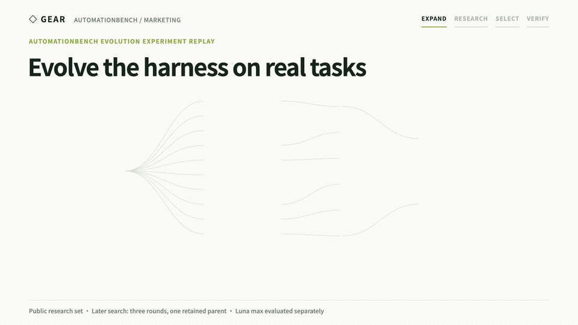

<div align="center">

# Gear

**A modular framework for recursive harness evolution.**

[](https://github.com/rsi-gear/gear/releases)
[](LICENSE)
[](https://discord.gg/ZduvAtS2k)
[](https://rsi-gear.github.io/)

[English](README.md) | [简体中文](README.zh-CN.md) · [User guide](https://rsigear.xyz/docs/gear) · [Examples](https://rsigear.xyz/docs/gear/examples/evolution-search)

</div>



<p align="center">
  <strong>RSI in Action: AutomationBench Evolution Replay</strong>
</p>

Gear is an open-source optimization framework for improving AI agent performance on real-world tasks.

To tailor an agent to a target scenario, first prepare a benchmark of representative tasks with clear success criteria. You can use an existing benchmark or [build your own task set](docs/guide/en/datasets.md). Run the [Refine Skill](skills/refine/SKILL.md) on that benchmark. Gear uses its evaluation results to iteratively improve the agent’s model, instructions, tools, and workflows.

The two examples below compare Luna Max with a Gear-optimized harness against Astra Max with Codex on the same AutomationBench tasks. Follow their execution from reading source information and applying rules to delivering the final result.

<table>
  <tr>
    <th width="50%">Landing page alerts</th>
    <th width="50%">Featured snippet opportunities</th>
  </tr>
  <tr>
    <td><a href="docs/guide/assets/landing-page-alerts-replay.mp4"></a></td>
    <td><a href="docs/guide/assets/featured-snippet-replay.mp4"></a></td>
  </tr>
  <tr>
    <td>Luna: <strong>5/5</strong> scored checks · Astra: <strong>4/5</strong><br><a href="docs/guide/assets/landing-page-alerts-replay.mp4">Watch full-size video</a></td>
    <td>Luna: <strong>2/2</strong> scored checks · Astra: <strong>1/2</strong><br><a href="docs/guide/assets/featured-snippet-replay.mp4">Watch full-size video</a></td>
  </tr>
</table>

## Experimental results


[SVG](docs/guide/assets/marketing-evolution-overview.svg) · Data: [Coding](docs/guide/assets/coding-results.json), [Marketing](docs/guide/assets/marketing-results.json), [Support](docs/guide/assets/support-results.json)

### Same-model, same-effort harness comparison

Each group keeps the model and reasoning effort fixed. Luna compares the base DSH harness with Gear's optimized DSH harness; Astra compares Codex with Gear's optimized DSH harness.

| Model (effort) | Harness | Marketing pass rate | Marketing objective completion | Support pass rate | Support objective completion | Terminal-Bench 2.1 pass rate |
| --- | --- | --- | --- | --- | --- | --- |
| GPT 5.6 Luna (medium) | DSH (Base) | 27.0% | 75.4% | 17.0% | 72.9% | 52.8% |
| GPT 5.6 Luna (medium) | DSH + Gear | **40.0%** | **83.9%** | **25.0%** | **81.3%** | **62.9%** |
| Δ (percentage points) | | +13.0 | +8.5 | +8.0 | +8.4 | +10.1 |
| GPT 6 Astra (max) | Codex | 57.0% | 84.1% | 35.0% | 88.4% | 86.7% |
| GPT 6 Astra (max) | DSH + Gear | **61.0%** | **86.3%** | **39.0%** | **88.7%** | **87.6%** |
| Δ (percentage points) | | +4.0 | +2.2 | +4.0 | +0.3 | +0.9 |

Task pass rate is the percentage of tasks passing all scored checks. Objective completion is the mean fraction of scored assertions satisfied per task. Δ is the absolute improvement in percentage points, not a relative percentage gain. Values are rounded to one decimal place.

### Additional evaluation: Luna at max effort

The optimized DSH harness was also evaluated with GPT 5.6 Luna at max reasoning effort:

| Benchmark | Task pass rate | Objective completion |
| --- | --- | --- |
| AutomationBench / Marketing | **53.0%** | **88.9%** |
| AutomationBench / Support | **27.0%** | **82.4%** |
| Terminal-Bench 2.1 | **84.3%** | — |

These are separate evaluations at a higher reasoning effort; improvements over Luna's medium baseline include both harness and effort changes. The dash means the metric is not reported.

On Marketing, Luna max with Gear achieved **88.88% objective completion**, compared with **84.08%** for Astra max in Codex; their task pass rates were **53%** and **57%**, respectively. In a separate cost comparison with both models using the same optimized DSH harness (`a0740800`), **Luna max's API cost averaged $0.0568 per task, versus $1.1858 for Astra max — 95.21% lower**. See the [token usage and cost methodology](docs/marketing-token-cost.md).

## Quick start

Use Gear through its **Refine Skill** in Codex, Claude Code, DSH, or another compatible agent environment. Start with an existing benchmark or provide your own tasks in [Harbor format](docs/guide/en/datasets.md).

For installation and dependency setup, see the [quick start guide](docs/guide/en/quickstart.md).

**Let your agent install Gear.** Paste the following prompt into your agent session:

```text
Follow https://rsigear.xyz/docs/gear/quickstart to install Gear in my environment.
Install rsi-gear@latest and agent-hitch@latest using npm and verify that all required dependencies are available.
Install the complete Refine Skill bundled with Gear in my current agent environment and configure its connection to Gear.
Use my actual task paths, target harness, and model settings; ask me for any missing information.
Verify that the Refine Skill can connect to Gear, then report the verification result and explain how to start my first optimization run.
```

For manual installation, install Gear and [Hitch](https://github.com/rsi-gear/agent-hitch), the evaluation runner. The following example also installs DSH as the task agent runtime:

```bash
npm install --global rsi-gear@latest agent-hitch@latest @deepseek-ai/dsh@latest
hitch eval setup harbor
```

Follow the [setup guide](docs/guide/en/quickstart.md) to install the bundled [Refine Skill](skills/refine/SKILL.md) in your agent environment and configure your benchmark. Then invoke `/refine` where supported, or submit the following request:

```text
Use the Refine Skill to improve performance on AutomationBench's Marketing tasks.
Use Codex + Astra to propose improvements and DSH + Luna to run the tasks.
Run one round of optimization.
```

The agent that proposes changes is called the **Meta agent**. It can use a different model from the task agent that executes the benchmark tasks.

## Algorithm design



Gear adopts a two-level architecture inspired by **meta-learning**, separating task-level execution from harness optimization guided by evaluation feedback.

- **Inner loop: task execution and evaluation.** Given a fixed model and harness configuration, the task agent interacts with the task environment to produce execution trajectories and task outcomes. These are evaluated according to predefined criteria, providing evidence for the outer loop.
- **Outer loop: harness optimization.** The Meta agent analyzes execution trajectories and evaluation feedback to identify failure modes and propose candidate harness modifications. Gear's optimization algorithm evaluates and selects candidates according to the configured objective and evaluation budget, determining the harness used in subsequent iterations.

A model's **harness** consists of the instructions, tools, and workflows used to run it as an agent. Gear aims to **evolve the model and harness together**, improving agent behavior through harness modifications and model capabilities through training, with task feedback guiding both processes. Harness optimization is supported today. Model training is experimental, and the full joint optimization loop remains under development.

### What can evolve?

Optimization is limited to the components you authorize Gear to modify.

| Component | What can change | Status |
| --- | --- | --- |
| Prompts and policies | Task instructions, system prompts, and action policies. | Supported |
| Tools and hooks | Tool implementations and hooks that run before or after tool execution. | Supported |
| Skills and workflows | Reusable procedures, helper scripts, and execution order. | Supported |
| Context management | Context selection and conversation history summarization. | Supported |
| Model weights | Model parameters updated through training using task feedback. | Experimental; full training and evaluation loop under development |

### Customizable algorithm components

Gear's evolution loop follows **Diagnose → Evolve → Evaluate → Promote**. You can customize the following modules within these stages.

| Stage | Module | What you can customize |
| --- | --- | --- |
| Diagnose | Parent selection | Which eligible harness versions to use as parents and how many candidates to generate from each. |
| Evolve | Proposal planning | How to use diagnostic feedback to plan candidate modifications. |
| Evaluate | Task sampling | Which tasks to evaluate at each stage and how to weight their scores. |
| Evaluate | Scoring rule | How to score task outcomes and combine evaluation metrics with configurable weights and constraints. |
| Promote | Candidate ranking | How to compare candidates tested on the same tasks under matching evaluation conditions. |

The runtime handles task execution, evidence storage, and final acceptance checks. See the [algorithm example](docs/guide/en/example-algorithm.md) and [Python component interfaces](python/gear/algorithms/__init__.py) to build on these components.

[Define a weighted objective](docs/guide/en/configuration.md#weighted-objectives-and-protected-tasks) to combine declared pass rate, process scores, cost or tokens while retaining the original measurements.

## Explore the examples

- [Optimize a harness for Marketing](docs/guide/en/example-harness.md): follow five rounds of harness optimization, from the initial configuration to the final retained harness.
- [Customize the optimization algorithm](docs/guide/en/example-algorithm.md): change how Gear proposes candidate modifications, selects tasks for evaluation, and retains candidates. The Marketing experiment uses a GEPA variant that allocates more evaluation budget to promising candidates.

## Architecture


[Learn more about Hitch](https://github.com/rsi-gear/agent-hitch)

## Roadmap

Gear supports harness optimization today. Two components of the broader learning loop remain under development:

- [ ] **Iterative model training and evaluation.** Use task feedback to train the model, evaluate the updated model, and repeat. An [experimental training workflow](docs/guide/en/training.md) is available; the full model iteration loop is not yet complete.
- [ ] **Automatic seed task generation.** Generate targeted practice tasks, or *seed tasks*, from task failures and incorporate them into subsequent optimization rounds. This automatic task generation loop is not yet complete.

## Citation

If you use Gear in your research, please cite the following preprint. The [project website](https://rsi-gear.github.io/#citation) lists the current citation; the arXiv link is not yet available.

```bibtex
@unpublished{tang2026gear,
  title  = {{GEAR}: An Open General Evolutionary Architecture for
            Recursive Self-Improvement of {LLM} Agent Harness},
  author = {Tang, Yehui and Zhu, Guanqi and Xia, Shao-Jun and
            Chen, Xin and Geng, Mengzhe and Du, Hongyang and Tang, Yuhao},
  year   = {2026},
  note   = {Preprint},
  url    = {https://github.com/rsi-gear/gear}
}
```

## Build with us

Start with the [user guide](docs/guide/en/index.md), browse the [example code](examples/evolution-search/README.md), or join [Discord](https://discord.gg/ZduvAtS2k).

For local development:

```bash
npm ci
npm run typecheck
npm run build
npm test
```

[Contributing](CONTRIBUTING.md) · [Documentation guidelines](docs/guide/README.md) · [GitHub issues](https://github.com/rsi-gear/gear/issues) · [MIT license](LICENSE)

Model evaluation connects to [already deployed model endpoints](docs/training/standalone-inference.md), with immutable bindings for each candidate and configurable trial concurrency. SGLang and its official Model Gateway manage inference replicas outside Gear and Hitch.
