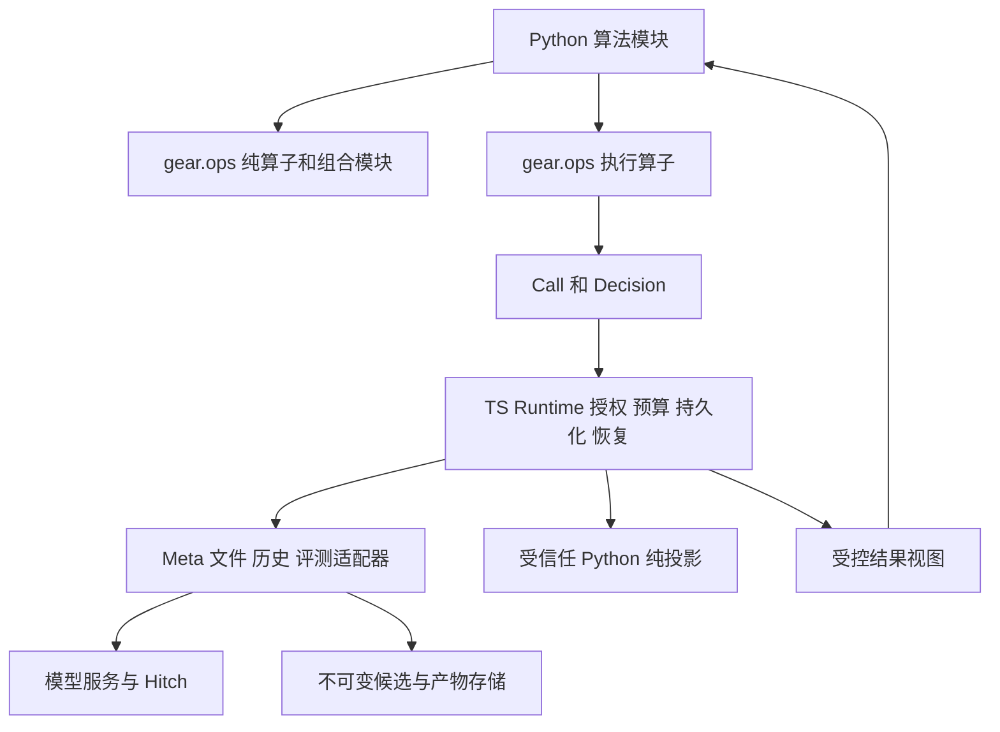

# Gear 可组合算法算子改造规范

状态：P1/P2 框架实现已落地。当前用法和能力限制见 [算子指南](algorithm-operators.zh-CN.md)，验证结果随 PR 记录。

接口布局修订：[算法工程师 API 简化规范](operator-capability-layout-spec.zh-CN.md) 修订本文的包布局、公共入口和组件依赖，按 core、evaluation、memory、training、search 五个能力入口组织算子，algorithms 保留可直接调用的完整算法实现。能力布局已按该规范迁移；本文中的 `gear.ops` 仅为历史设计记录，该包已删除；当前导入方式与平铺算法布局以修订规范和作者指南为准。

日期：2026-11-16。

设计分析基线：Gear `24af6e1b` 及当时工作树中的经验、轨迹相关修改。实施基线按后续要求更新为最新 `origin/dev` 的 `38730cde`，分支为 `codex/composable-algorithm-operators`；其他工作的未提交修改没有迁入。本文接口以逐项验收为准，不表示已经发布。

关联需求：[算法覆盖 issue 91](https://github.com/rsi-gear/gear/issues/91)、[RRSI issue 97](https://github.com/rsi-gear/gear/issues/97)。

## 1 目标与架构决策

新增框架能力以 Python 中可调用、可替换、可组合的算子提供。算法继续拥有独立模块，通过组合算子表达优化逻辑；TS 执行层提供通用副作用执行、授权、预算、持久化和恢复。新增算法不应要求在 TS 中增加算法名称判断、提示词、排序公式或阶段流程。

采用以下决策：

1. 新增公共包 `gear.ops`，提供纯计算算子、声明式执行算子及少量有显式状态的组合模块。
2. 保留 `gear.algorithms`、现有六模块结构与 `SearchAlgorithm.step(view, state)`。六个模块是已有算法的组织形式，不限制新算法的内部目录与流程。
3. 纯算子调用直接返回值；执行算子调用返回 `Call[T]`，由 `Decision` 提交，结果在后续 step 中读取。算法 worker 保持同步纯决策。
4. 参数和子模块进入冻结实现身份；动态状态显式存入 `AlgorithmState`。不依靠 Python 实例存活、闭包、协程栈或隐式全局变量恢复。
5. 候选、历史、评测和学习库通过有身份的引用连接。引用需由 runtime 校验，不能把 payload 中的路径当成授权。
6. 算法内部采纳、任务输出选择、学习库发布和全局 champion 发布是不同事件。最终独立验收继续由运行层控制。

设计借鉴 scikit-learn 的构造参数、嵌套组件与 clone，以及 PyTorch 的可调用模块、命名子模块和显式状态组织。Gear 不依赖这两个库，也不引入自动微分、Tensor 或强制 `fit/predict` 接口。[scikit-learn 开发约定](https://scikit-learn.org/stable/developers/develop.html)、[PyTorch Module](https://docs.pytorch.org/docs/2.15/generated/torch.nn.Module.html)

## 2 当前实现与改造范围

| 当前实现 | 现状 | 本次处理 |
| --- | --- | --- |
| `algorithms/contracts.py` | 六类策略及任意 `step` 已可替换 | 保留，增加算子作者接口与 v2 数据类型 |
| `algorithms/workflow.py` | GEPA、RandomSearch 共享 staged flow | 逐步调用公共算子，阶段策略留在 Python |
| `algorithms/meta.py` | 已支持 `payload.meta` 指令与 schema | 提供类型化 `Meta`、`GenerateCandidate` 调用入口 |
| `algorithms/operators.py` | TS 使用的固定纯投影分发器 | 保持内部定位；不作为新公共算子注册表 |
| `Project._describe_algorithm`、worker | 按五个固定策略属性序列化和重建 | 增加递归组件描述，兼容旧描述方式 |
| `sealedProvider`、`TargetStore` | 已有候选隔离、封存、可信 diff | 复用并增加多来源读取、精确构造 |
| `runner.reserve` | 固定重复槽位，已有证据即复用 | 新增独立样本身份与显式证据集合 |
| experience | 已有当前 run 的历史索引与授权轨迹读取 | 扩展完整生命周期、跨 run 显式导入 |
| objective、projection | 已有 Python 指标计算和独立验收 | 复用纯逻辑，扩展样本集合输入 |

本次交付是框架能力与作者 API，不要求同一个变更实现 issue 91 的全部算法。每个算法单独实现、验证其参考机制并记录适配差异。

不在本次引入任意 Python 调用栈恢复、通用分布式 DAG 引擎、Python worker 直接访问项目存储、可写 Git worktree API，或让算法修改运行中的冻结源码。

## 3 分层与依赖方向



| 层 | 应包含的职责 | 不承担的职责 |
| --- | --- | --- |
| Python recipe | 算法阶段、参数、选择、接受、探索、剪枝 | 外部提交、持久化权限、修改发布门槛 |
| Python 公共算子 | typed input/output、纯计算、执行请求构造、可复用组合流程 | 私自读写目标目录、网络调用、provider 凭据 |
| TS runtime/application | 冻结身份、资源引用验证、预算预约、journal、结果可见性、发布 CAS | 算法专用公式、组件分类、critic 提示词 |
| TS adapters | 模型调用、文件物化、Hitch 提交、产物提取 | 决定进化策略或内部 winner |
| Hitch | 独立执行、隔离、轨迹、评分、计量 | 种群、RRSI 策略、跨任务学习规则 |

受信任的独立验证不意味着公式必须写成 TS。运行层继续调用冻结的 Python 纯投影，并独立绑定输入与验证结果来源；算法自行声称“通过”不构成验收证据。

## 4 Python 作者接口

### 4.1 纯算子

纯算子接受内存中的值并返回值，无网络、文件、时间或隐式随机副作用。支持命名函数、callable dataclass 及可选的 `Module` 基类，不强制继承。

```python
class PureOperator(Protocol[I, O]):
    def __call__(self, value: I, *, rng: RandomSource | None = None) -> O: ...
```

该协议是新增算子的推荐签名。现有 `ParentPolicy` 等签名不强制改变，由适配器桥接；现有命名函数仍可直接使用。有随机行为的算子必须接收显式随机源，随机流按 run seed、模块路径和调用键派生，不能受并行完成顺序影响。

示例：`SelectParents`、`CompareCandidates`、`CheckEdits`、`MergePlaybook`、`SelectEvidence`、`UpdateArchive`。涉及模型的反思不属于纯算子，必须显式调用执行算子。

### 4.2 执行算子

```python
class EffectOperator(Protocol[I, O]):
    def __call__(self, value: I, *, key: str) -> Call[O]: ...

@dataclass(frozen=True)
class Call(Generic[O]):
    key: str
    operator_ref: OperatorRef
    effect: EffectRequest
    output_schema_ref: SchemaRef
```

调用只完成参数检查和请求构造，不启动模型或任务、不写候选、不预约预算。只有进入已持久化 `Decision.calls` 的调用才具有执行资格。`Call[T]` 不是 Future，不能 `await`、阻塞等待或从算法 worker 直接 `.execute()`。

`operator_ref` 指向 admission 时冻结的组件描述；结果类型 `T` 的编解码器随 Python 实现冻结。TS 处理已版本化的效果合同与通用 schema，不识别 `T` 中的算法业务含义。

静态 schema 随组件配置冻结；由当前输入生成的 schema 随该 Call 保存内容和摘要，在提交前验证支持范围及大小。两者均不能在恢复时重新生成。作者侧泛型不能代替 wire 校验。

同一 run 内 `key` 唯一。相同 key、相同请求只能关联同一次调用；相同 key、不同请求必须报 `call-key-conflict`，不能用覆盖请求实现重试。

### 4.3 根算法与结果读取

保留 `SearchAlgorithm.step(view, state) -> Decision`。v2 新增 `calls` 和受控的 `view.results`，终止动作通过 `Decision.terminal` 表达。v2 不同时接受旧 `operations` 字段。

v2 Decision 包含 `state`、`calls`、`reason`、可选 `terminal` 和 `records`。没有 terminal 时至少包含一个实际调用；有 terminal 时 calls 必须为空。纯计算连续推进到上述边界，不提交无工作 Decision。`terminal` 为 `nominate(candidate_ref, outcome)` 或 `stop(outcome)`；`outcome` 可保存算法所选候选、任务输出和库快照引用，但本身不授予发布权限。

`records` 保留研究记录并增加内部选择记录；runtime 验证引用，但不把算法理由视为真实性证明。任务结束通过第 10 节的 `CompleteTask` Call 提交，成功 receipt 才产生权威完成事件，不从研究记录或任意 state 字段推断。

```python
# 拟议接口示例，省略与本例无关的算法阶段。
def step(self, view, state):
    key = f"round/{state.data['round']}/propose"
    if state.data["phase"] == "propose":
        call = self.proposer(
            GenerateInput(
                base=view.candidate(state.data["parent_id"]),
                sources=tuple(state.data["source_refs"]),
                instruction=state.data["hypothesis"],
            ),
            key=key,
        )
        return Decision(
            state=state.updated(phase="inspect", pending=call.ref),
            calls=(call,),
            reason="generate candidate",
        )

    result = view.results.require(state.data["pending"])
    if result.status != "succeeded":
        return self.on_generation_failure(view, state, result)
    edit_check = self.edit_checker(result.value.change)
    return self.after_edit_check(view, state, result.value, edit_check)
```

`Call.ref` 是可序列化的请求引用，包含 key 与作者请求摘要；最终 operation ID 和执行摘要由 runtime 绑定 run、授权材料、provider 及预算后生成，并保存二者的映射。`CallRef` 不授予权限，只能在其所属 run 的受控结果视图中解析。`results.require` 只查询当前可见的已终结结果；未知、未完成或不可见引用必须失败，不能触发 I/O。状态和调用在同一个 journal 提交点保存。

作者请求摘要覆盖 canonical Call 的 key、operator ref、effect 和 schema 内容身份，不包含派生 ref、runtime operation ID 或预算。重建同一个声明可得到相同引用，绑定后的执行摘要另存；不得把两种摘要混用。

示例中的 `state.updated` 是 v2 的不可变更新助手：将 typed refs 编码为 JSON，返回新状态并校验 schema；`view.candidate` 只查询已在视图中授权的候选。二者均不读外部存储。

一个 Decision 中的调用可以并行，但必须相互独立，只引用已提交可见产物。依赖另一个调用结果的请求在下一个 step 构造，不在第一版实现未解析的输出占位符或隐式 DAG。

### 4.4 组合模块

组合模块可以是 Python 中的普通函数调用，也可以是显式分阶段模块。后者使用与根算法相同的推进方式，避免每个 recipe 重写相同的 generate/check/evaluate 流程。

```python
@dataclass(frozen=True)
class ModuleStep(Generic[O]):
    state: JSON
    calls: tuple[Call, ...]
    done: bool
    result: O | None

class StepModule(Protocol[I, O]):
    def __call__(
        self, value: I, *, view: SearchView, state: JSON, key: str
    ) -> ModuleStep[O]: ...
```

第一批组合模块为 `ScreenedEvaluate` 和纯算子的 `Sequential`。`Sequential` 只组合纯计算，不能跨越异步执行边界。`ScreenedEvaluate` 显式经历检查、可选 Meta critic、结果解释、执行或跳过。

父算法将子模块 state 保存在自己命名的子树，将返回的 calls 合入根 Decision。`done=False` 时必须有待提交调用，或由父算法在同一次纯计算中推进至可等待状态；不能产生无工作循环。`done=True` 时 calls 必须为空。子模块不能直接提名 champion 或终止整个 run。

### 4.5 参数树、克隆与状态

可选 `Module` 提供 `get_params(deep=True)`、`set_params(**params)`、`named_children()`、`describe()`，`gear.ops.clone(module)` 只复制配置及子模块，不复制运行状态。

描述格式使用递归 `ModuleSpec`，明确区分 JSON 参数和子模块类型：

```python
@dataclass(frozen=True)
class ModuleSpec:
    entrypoint: str
    params: dict[str, JSON]
    children: dict[str, "ModuleSpec | FunctionSpec"]
    source_dependencies: tuple[SourceDependency, ...]
    package_dependencies: tuple[PackageDependency, ...]
    resources: tuple[SourceResource, ...]
    state_schema_version: int
```

`FunctionSpec` 保存命名函数 entrypoint 与依赖，不能包含 lambda 或闭包。无状态组件使用固定空 state schema。prompt、schema 等资源需显式声明，SDK 在准入前读取其真实字节并纳入冻结包，worker 只读取冻结资源。不得用 `dataclasses.asdict` 把子算子变成丢失类型信息的普通 dict。

嵌套参数使用稳定名称，例如 `evaluator__critic__max_tokens`。组件的构造函数只保存配置，不读文件、不探测服务、不消耗随机数。构造后的合法性检查可在 `describe` 和 admission 进行。

`set_params` 只允许用于尚未准入的配置对象；准入后使用冻结副本，调用方修改原对象不会改变正在运行的 run。未知参数、重名路径、循环组件引用必须拒绝。同一组件实例出现在多个位置时按路径保存独立配置，动态状态也分别保存；不支持隐式共享可变对象。

动态状态使用 `AlgorithmState.data` 下的命名子树，例如 `modules.evaluator`、`modules.library`。序列化为 JSON 与已验证产物引用，不包含 Python 对象、pickle 或进程句柄。`StateTree.state_dict()` 返回深拷贝，`StateTree.from_state_dict()` 验证版本后重建；它们不序列化 Module 的实例属性。

worker 仍可在每次 step 重建整个组件树。算法的行为不得依赖构造次数、上一步实例或 `.state_dict()` 之外的学习状态。每个有状态模块声明 state schema version；改变配置或 schema 不静默恢复旧 run。

## 5 首批公共算子

名称为本规范选定的作者 API；类型化 input/output 在实现时由对应模块定义，并由公共入口导出。

| 类别 | 算子 | 输入与输出 | 主要实现归属 |
| --- | --- | --- | --- |
| 纯计算 | `SelectEvidence` | trial 引用、范围规则 → `EvidenceSet` 请求描述 | Python |
| 纯计算 | `CompareCandidates` | 明确证据集合、比较规则 → 比较结果 | Python，复用 objective/projection |
| 纯计算 | `CheckEdits` | 完整编辑材料、检查配置 → 编辑审计 | Python |
| 纯计算 | `ApplyEdits` | 已读文件内容、`EditPlan` → 新内容 | Python |
| 纯计算 | `MergePlaybook` | 结构化条目、delta → 新 playbook | Python；领域策略可替换 |
| 纯计算 | `UpdateArchive` | 旧档案、选择事实或算法判断 → 新档案 | Python |
| 执行声明 | `ReadArtifact` | 引用、路径或分页范围 → 内容页 | Python 构造；TS 验证并读取 |
| 执行声明 | `QueryHistory` | 冻结历史快照、过滤条件、cursor → 历史页 | Python 查询投影；TS 数据加载 |
| 执行声明 | `ReadEvidence` | EvidenceSetSpec、分页范围 → 已绑定集合及可见数据页 | `read` effect 的类型化入口 |
| 执行声明 | `Meta` | 指令、schema、授权材料 → 结构化响应 | Python 语义；Meta adapter 执行 |
| 执行声明 | `GenerateCandidate` | 基底、来源、指令 → 封存候选与真实 change | Python 构造；Meta 与文件 adapter |
| 执行声明 | `MaterializeCandidate` | 基底、来源、精确编辑计划 → 封存候选 | Python 计划；文件 adapter |
| 执行声明 | `Evaluate` | 执行输入、样本计划、指标 → 执行及评分引用 | Python 构造；TS/Hitch 执行 |
| 执行声明 | `Rollout` | 执行输入、样本计划 → 输出和目标轨迹引用 | Python 构造；TS 可见性投影 |
| 执行声明 | `Score` | 已封存执行、冻结 scorer → 评分引用 | 条件能力；P3 才开放 |
| 执行声明 | `CommitLibrary` | 原库版本、精确更新 → 新不可变快照 | Python 计划；TS 存储 |
| 执行声明 | `PublishLibrary` | 新快照、expected revision → 发布结果 | TS CAS；与 champion 分开 |
| 执行声明 | `CompleteTask` | 当前任务、所选输出、expected stream revision → 新进度 | Python 请求；TS 验证并提交 |
| 组合流程 | `ScreenedEvaluate` | 候选、critic/check/evaluator → screened 或 evaluated | Python 组合模块 |

现有父代选择、任务采样、proposal、ranking、stopping 保留自己的 Protocol，不为了“算子化”增加无意义包装。算法专用的 `RRSICostRule`、`ACEReflector`、`DarwinXSelection` 放在对应 recipe 中；出现实际跨算法复用后再提升为公共算子。

公共 `CheckEdits` 提供文件范围、计数、完整性检查和可替换分类器；RRSI 的组件词表与正则、AHE 的修复假设不进入 TS 或通用内核。

## 6 候选材料与精确编辑

### 6.1 引用与来源

`CandidateRef` 至少包含 owner run、candidate ID、manifest digest。`ArtifactRef` 包含 owner、kind、digest、可见性类别与内容描述；外部路径不是公共引用。

生成输入保留一个 `base`，增加 `sources`。base 是实际修改基底；sources 是只读 donor、历史候选或算法学习资产。runtime 验证它们属于当前准入集合或显式导入集合，并冻结其摘要。生成后记录 base 与全部实际授予的 source refs，不能把“授予访问”表述为“证明该来源对结果有贡献”。

跨 run 来源必须经过显式导入及兼容性检查，不允许通过历史 run ID 绕过授权。代码材料与评测证据分开导入：可复用源码不等于旧分数可直接比较。

`ReadArtifact` 为 Python 纯算子提供有界内容读取；Meta 使用同一组冻结引用，通过受控 reader 读取材料。单页返回 continuation 与完整性，不把摘要或截断 diff 标记为完整内容。现有 `candidate_change` 继续作为有界投影，保留 `omitted_patches`。

### 6.2 精确构造

`EditPlan` 支持 `create`、`replace`、`delete` 和精确 unified patch；每项包含相对路径、预期原内容摘要、新内容或 blob 引用。空基底文件使用明确的 absent 前置条件。第一版只允许常规文件与受 mutation policy 允许的可执行位，拒绝符号链接、越界路径和模糊 patch 匹配。

`ApplyEdits` 在 Python 中提供确定性内容变换和本地验证。`MaterializeCandidate` 将相同计划应用到 runtime 验证过的基底，复核前置条件及结果摘要。适配器可以调用受信任 Python 编辑函数，不在 TS 再实现 ACE 合并或模块选择策略。

全部编辑在私有 staging 中完成，通过 harness check 和 mutation policy 后原子封存；任一冲突均不发布部分候选。恢复可验证并复用已经封存的同一结果，不能再次随机生成候选。精确编辑不占 Meta token 预约，但占候选配额和文件资源预算。

ACE 的 `MergePlaybook` 计算条目 ID、计数和 delta 的确定性合并，再由 `MaterializeCandidate` 写入。AHE 回滚通过显式旧文件/旧片段引用和前置摘要表达。多候选组合必须生成新的完整候选，组合来源不能修改原候选。

## 7 筛查与成本

### 7.1 可组合评测模块

`ScreenedEvaluate(critic, check, evaluator)` 是 Python 评测流程模块。`critic` 可用 `Meta`，`check` 是纯判定算子，`evaluator` 默认为 `Evaluate`。规则如下：

1. 先取得已封存候选及所需完整编辑材料。
2. 执行静态检查及配置的 critic；结果、用量和材料摘要持久化。
3. Python check 解释结果，得到 `allow`、`reject` 或 `insufficient_evidence`。
4. 仅 `allow` 构造 benchmark 调用；另外两种结果返回 `screened`，没有 trial、没有伪造零分或环境失败。

上述逻辑属于所选评测模块，满足 issue 97 的 eval workflow 约定，不新增 RRSI 专用 TS 操作。普通 `Evaluate` 仍是公开原语；算法主动改用它属于不同算法配置，不能宣称运行了同一筛查流程。

若运行配置声明筛查为强制前置条件，则 `Evaluate` admission 绑定冻结的 screening policy 与来源 receipt。runtime 独立调用对应冻结 Python 纯判定，验证结果和候选摘要相匹配；不能仅接受算法 state 中的 `allowed=true`。TS 只处理通用前置检查，不解释泄漏规则或组件类型。该前置条件及判定实现进入配置身份。

自定义 screening 判定在受限 Python 环境中执行，只获得该 policy 被授权的材料和 receipt。被 runtime 调用不会使它获得私有存储、held-out 或最终验收投影的权限。

### 7.2 计量

沿用 `RawMetricContract` 与 `Evidence.raw_metrics`。RRSI 使用的 policy-token 指标必须说明目标模型范围、输入/输出/cache 口径、子调用及重试口径、完整性和来源。

Meta、critic 的调用消耗进入各自执行用量和 run 预算；不能用这些用量代替目标策略成本。缺失、部分覆盖或 unsupported 不填零，也不自动回退到估算值。算法可以明确配置估算指标，但它必须具有不同合同身份并在结果中标记。

RRSI 的成本公式、噪声带和 novelty 权重是 Python recipe 算子。runtime 验证原始计量绑定及必要能力，不执行 RRSI 选择公式。

## 8 独立采样与比较证据

### 8.1 三层身份

区分逻辑样本、物理执行尝试和评分记录：

- `sample_id`：一次计划中的独立采样。由持久 `plan_id`、任务和样本槽确定；plan 绑定有效执行身份。
- `attempt_id`：该样本的一次物理执行或恢复尝试；不同 retry 不成为额外统计样本。
- `assessment_id`：对一份不可变执行产物的一次评分，绑定 scorer 身份；重新评分不启动目标模型。

执行条件包括 candidate manifest、影响目标的 library/artifact refs、task/dataset digest、provider/harness/model 配置与采样参数。影响执行的记忆快照不能只放在算法 state 中，否则会错误命中评测缓存。

`SamplePlan` 明确任务、每任务样本数、采样键及 `mode`：

| mode | 语义 |
| --- | --- |
| `fresh` | 使用新的调用键创建新 plan，再按其任务和槽产生样本；恢复复用原 plan |
| `reuse` | 显式引用已有样本集合；缺失即失败，不隐式执行 |
| `ensure` | 引用预先定义的 plan 并补齐指定槽；不同调用引用同一 plan 时复用已有样本 |

`ensure` 承接现有固定 repetitions 行为。fresh sample、失败 retry、verifier-only 评分各自记账。不能通过换 scope 假装新采样，也不能在失败恢复中悄悄生成新随机样本。

GEPA 的 local、bridge、global 对同一候选引用同一固定 plan，只扩大请求的任务槽集合。初次固定 plan 的内容身份和创建规则在 admission 冻结；runtime 首次预约时持久化。计划中每个候选的样本命名空间分别绑定该候选执行身份，比较计划再按共同任务和样本槽对齐。

计划明确采样随机性：受控 seed、跨候选配对 seed 或 provider 自身随机性。受控 seed 在首次预约时确定并持久化；provider 不支持所声明的控制方式时拒绝该计划。新的 sample ID 表示新执行，不单独证明统计独立性；报告保留实际采样条件。

预算在提交前按实际新执行上界预约；并行批次整体校验。物理失败仍计费，但同一个 sample 的多次 attempt 不重复进入统计分母。

### 8.2 明确证据集合

`EvidenceSet` 是不可变、可寻址的集合，绑定 sample/assessment refs、任务范围、权重、每任务样本计划、缺失处理和归约版本。`Evaluate` 为其明确请求的样本计划返回已绑定集合。需要另选集合时，Python `SelectEvidence` 纯算子产生 `EvidenceSetSpec`，再调用 `ReadEvidence(spec, key=...)`；runtime 验证引用及可见性，封存集合描述并返回数据页。这是既有 `read` effect 的子类型，不增加远程比较或隐式 I/O。

`CompareCandidates` 接收集合描述及实际已加载的可见值，不只接收不可解引用的 refs。小集合随结果返回完整数据；大集合通过绑定 digest 的页加载，由纯归约器携带显式状态逐页处理。调用方必须校验页覆盖和去重后才能声称集合完整；尚未加载齐数据与真实试验缺失分别标记。

`ComparisonPlan` 至少包含 `candidate_refs`、各候选的 `evidence_set_ref`、`task_weights`、`sample_alignment`、`reducer_ref`、`missing_policy`、`objective_ref`。归约器与自定义统计代码进入冻结实现身份。作者侧未封存描述可用于探索计算，最终 gate 只接受运行层独立绑定的计划。

`CompareCandidates` 只能消费显式集合，不能默认把 journal 中所有历史 evidence 混在一起。框架至少提供 `common-scope` 比较：各候选使用相同任务权重、采样计划和归约方式；环境失败或评分失败保持不完整，不从分母删除，也不当成任务零分。

算法可使用更复杂统计方法，但必须声明样本选择和缺失处理。前沿与均值复用已有 Python 实现；新增置信区间等统计方法在 Python 中单独实现并验证。同一任务新增样本后不能直接交给只支持固定 repetitions 的旧比较器。

最终 gate 的样本计划在查看相应验收评分前冻结。默认继承固定 seed/held-out 计划，扩展采样采用预先声明规则；不得按已见分数挑选“最好的一批”作为验收依据。旧算法通过兼容投影继续看到原来的固定槽位。

## 9 无真值反馈与执行评分分离

### 9.1 信息可见性

run admission 冻结任务范围与 exposure policy。至少支持 `scored` 和 `blind`；后者只能向优化器暴露允许的任务输入、目标执行状态、输出、目标轨迹及白名单中的策略用量。

blind 过滤必须同时覆盖：

- Python `SearchView`、调用结果和任务元数据；
- Meta input、schema 上下文和自动经验注入；
- history、experience、research、objective 投影与错误详情；
- artifact reader、原始结果、verifier 文件和日志。

不能只删除 `score` 字段。由分数推导的 feedback、assertions、排序、通过状态同样不得暴露。目标执行失败与评分失败分别保存；blind 视图不能用评分失败改变目标执行结果。轨迹 reader 仅授予目标执行阶段的允许内容，不能同时开放 verifier 轨迹或整个原始结果文件。

权限由 runtime 决定，算法不能通过 Call 参数扩大。当前 task 的输出选择及结束事件先持久化，再按 admission 规则用于研究评分/报告；不存在算法自行请求揭示真值的通用操作。在线任务之间是否允许前一任务反馈同样在准入时声明，不能借 library 导入泄漏禁止的评分。

### 9.2 两种后端能力

P2 的 `Rollout` 可以复用 Hitch 正常评测，但评分仅保存在控制面私有账本，所有优化路径严格隔离。该模式声明为 `scored_private`；不宣称 verifier 未运行，预算包括实际发生的评分费用。

P3 可选支持 `unscored`：执行结束后不运行 verifier，先封存输出及评分所需产物，再对原执行调用 `Score`。该能力需要明确的 provider 支持；不能用 verifier 缺失或失败伪装未评分成功。

`Score` 不能重新执行候选、改变原输出或替换冻结 scorer。Hitch 现有 verifier-only 可作为实现基础，但从未评分执行进入首次评分的合同需另行扩展和验收。provider 不支持 `unscored` 时，只有用户配置允许 `scored_private` 才可使用后者，不静默降级。

## 10 历史档案与学习库

### 10.1 实验事实与算法解释

扩展现有 archive，而不是只记录已有评测的候选。至少索引 generated、screened、evaluated、internally_selected、nominated、published 事件，并关联调用、候选、样本及来源摘要。

runtime 记录真实执行、变更、用量和发布结果；算法记录理由、假设、组件标签和内部选择。两类记录分别标记 provenance，算法自述不能升级为可信执行事实。critic 拒绝和生成失败也可检索，不要求先预约一次 benchmark。

历史快照在读取调用提交时冻结；分页 cursor 绑定快照和过滤条件。恢复不能读到新的 live history 后重新解释旧调用。大材料通过 artifact refs/分页提供，不无限扩大 SearchView 和 stdio envelope。

### 10.2 学习库的内容与生命周期

学习库保存 playbook、skills、lessons 或 improvement harness 等算法资产。它是版本化 artifact 集合，不是可任意写入的全局数据库。`CommitLibrary` 生成不可变快照；run 内后续任务可以使用该快照，无需发布共享 head。

跨 run 使用库需在 admission 显式固定 snapshot 与允许用途。`PublishLibrary` 独立使用 expected head revision 做 CAS；冲突返回明确结果，不自动改用最新库、合并或重跑已提交决策。库提交与调用完成需具备可恢复身份，进程崩溃不产生重复版本或半更新。

每次发布有稳定 commit ID 和不可变提交记录。即使发布后 receipt 丢失、head 又被后继 run 更新，也能确认原调用已经成功；不能仅靠当前 head 判断是否重复应用 delta。库与 champion 默认独立发布并分别报告，本规范不提供跨二者的原子事务承诺。

首版仅支持已准入有限任务流。task cursor、epoch、batch 和拒绝缓存属于 Python state。根据任务顺序提供允许的任务与历史视图，防止使用未来任务的标签或产物。动态追加任务需要新的准入合同，不以修改 run spec 实现。

其中 Python task cursor 是调度状态与进度镜像，授权边界使用 runtime 单独保存的 `TaskStreamProgress`。准入时冻结任务顺序及反馈开放规则；`CompleteTask` 绑定当前 task、所属 sample 的已封存所选输出、允许随任务采纳的 library refs 和 expected stream revision。该 Call 在一个 Decision 中独占，runtime 验证后原子保存完成事件、所选输出和新进度，再开放下一步允许视图；恢复先对账原事件，不重复推进。仅修改 Python state、写研究记录或提交 library 均不能推进该授权进度。

普通 skill/playbook 在目标中使用时进入目标执行身份。Harness² 的 improvement harness 如果只包含指令/知识，可以作为 `Meta` 的冻结上下文；如果包含实际执行代码或工具配置，则必须由声明支持该资产类型的 Meta adapter 在隔离环境中执行，绑定版本、工具权限和预算。只把代码作为文本附在 prompt 中，不算执行了该 improvement harness。

## 11 执行合同与恢复

### 11.1 有限的执行原语

v2 调用封套区分算子身份与效果类型。TS 根据效果类型执行，不根据算法或公共算子类名分支：

| effect | 核心含义 |
| --- | --- |
| `meta` | 只读模型推理，受控材料与结构化结果 |
| `candidate` | `mode=model` 或 `mode=edits`，构造并封存候选 |
| `read` | 读取授权 artifact 或冻结历史页 |
| `execute` | 按样本计划执行，应用 scored/blind exposure |
| `score` | 对已有执行产物评分，P3 条件能力 |
| `library` | 生成快照或 CAS 发布 library head |
| `stream` | 验证并提交有限任务流的完成事件及授权进度，P2 开放 |

纯算子不成为 runtime 远程调用。组合模块也不成为新的 effect。禁止通过通用 `python`、`shell` 或任意函数名 effect 绕过资源权限。

内部 objective、screening 等受信任纯投影继续走独立、冻结的 Python 调用路径。公共算子可以复用同一纯函数，但自定义算法不能替换最终验收的冻结投影。

### 11.2 调用状态与结果

执行状态为 `reserved → submitted → succeeded/failed/cancelled`；外部执行结果未知时保留待恢复状态并先 inspect。业务上的拒绝是成功调用返回的领域结果，例如 `ScreenResult(rejected)`，不是执行失败。

`CallResult` 包含 call ref、请求摘要、状态、值或错误、产物引用和用量完整性。receipt 中的 provider 原始数据仍由控制面保存，向算法返回的结果须通过 exposure 投影。

一次提交必须原子保存下一 AlgorithmState、Decision、全部调用身份和预算预约。恢复先处理既有调用，再运行下一步；已提交决策不重新采样。模型生成结果已存在时 inspect/seal，不能重复模型调用；原子封存存在时验证摘要，不能覆盖。

任务执行、读材料和 Meta 分别采用明确资源上限。读取也计入页数/字节/调用预算，防止纯决策循环无限发起读取。所有 Meta 侧模型调用，包括 critic 和结构化修复，都进入已有 generation budget 的统一预约模型，不能因新增 effect 名称漏计。目标模型执行使用评测/执行预算及真实 usage，不重复扣除 Meta 配额。

### 11.3 能力声明

组件 `describe()` 汇总 requirements，例如 artifact read、exact edits、fresh samples、blind projection、policy usage、library commit、improvement-harness execution。runtime/provider 返回版本化能力与限制；requirements 只是需求，不赋予权限。

准入时校验已知需求；动态输入在对应调用预约前再次校验。能力不足在收费执行前返回明确 unsupported。纯组件可在离线测试中独立运行；不因为安装 `gear.ops` 就要求 Node 或 Hitch 可用。

提供 `gear.ops.testing.check_operator`，对具备组件描述的算子检查参数往返、克隆、重复构造一致性、纯调用无副作用及结果 schema。对 StepModule 使用模拟结果驱动多步推进；通过 public Call executor 的集成测试检查真实恢复，不在测试工具内再写一套生产调度器。

## 12 算法组合映射

| 算法 | Python 算子组合 | 框架验收重点 |
| --- | --- | --- |
| GEPA / RandomSearch | 原六策略 + Meta / GenerateCandidate / Evaluate / CompareCandidates | 既有轨迹、范围与提名行为不意外改变 |
| OPRO | 历史排序 + Meta + 精确提示词构造 + Evaluate | 原始历史与评分绑定 |
| EvoPrompt | 种群选择 + 交叉/差分变异 + Generate/Materialize + Evaluate | 多来源内容与谱系 |
| ADAS | QueryHistory / ReadArtifact + Meta + GenerateCandidate | 设计源码、轨迹和评分可按需读取 |
| ACE | Meta Reflector/Curator + MergePlaybook + Materialize/CommitLibrary | 条目 ID、计数、确定性 delta |
| SkillOpt | batch/epoch 模块 + Meta + CheckEdits + Materialize + CompareCandidates | 编辑预算、拒绝缓存、train/selection/test 隔离 |
| Evo-Harness | 顺序任务模块 + Meta + MergePlaybook/Materialize + library | 后续任务使用正确学习版本 |
| AHE | ReadArtifact + Meta + CheckEdits + Materialize | 编辑审计、归因及精确回滚 |
| Meta-Harness | QueryHistory + ReadArtifact + Meta + GenerateCandidate | 历史源码、分数、完整轨迹访问 |
| RRSI | 编辑预算/探索/剪枝纯算子 + ScreenedEvaluate + 成本选择 | critic 实际执行，真实 diff，policy-token 口径 |
| DarwinX | 分支档案 + 多来源组合 + fresh Evaluate + CompareCandidates | 暂准入与追加确认的独立样本 |
| ModularRSI | 模块选择 + Materialize/Generate + Evaluate + archive | 多模块来源、局部变更与整合 |
| Harness² | blind Rollout + Meta propose/compose/select + library | 无真值决策、输出选择、improvement harness 版本 |

SkillOpt 的 selection 集属于优化时可见范围，应在 seed 内显式划分，不能复用最终不可反馈的 held-out。算法内部更新 state/库不触发 champion gate；最终 nomination 仍是独占终止动作。

## 13 代码布局与迁移

```text
python/gear/ops/
  __init__.py          公共入口
  base.py              协议 参数树 描述 clone
  calls.py             Call Result 引用与 effect 请求构造
  state.py             显式状态树
  artifacts.py         材料与历史调用
  candidates.py        生成 精确构造 编辑检查
  evaluation.py        Evaluate Rollout Score 及证据集合
  memory.py            库快照调用和通用纯更新
  composition.py       Sequential ScreenedEvaluate
  testing.py           算子合同检查及模拟执行器
```

文件数量可随实际实现合并，但公共导出与依赖边界必须保持。已有 `algorithms/objective.py` 等纯实现先复用，不复制一套公式；公共入口包装后再按实际依赖移动文件。

| 修改位置 | 要求 |
| --- | --- |
| `python/gear/project.py` | 支持通用递归组件描述，不继续硬编码所有新策略属性 |
| `python/gear/refine/worker.py` | v2 decode、组件树重建、typed result、显式状态 |
| `python/gear/algorithms/contracts.py` | 保留旧作者合同，导出 v2 根接口与兼容适配 |
| `python/gear/algorithms/workflow.py` | 使用公共调用构造器和可替换 evaluator，策略仍在 Python |
| `src/adapters/python/source.ts` | 冻结 `gear/ops`、组件闭包及 schema；继续排除 SDK/私有执行代码 |
| `contracts/algorithm-v2.schema.json` 与生成脚本 | 单一 wire 来源，生成 Python/TS 合同，不手工维护副本 |
| `src/runtime/runner.ts`、`decision-validation.ts` | v2 call 预约、引用校验、样本身份、可见性、兼容执行 |
| `src/runtime/generation-budget.ts` | 按实际 effect 计费，覆盖新增 Meta/critic 路径 |
| `src/application/sealed-provider.ts`、storage/targets | 多来源 provenance、精确构造、封存与恢复 |
| experience/research 与 artifact access | 全生命周期索引、分页、导入、blind 权限、library |
| Codex Meta adapter | 挂载多个只读来源；通用指令/schema；按能力执行版本化 improvement harness |
| Hitch adapter | 新采样身份映射、逐执行计量、blind 投影、条件评分能力 |
| `scripts/check-python-boundaries.py` | 将纯算法限制覆盖 `gear.ops`，区分内部 transport |
| authoring 文档、examples、package checks | 算子说明、组合示例、wheel/npm 冻结内容与公开 API |

v2 是显式协议与状态格式升级。保留原 `algorithm-v1.schema.json` 和 v1 解码/执行路径，为旧冻结 worker 提供原语义；不能只把运行中 journal 的版本号改成 2。v1/v2 在 admission 与 handshake 明确匹配，旧 run 的配置、证据和实现身份不重新冻结。

v1 兼容支持期内，新版 runtime 仍需能完成和取消旧 run；若某部署不携带 v1 执行能力，则在恢复前明确拒绝并指出需要兼容版本。新 run 通过作者配置选择 v2；原六策略签名由适配器保留。GEPA/RandomSearch 的 v2 迁移以行为回归验证为前提，不静默宣称新旧实现身份相同。

## 14 分阶段交付与 Hitch 边界

### P1 可调用算子与离线候选构造

交付 `gear.ops`、组件描述/冻结、v2 Call/Decision、Meta/Generate/Read/Materialize/ensure Evaluate、固定槽 EvidenceSet/ComparisonPlan、ScreenedEvaluate、完整历史索引和成本接入。提供 GEPA/RandomSearch 兼容例、OPRO 最小例、ACE 精确 delta 与 RRSI 筛查合同夹具。

P1 不以前置修改 Hitch 核心为条件。历史材料权限、组合、精确 patch 和 critic 流程属于 Gear。Hitch 已有独立评测提交、轨迹/产物读取及部分 endpoint usage；逐 trial 计量缺口先检查已有公开输出与 Gear 提取路径，确需新增字段时单独补接口，不把算法公式下放 Hitch。

### P2 独立采样与持续学习

交付 fresh samples 与自适应比较集合、blind 的 scored_private 模式、CompleteTask 与有限任务流、library snapshot/CAS，以及不同 improvement harness 资产类型的能力声明。提供 DarwinX 追加确认和 Harness² 无真值数据流夹具；未支持可执行 improvement harness 时明确声明对应复现缺口。

新的采样 Call 映射到 Hitch 独立 control key/eval ID，继续使用普通评测。blind 优先由 Gear 做完整数据访问隔离；不把“Hitch 内部先评分”描述为“算法使用了评分”，也不把“隐藏评分”描述为“未运行评分”。

### P3 可选执行与评分生命周期

仅在需要真实 `unscored` rollout 时扩展 Hitch：执行成功/未评分状态、不可变评分输入、对原执行首次评分、能力版本和预算。复用现有 verifier-only 基础，验证评分不重跑候选。

P3 不是 P1/P2 的交付条件。新的执行模型或工具能力需要各 provider 显式实现，缺失时拒绝相应配置，不隐式换用另一种模型或执行环境。

## 15 验收标准

验收以公共作者 API、实际持久执行路径和恢复行为为准，不能只检查能否生成某个 JSON。

| 类别 | 必须验证的行为 |
| --- | --- |
| 可调用性 | 纯算子可脱离 Node/Hitch 运行；执行算子构造 Call 不产生 I/O |
| 可组合性 | 替换一个嵌套 critic/check/ranker 只修改 Python 配置；TS 无新增算法分支 |
| 冻结身份 | 子模块源码、配置、schema 和声明依赖变化会改变身份；隐藏依赖不能静默使用 |
| 参数与状态 | clone 只复制配置；每 step 重建实例与常驻模拟执行产生相同决策；state 版本不符拒绝 |
| 恢复 | 决策提交后、模型返回后、候选封存后、库发布后分别崩溃，恢复均不重复副作用 |
| 调用键 | 同 key 同输入复用；同 key 不同输入拒绝；不同 fresh key 不误命中旧样本 |
| 材料 | 未授权来源、摘要漂移、越界路径被拒绝；分页绑定快照；截断信息可见 |
| 精确编辑 | ACE delta 确定性；原内容不匹配时无半候选；局部回滚保留无关修改 |
| 筛查 | 拒绝与材料不足均不启动 benchmark；critic 真执行；无伪造 environment_failed |
| 强制筛查 | 绑定前置条件的 evaluator 拒绝缺少、错候选或伪造的 screening receipt |
| 计量 | policy/Meta/critic 口径分开；partial 不当作零；全部实际模型调用进入预算 |
| 新采样 | ensure、reuse、fresh、retry、rescore 行为不同；并发不超预约且不重复统计 retry |
| 固定计划 | GEPA 不同阶段使用不同 Call 但引用同一 plan，已完成任务不重跑；fresh 则创建新 plan |
| 比较 | 增加样本不污染旧 EvidenceSet；不同样本范围不误用旧固定槽比较器；gate 无择优挑样本 |
| blind | 用植入的评分标记检查所有视图、错误、Meta、历史与artifact路径，优化器不可读；允许输出和轨迹仍可用 |
| 学习库 | 相同候选不同有效库版本不能复用执行；CAS 冲突不自动换最新库；未来任务不可见 |
| 任务推进 | 改 Python cursor 或伪造研究记录不能开放下一任务；CompleteTask 丢 receipt 后不重复推进 |
| 库发布恢复 | CAS 成功后丢 receipt，且 head 已继续推进，仍能通过 commit ID 确认原发布而不重复更新 |
| 发布语义 | 内部采纳与任务盲选不发布 champion；算法最终结果与 Gear gate 结果分开报告 |
| 兼容 | v1 冻结 run 按原规则恢复/取消；v2 不接受 v1 状态伪升级；现有六策略行为回归 |
| 身份兼容 | 协议兼容仍需匹配原 provider/投影身份；不重算或覆盖旧 identity 以通过恢复 |
| 包装 | wheel 公共导入、npm 冻结源码、schema 生成和依赖边界检查全部覆盖 `gear.ops` |
| 条件能力 | provider 不支持能力时在收费前失败；scored_private/unscored 不静默互换 |

实现时运行受影响的 Python 单元测试、worker/runtime 集成测试、`check:contracts`、`check:boundaries`、类型检查和公开包验证。新增算法的论文复现、模型效果与预算比较另做独立实验，不以框架夹具通过替代。

## 16 参考资料

- [当前算法作者指南](search-algorithm-authoring.zh-CN.md)
- [当前 Python 作者合同](../python/gear/algorithms/contracts.py)
- [当前 worker](../python/gear/refine/worker.py)
- [当前运行层](../src/runtime/runner.ts)
- [当前候选封存](../src/application/sealed-provider.ts)
- [Gear 与 Hitch 边界](mle-bench-gear-hitch-boundary-spec.zh-CN.md)
- [ACE](https://arxiv.org/html/2510.04618v3)、[SkillOpt](https://arxiv.org/html/2605.23904v2)、[Evo-Harness](https://arxiv.org/html/2608.15071v2)
- [AHE](https://arxiv.org/html/2604.25850v4)、[Meta-Harness](https://arxiv.org/html/2603.28052)、[RRSI](https://github.com/google-research/rrsi)
- [DarwinX](https://arxiv.org/html/2608.07545v1)、[ModularRSI](https://arxiv.org/html/2609.14857v1)、[Harness²](https://github.com/google-research/harness2)
