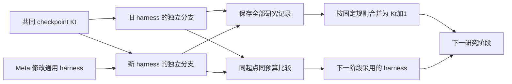

# 数据分析 Harness 进化实现规范

状态：首版实现，Gear 与 Hitch 联调。提案日期：2026-11-05。首个开发任务：Kaggle Titanic。[真实验收与证据边界](data-analysis-harness-validation-2026-11-06.zh-CN.md)。

本规范将 Gear 的优化对象定义为能够自主完成数据分析的 Target harness。Target 从明确的研究状态开始，在预算内检查数据、设计验证、编写模型代码、运行实验、选择方案并输出预测及新的研究状态；Meta 根据这些执行的证据改进通用分析方法。同一任务的历史实验持续保留，通过不可变 checkpoint 传入下一阶段。

**Gear candidate 是 harness 版本；训练脚本、模型、实验账本和 submission.csv 是该 harness 执行任务后产生的 run artifacts。**

**Harness 与研究状态分别版本化。** 新会话和新工作区不等于空白研究历史。比较两个 harness 时，必须从同一个 checkpoint、在相同新增预算下分别推进；相邻阶段的分数变化只表示累计研究进展，不能直接归因于 harness 修改。

首版采用 `analysis-five-rollout@1`：每个 harness 在一个任务起点上执行一条包含五次 rollout 的评估序列；一次 rollout 对应一个正式实验，后一次继承本分支前面的实验记录。每次结束封存当时愿意交付的方案。第五次后的最终选择决定主评分，五步过程曲线、搜索潜力和选择损失用于诊断。首版每个 harness 只有这一条序列，共五次实验。

审查源码基线：Gear `3ea74336ea6f2f627d50b60f9014098cf0ce961c`；Hitch `3aee047ad4d87e4b621f19dd4ad77dd59313c952`。实现入口为 [data-analysis-harness](../examples/data-analysis-harness/README.zh-CN.md)，正式 wire 字段以其发布的 JSON Schema 为准，下文类型用于说明职责与身份。

2026-11-06 用户确认：模型 token 和请求次数不需要限制。默认采用明确的 `usage-only` profile，`tokens: null`、`requests: null`；五次实验、wall/CPU、内存、工具和磁盘上限继续执行。缺失 usage 或无法核验的 provider 内部重试只报告下界，价格未知记为 unknown。硬模型预算不再是本次验收的前置条件。

2026-11-06 MLE-bench 扩展：后续 Kaggle 任务统一使用 MLE-bench 的 config/prepare/grade 和 prepared/public、prepared/private 目录。新增 `analysis-task@2`、`analysis-experiment@2`，覆盖 accuracy、概率 AUC 和双目标 mean-column-wise RMSLE，保留附属文件、原指标及效用值。五次实验语义不变，旧 `@1` 记录不改写。具体格式、上游固定版本、指标映射、Titanic 自定义任务与导出入口以 [MLE-bench 接入说明](../examples/mle-bench/README.zh-CN.md)为准；下文关于二分类和 accuracy 的首版约束仅适用于 `@1`。

本规范承接[原 Kaggle 支持规范](kaggle-support-spec.zh-CN.md)，替换其中针对新方案的“每折执行固定 pipeline”“Meta 直接修改 Titanic 模型”“Target 只调用一次 run_pipeline”设计。旧示例、历史评测和 CSV 保留，不迁移为新方案的基线。此工作不依赖整个 Gear 项目重构或 Python 算法 API 重构先完成。

## 1 目标与首版范围

首版回答两个问题：一个固定 harness 能否让 Target 持续推进真实表格研究并形成有效解法；从任务轨迹中产生的 harness 修改，是否在相同研究起点和新增预算下改变预期行为并改善结果。

必须交付：

1. 一个真实 DSH Target 驱动的有界实验 rollout；从空状态或已封存 checkpoint 开始，一次 rollout 只承担一个正式实验。
2. 可进化的分析提示、技能、搜索策略、实验记忆与最终选择策略。
3. 可追溯的内部实验、外部独立评分和失败记录。
4. Gear 对五次顺序 rollout 构成的完整评估序列进行候选比较和开发晋升。
5. 根据选定 solution 精确重训并导出 `submission.csv`。
6. 与开发晋升分开的迁移评估协议。
7. 同任务历史实验的持久保留、checkpoint 分叉与阶段结束后的显式合并。

首版支持 CSV、表格二分类、CPU、accuracy、固定 Python 依赖以及 Hitch direct/local-docker 后端。任务元数据声明 ID 列、标签列和合法标签，不在通用代码中硬编码 Titanic 字段。至少使用一个非 Titanic 的合成任务验证此边界。

GPU、回归和排序指标、Notebook/code competition、运行时安装依赖、联网检索、自动 Kaggle 提交、任意 DSH JavaScript 插件进化、分支间共享可变记忆及未声明的跨任务历史导入不在首版范围。同任务的显式 checkpoint 继承属于首版必需能力。后续扩展必须改变对应协议或运行身份，不能静默开启。

## 2 当前问题与保留能力

用户回报的两份 Titanic submission 分数分别为 `0.77751` 和 `0.75837`，下降 1.914 个百分点；这些分数未通过 Kaggle API 独立核实。同期本地五折均分从 82.463919% 升至 83.870456%，晋升集从 141/178 升至 143/178。[既有运行记录](kaggle-titanic-iteration-2026-11-05.zh-CN.md)

单次下降不能确定具体统计原因。源码已经能够确认以下设计缺口：

| 当前实现 | 新方案要求 |
| --- | --- |
| Target 被要求只调用一次固定训练工具 | Target 在预算内执行完整研究循环 |
| Meta 修改 Titanic 特征与模型代码 | Meta 修改产生和检验解法的方法 |
| 外层一个 task 对应一次 fold 训练 | 外层一个 task 对应五次实验的评估序列；五折属于每次实验内部验证 |
| 证据主要证明执行身份和 CSV 有效 | 同时保留分析决策、验证计划和全部实验结果 |
| harness commit 同时指认训练代码 | harness 身份与动态生成的 solution 身份分别封存 |

对应源码为 [固定工具边界](../examples/kaggle-titanic/target-carrier/fixed/target-loader.js)、[旧 Meta 上下文](../examples/kaggle-titanic/meta-task-context.txt)和[旧 runner](../examples/kaggle-titanic/target-carrier/fixed/runner.py)。

继续复用 Gear 的 exact commit、candidate workspace/check/finalize、轮次状态机、raw metrics、配对评估、预算账本和晋升机制。当前 [EvaluationSearchAdapter.diagnose](../src/search/evaluation-adapter.ts) 已允许从完整 objective 观测提出改进假说，并不限于程序错误；首版不以替换 `failure-cluster-gepa-v1` 为前置条件。

## 3 对象与职责

| 对象 | 含义 | 所属与生命周期 |
| --- | --- | --- |
| Harness candidate | 通用分析方法的不可变源码版本 | Gear；通过现有 candidate 流程产生 |
| Analysis task | 任务说明、数据、初始 checkpoint、固定环境和新增预算 | Hitch task producer；内容寻址 |
| Research project | 一场持续推进的研究，关联所有阶段和完整成本 | Gear 示例 controller；跨 evolution 的研究链 |
| Research checkpoint | 可复用实验事实、源码、验证计划、当前解法和未完成假设的不可变快照 | 研究状态；独立于 harness 版本 |
| Research stage | 从同一 checkpoint 比较一个或多个 harness 的固定评估阶段 | 固定任务输入、预算和预登记分支计划 |
| Evaluation sequence | 某 harness 从指定 checkpoint 出发的五次顺序 rollout | Gear 逻辑评测 cell；包含子 run 清单、顺序历史与汇总证据 |
| Rollout / Experiment | 一份 solution 的提出或复用、一次明确的验证尝试及当时选择 | 一个 Hitch 逻辑 run；新会话与工作区，继承本分支已封存历史；失败也占一次 |
| Selected solution | Target 当次选中的源码包、参数和训练入口 Ck | 每次 rollout 输出；独立 digest，C5 为序列最终选择 |
| Development champion | 已通过开发选择规则的 harness | Gear champion 的报告语义，不增加核心状态枚举 |
| Transfer evaluation | 冻结 finalist 在未参与开发的任务族上的评测 | 独立评测计划与报告，不回流原轮次 |
| Refit | 对同一 selected solution 扩大训练数据后重新拟合 | 新 Hitch run；不调用模型修改解法 |



Hitch 负责资源角色隔离、运行生命周期、固定评分、输出采集和可验证身份。Gear 负责 harness 候选生成与比较。具体分析策略属于可进化 harness；执行预算、数据权限和可信计分属于不可编辑 substrate。

## 4 数据划分与任务单位

### 4.1 一次实验 rollout 与五次评估序列

Target 接收任务说明、带标签的 `train.csv`、不带标签的 `predict.csv`、提交 schema、初始 research checkpoint 和新增预算。空状态使用明确的 `empty` 标记。外部 query 标签仅存在于独立 verifier 资源中。Target 可以检查 query 的 schema 和非标签统计；首版所有拟合式处理只能使用可见训练数据。

空状态的 Target 在可见训练数据内部建立验证计划；有历史时先认证并加载既有计划及实验。Titanic 默认分层五折，每次实验以同一计划比较候选。Target 不必重复已经完成的 EDA 或实验，可以复用兼容的代码和已认证内部结果。一次 rollout 完成一个实验，封存实验结果、当时选择 Ck 与本次研究增量，下一次从这些显式记录继续。五次结束后由固定执行层使用全部可见训练行重训 C5，对 query 预测。外部评分发生在序列封存之后，不进入这五次 rollout 或后续 Target checkpoint。

五折的训练和预测是一次实验内的五次子执行，不增加 rollout 次数，也不产生五个 Gear task。每个 harness 只执行一条五次实验序列。新旧 harness 的第一步读取同一个初始 checkpoint；第二至第五步只能增加各自分支先前封存的实验记录，不能读取对方分支的新增结果。每次 rollout 拥有新的会话与可写工作区；历史快照只读。

本规范不再使用 episode 表示研究或评估单位，以免与 rollout 混淆。五次实验是顺序研究步骤，不是相同起点上的五次独立重复。

### 4.2 三种反馈边界

| 反馈 | Target | Meta | 用途 |
| --- | --- | --- | --- |
| 内部 CV、OOF 错误与训练数据诊断 | 可读 | 通过受控 seed 轨迹可读 | 任务内研究及 harness 诊断 |
| seed 评估序列的外部评分 | 序列内不可读 | 可读汇总与授权 seed 证据 | harness 开发选择 |
| promotion task 的评分与轨迹 | 序列内不可读 | 沿用现有隐藏边界；不开放逐任务详情 | 开发晋升门槛 |
| transfer task 的内容与结果 | 仅被评测的 Target 按任务权限读取 | 冻结前不可读 | 冻结后独立审计 |

晋升的通过/拒绝也会影响后续搜索，所以 promotion suite 属于开发过程。仅隐藏标签、只返回通过/拒绝，均不足以把反复使用的集合称为最终独立测试。

内部 CV 的分数必须由固定程序从预测重新计算，不能相信 stdout 或 LLM 自报。但 Target 已经能够读取全部可见 train 标签，因此内部 CV 仍是开发反馈；它不能保证生成代码没有记忆标签或对验证集过拟合。泛化评估依赖序列外部隐藏标签以及后续新任务。

### 4.3 两个运行 profile

`single-task-development` 用于 Titanic 起步。复用可追溯的 713/178 外层开发划分，Target 只在 713 行中做内部五折。已有 Titanic 数据和已使用的分数全部标为开发材料，178 行不重新宣称为未接触测试集。使用 `evaluationMode: "reuse-seed"` 表达开发选择意图，同时设置 `promotion.validationMode: "shared-set-research"` 与 `allowSharedSetPromotion: true`。报告明确写开发冠军、单任务证据、没有独立晋升评估。

staged search 通过显式的 `verifySeedPromotionReuse` 能力实现复用：验证两侧任务、计分宇宙与执行条件相同，直接使用完整 seed 比较决定开发晋升，保留原 seed 证据身份，不构造虚假的 held-out 物理 run。共享集合模式未明确允许更新时保持 advisory；独立验证模式禁止走此分支。

`multi-task-development` 使用多个数据来源的开发任务和独立的 promotion 任务族。数据来源相同但重新拆分、改名的任务仍属于同一个 `taskFamilyId`。另留 transfer suite，在 finalist 冻结后才启用。首个小规模迁移试验建议至少三个不同来源的表格任务；这只是试验规模，不等于充分的总体统计证据。

### 4.4 持续研究与同起点评估

一次研究阶段先冻结 `K_t`、候选范围、五次 rollout 的顺序协议和预算；每轮再冻结当轮 champion anchor，晋升后下一轮可以采用新的 anchor。在所有阶段比较完成前不移动公共输入 checkpoint；每条序列内部按步骤追加本分支历史。可在同一个 `K_t` 上进行多轮 harness 提案，但该阶段内所有评分都只解释为给定 `K_t` 的开发结果。阶段初始 reference 另行保留用于报告，不假设现有搜索固定跨轮 anchor。

首版持续研究先运行一次预登记 reference harness 的 bootstrap rollout，锁定验证计划并生成初始 `K_0`；bootstrap 的预算和来源纳入公共前置成本，不算任意一侧私有获得的实验。随后 continuation 分支继承同一计划。Cold-start 对比可以让双方自行设计验证，但它属于独立评估路径，不自动作为该持续研究链的合并阶段。

```text
def evaluate_sequence(H, K_t, budget):
    K_branch = K_t
    for k in range(1, 6):
        K_branch, V_k, C_k = rollout(H, K_branch, k, budget)
    return K_branch, sealed_final_delivery(C_5)

(K_parent_out, y_parent) = evaluate_sequence(H_parent, K_t, incremental_budget)
(K_candidate_out, y_candidate) = evaluate_sequence(H_candidate, K_t, incremental_budget)
harness_delta_at_K_t = y_candidate - y_parent
```

禁止比较 `evaluate_sequence(H_parent, K_t)` 与 `evaluate_sequence(H_candidate, K_t+1)` 来计算 harness 增益。即使源码和数据文件不变，更多实验记录、更好的起始解法或不同记忆摘要都会改变初始条件。同一序列内部研究状态随五次 rollout 推进是预期行为，用分支 checkpoint 区分；不得将它当成公共阶段起点已经更新。

阶段结束后保留所有分支的完整记录，按预登记的 merge policy 形成 `K_t+1`。默认合并所有已认证、同数据权限范围的内部实验事实，包括失败、负结果及未晋升 harness 的实验；不按外部得分过滤有利记录。每条记录保留原分支、run、harness、experiment 和来源 receipt 身份，合并不重新计算或伪造分数。当前 active validation plan 保持不变；历史中其他计划的事实保留为非排名线索，不能混排，相关 solution 需要按 active plan 重验后才具有可比较成绩。

同一验证条件下多次执行同一源码仍保留为多次观测，不只取最好的一次。不同代码或相互矛盾的研究结论并存并标注来源。当前解法默认指向最终采用 harness 的唯一评估序列中的 C5，且须有 active plan 下的有效证据；不可用时保留 `K_t` 的当前解法并记录原因，不借外部评分从分支中挑赢家。

公共 `K_t+1` 在阶段结束后才允许成为下一阶段输入，所有下一阶段分支读取同一版本；这不妨碍当前序列内读取本分支前序实验。外部评分、晋升理由、query 标签及评估后的人工解释留在 Meta/controller 的评估记录中，不并入 Target 研究历史。只有 Target 在外部评分前生成的解释与固定执行事实可进入默认历史视图。

Harness 晋升与 checkpoint 推进是独立决定：候选被拒绝仍可积累有价值的实验事实，harness 被接受也不意味着必须采用其所有结论。完整研究档案保存全部授权产物；checkpoint 是下一阶段允许读取的视图，不是删除其余记录。

### 4.5 首版的阶段编排

当前 Gear 将任务 dataset 封存在 evolution 中，`control.continue` 不能替换公共起点或原地更改 dataset。首版每次推进公共 `K_t → K_t+1` 后重新编译外层任务，从精确采用的 harness commit 调用 `control.start` 创建新 evolution/cohort，并在新起点重测 baseline。序列内部由新增评估适配器根据冻结计划产生五个顺序子任务及其分支 checkpoint；这不修改外层 dataset，也不为每个实验另开 evolution。示例 controller 用 `researchProjectId/stageId` 串联这些 evolution。

新增研究项目级预算与阶段日志，记录输入 checkpoint、所有物理分支、harness 选择、merge plan、输出 checkpoint 和累计消耗。新建 evolution 不重置项目总预算；阶段推进用带 expected checkpoint 的原子更新，不能让并行 controller 相互覆盖研究状态。阶段日志与既有执行账本互相引用，不复制或改写原评测事实。

同一 evolution 内动态更换公共起点、把旧 archive 当新起点的可比较证据，均不在首版范围；如需支持，必须另做通用 cohort/input-advance 协议。预登记序列内部的分支历史推进属于本协议，必须与上述公共起点更换区分。

## 5 新增任务合同与身份

以下类型是待实现的示意合同；正式 JSON Schema 必须拒绝未知字段并测试跨仓库一致性。

```typescript
interface AnalysisTaskV1 {
  protocol: "analysis-task@1";
  taskId: string;
  taskFamilyId: string;
  mode: "evaluate" | "deployment" | "refit";
  sequenceContext: {
    planDigest: string;
    sequenceId: string;
    rolloutIndex: 1 | 2 | 3 | 4 | 5 | null; // 固定交付/refit 非研究步骤
    previousRolloutReceiptDigest: string | null;
  };
  initialResearchState:
    | { kind: "empty" }
    | {
        kind: "checkpoint";
        checkpointDigest: string;
        importPolicyDigest: string;
      };
  descriptionDigest: string;
  inputs: {
    trainDigest: string;
    predictDigest: string;
    submissionSchemaDigest: string;
  };
  prediction: {
    idColumn: string;
    targetColumn: string;
    kind: "binary-label";
    allowedLabels: [string, string];
  };
  metric: { id: "accuracy"; direction: "maximize"; revision: string };
  validationPolicyDigest: string;
  experimentProtocolDigest: string;   // analysis-five-rollout@1 及固定计数/选择合同
  runtimeDigest: string;
  toolProtocolDigest: string;
  budgetDigest: string;
  taskDigest: string;
}
```

标签的 CSV 表示与解析规则在 submission schema 中固定，不能因字符串或数值转换产生不同对齐结果。外部标签、精确评分器和分区信息进入 verifier 的私有资源及完整任务身份；公有 task descriptor 不包含标签路径或可读取私有对象的引用。

任务身份覆盖说明、数据及精确行集合、外层划分、验证权限、评分器、工具、环境、预算和 producer revision。只改变绝对宿主路径不改变语义身份。public descriptor digest 与完整评测合同 digest 分开；后者包含私有资源承诺但不暴露其内容。`evaluate` 的外层序列注册隐藏标签评分合同；实验子 run 只认证本次研究输出与内部 CV，不产生用于后续研究的外部 accuracy。C5 的固定交付及独立 verifier 完成后才形成外层主评分。`deployment/refit` 注册格式与来源检查合同，不纳入 accuracy 搜索集，不产生外部 accuracy 字段。

一个外层逻辑 cell 对应一条五次实验序列，保留现有 harness commit/manifest、外层 task content、model/provider/sampling 与执行条件身份；首版外层 `repetition=0`，只有一条序列。每个子 rollout 另有真实 Hitch run/task 身份，绑定序列计划、rolloutIndex、实际输入 checkpoint、前一 receipt、同一 harness 和累计预算。实验序号不能填入 repetition 字段冒充独立重复。新增协议、预算、checkpoint 内容及历史可见策略均进入语义摘要；旧 pipeline cell 不满足新身份，禁止缓存命中或作为新 baseline。

现有单 run 评估不能直接视为多 run 的受信汇总。新增 analysis sequence 评估适配器须持久化冻结计划、五步依赖和全部子 run 引用，认证每步来源与连续性，再将 C5 实际交付映射为一个外层 observation。已启动步骤的 receipt 缺失、跨 harness 拼接、未声明跳步或预算重置都不能认证；合法提前停止用固定停止事件和 not_started 记录认证。中间分支 checkpoint 在执行后才确定，汇总 receipt 绑定其实际 digest；外层任务绑定生成这些输入的冻结协议，不事先伪造未知 digest。

新增 checkpoint 合同：

```typescript
interface ResearchCheckpointV1 {
  protocol: "analysis-research-checkpoint@1";
  researchProjectId: string;
  taskFamilyId: string;
  baseTaskDigest: string;              // 不含 checkpoint 的任务与数据身份
  dataScopeDigest: string;             // 可见标签行及其授权边界
  validationPlanDigest: string | null;
  runtimeDigest: string;
  scorerDigest: string;
  parentCheckpointDigests: string[];
  sourceOutputManifests: string[];
  historyManifestDigest: string;       // 事实、源码、OOF、失败、解释的内容清单
  historyVisibilityDigest: string;     // 公共起点可见集合相同；后续只追加本分支事实
  cachePolicyDigest: string;
  costLedgerDigest: string;
  currentSolutionDigest: string | null;
  mergePolicyDigest: string;
  checkpointDigest: string;
}
```

checkpoint 由 controller 从已封存 run outputs 构造，按白名单纳入 Target 在外部评分前产生的研究事实与解释；原始完整轨迹不直接作为可执行恢复输入。导入前校验来源 manifest、文件 digest、task family、数据权限、验证计划和环境。公开历史不包含外部 reward、promotion 判定、私有路径或凭据。

首版将 checkpoint 作为 candidate-side `input-tree` 纳入 resource lock，其资源闭包改变 task content digest，现有 `CellIdentity` 即可区分 `K_t` 与 `K_t+1`。使用当前支持的 private-copy 物化，再由 supervisor 所有权和权限实现只读，不能宣称已有 read-only resource binding。

历史文件按内容寻址引用并保留来源。完整研究档案可以大于单次输出上限，单次 rollout 输出历史引用与新增分片；同一起点给两个 harness 相同的可见事实和查询能力。首版使用预物化的有界 history input-tree，超过其预登记输入存储限额时 admission 拒绝并保留全部原始档案，不能静默丢掉失败记录或只挑最佳历史。模型上下文由各自 harness 做摘要，摘要生成成本属于该分支。

历史内部成绩的复用键至少包括 source、训练行集合、validation plan、超参数、训练 seed、依赖/runtime 和 scorer。全部兼容时才可作为已有比较证据，否则只保留研究线索并要求重新验证。相同缓存观测被读取多次不增加独立样本数。

首版复用历史源码和已认证实验指标/OOF，不复用已训练的二进制模型来跳过最终拟合；两侧使用同一 cache policy。已有模型可作为审计产物保留，后续开放模型缓存时需增加训练范围、模型兼容性和隔离加载验收。

首版仍使用 resource manifest v2、`harbor-role-context@1`、candidate/verifier 分离和普通 terminal task。当前 resource-role 路径不能直接组合 Package-native phases；本规范不依赖 `native-phase-control@2` 或 tool-server package 的组合能力。

## 6 可进化 Harness 与固定执行层

新建 `examples/data-analysis-harness/`，保留旧 `examples/kaggle-titanic/`。建议布局：

```text
examples/data-analysis-harness/
  research.mjs                    # 项目阶段、checkpoint 与总预算编排
  checkpoint.mjs                  # 导出、导入、合并与身份校验
  prepare.mjs
  start.mjs
  refit.mjs
  report.mjs
  target-carrier/
    fixed/                         # loader、supervisor、checker、工具适配
    harness/
      preset/agent.cordis.yml       # 固定装配，首版不开放任意模块
      prompts/research.md
      prompts/operators/           # draft、debug、improve、select
      skills/data-analysis/
      workflows/research/
        policy.py                  # 下一步研究动作
        policy.json                # 搜索与选择参数
        memory.py                  # 有界实验摘要
  fixtures/
  tests/
  README.zh-CN.md
```

首版 Meta 可修改 `prompts/`、`skills/`、`workflows/research/` 中经 schema 与类型检查的文件。复用通用 builder 的允许根目录机制，再由本例 checker 收紧范围。`fixed/`、preset 装配、依赖、评分器、任务数据和预算上限不可修改。

可进化 Python policy 在隔离 worker 中读取有界状态 JSON，返回结构化动作；它不持有模型凭据，也不直接启动模型请求。固定 driver 将动作转换成真实 DSH operator 调用和受控工具执行。由此可以修改搜索算法，而无需把任意可编辑 JavaScript 加载到持有 provider 凭据的 DSH 进程。

拟议策略入口：

```python
def next_action(state: dict) -> dict:
    # 返回 analyze / draft / debug / improve / confirm / reuse / select / finish
    ...

def summarize_memory(state: dict) -> dict:
    # 返回有界摘要；完整事实账本由 supervisor 保留
    ...
```

状态包含起始 checkpoint、剩余新增预算、当前 slot、继承与新产生的实验事实、可见指标、已有 solution 引用和诊断摘要；没有外部评分。动作可以引用经过认证的 checkpoint 对象或本分支新对象，不能引用同阶段其他分支的新增对象。固定 driver 验证动作 schema、引用、槽位、预算及状态转换，但不替 policy 决定研究方向。无效策略动作允许一次有界纠正，仍无效则记录 `policy_error`；此纠正不允许重新执行已失败的实验或更换已提交源码。不得静默切回另一套算法并把结果归属于原策略。

必须记录实际载入的 prompt、policy、memory 文件 digest，以及每次 policy 决定和对应执行事件。新增文件未进入加载链属于检查失败。行为变化要在运行轨迹中验证，不能仅以代码存在或 LLM 声称遵守为证据。

## 7 Target 工具与 Rollout 生命周期

以下为新 carrier 的工具协议，不是新增 Hitch CLI 命令。

| 工具 | 输入与结果 | 固定边界 |
| --- | --- | --- |
| `task.inspect` | 返回任务、schema、输入清单、checkpoint 和剩余新增预算 | 不返回外部标签或评分 |
| `workspace.list/read/write` | 访问本 rollout 的相对路径；写入使用内容摘要前置条件 | history 子目录只读；禁止越界、链接、写 substrate 或其他 run |
| `analysis.execute` | 执行工作区内 Python 分析脚本，返回日志和产物引用 | 无网络、无凭据；执行消耗记账 |
| `experiment.evaluate` | 已预约 slot、source digest、validation plan digest、训练 seed、实验假设 | 每个 slot 一次标准 CV 尝试；固定 runner 计分，源码失败不返还槽位 |
| `experiment.inspect` | 分页读取已认证历史及本分支新实验的 OOF/诊断摘要 | 限初始 checkpoint 和本分支；有长度限制 |
| `experiment.select` | 当前 slot、所选 solution、当时内部证据及选择理由 | 每槽追加封存一次 incumbent，不能事后改写或跳过选择直接开下一槽 |
| `solution.freeze` | source digest、选中实验、选择理由和 refit 参数 | 验证入口与依赖，封存不可变 solution 包 |
| `rollout.finish` | 当前实验、Ck 和本次研究增量 | 每次只封存一个实验；下一次从该记录继续，不在本 run 内启动第二个实验；幂等 |

五次 rollout 结束后由固定 controller 执行 `sequence.finalize`：使用无模型 executor 拟合已封存的 C5 并收集预测，不再启动研究会话或生成第六个方案。它是交付步骤，计入序列预留预算，与第 14 节扩大训练范围的部署 refit 分别记账。

工具参数使用已登记对象的 digest，不接受任意宿主命令、解释器路径或 evaluator 路径。Python 可以在受限 worker 内实现数据分析和训练，但不能通过 subprocess 绕过资源与文件权限。

固定生命周期：

```text
序列：planned → rollout_1 → rollout_2 → rollout_3 → rollout_4 → rollout_5
              → C5_frozen → refitting → delivery_sealed
单次：created → checkpoint_verified → inspecting → validation_locked
              → one_experiment → selection_sealed → research_delta_sealed
```

空 checkpoint 下，第一条可比较实验开始前锁定内部 validation plan，包括精确行 ID、折分、指标和随机种子。Target 可以根据数据检查结果选择适用的验证方式；计划必须满足任务声明的分组或时间约束。有 checkpoint 时继承已锁定的计划；首版不能在 continuation 内更换计划并沿用历史排名。Titanic 使用分层五折。

允许 schema、导入和输出格式的有界 smoke 检查，不将其视为模型质量证据。产生用于选择模型的训练/验证结果必须登记为正式实验，不得通过 `analysis.execute` 或一个脚本内的未登记搜索隐藏额外评估。任意 Python 的全部计算仍计入硬资源预算；五次 rollout 不等于总共仅五次模型 fit。首版不在搜索途中修改已经使用的验证计划；发现根本错误时终止该序列并保留失败证据。

`experiment.evaluate` 将 source 快照封存后执行。每折 worker 仅接收该折训练文件和验证特征；所有拟合式预处理在该次调用内部完成。固定程序汇总每折指标和按 ID 对齐的 OOF 预测，主排序采用 pooled OOF accuracy，另报 mean-fold accuracy；两者名字与语义不可互换。

每槽选择只能消费当时已有的内部结果。`rollout.finish` 之后本次 run 不再新增实验；若需修改方案，必须进入下一次 rollout。`sequence.finalize` 只能执行 C5，禁止换阈值或换 ensemble；重复调用同一身份返回已有状态，不重复训练。外部主评分只使用最终 C5 的实际预测。controller 可在全部选择封存后审计其他版本，但审计不能替 Target 选择提交，也不能把成绩或审计产生的新事实送回 Target checkpoint。

## 8 五次 Rollout 研究协议与初始算法

### 8.1 固定五次正式实验机会

每个 harness 的评估序列预登记 rollout 1–5；文中的 slot 是该 rollout 的实验机会，两者一一对应，不再嵌套另一组实验。`V_k` 表示第 k 次 rollout 的不可变 solution；`C_k` 表示该次结束后 harness 愿意交付的方案，两者可以不同。`C_0` 是共同 checkpoint 的当前解法，不消耗新增槽位；cold-start 可以没有 C0。

固定 controller 在启动一次研究 run 前原子预约 slot；driver 最多接受一份封存源码和一次标准 CV 尝试。生成失败、代码报错、预测无效或超过该槽执行限额都消耗这次 rollout；Debug 修改源码后进入下一 rollout。基础设施修复可以保留原逻辑 rollout 和精确源码，所有物理尝试计费，不能借修复更换代码或种子择优。

第 k 槽的可选池为 `{C_0, V_1, …, V_k}` 中具有有效内部证据的方案。完整历史仍可供分析，但其他历史解法若要加入本次可选池，必须登记为一个 V，占用一个槽位；兼容的既有验证结果可按共同 cache policy 复用，不伪装成新训练。重新确认同一源码也占一个槽位，执行 seed/计划按预登记规则确定，不增加独立 Debug 或确认配额。

首版没有额外的第二套确认流程。若以后采用不同确认划分，必须先扩展验证合同并在新 cohort 启动前封存，相关执行仍包含在五槽内。Ensemble、阈值修改和参数调整均为新 solution，必须在某个槽位完整评估；第五槽后不能再合成未测试的第六版。

### 8.2 每槽封存实际选择

每槽终结后，harness 根据当时的内部证据选择 Ck，保存选择依据、可见证据引用、选择策略 digest、时间和累计成本。记录必须在下一槽启动前封存。Ck 可以等于 C(k-1)，失败尝试不强迫替换现有解法。第五条记录 C5 就是最终选择，不能事后看外部结果重建一条“历史最好曲线”。

正常提前停止时，固定 controller 封存停止事件，剩余 rollout 记为 `not_started`，并将已有选择显式 `carry_forward` 到 C5；没有产生新实验或分数观测。已停止的序列不允许恢复后补跑未用机会。没有有效 incumbent 时相应选择为空，最终按交付失败规则处理。报告固定列出 `planned=5`、attempted、valid candidates、unused 和 unique solutions，不能把五次机会称为五个成功模型。

### 8.3 可进化的初始策略

槽位、数据权限、预算和封存规则由固定执行层约束；下面的研究策略属于可进化 harness：

1. 读取共同 checkpoint 的画像、失败、已有代码和待检验假设；缺证据时完成必要数据检查。继承或冻结验证计划。
2. 在五个槽位内选择 Draft、Debug、Improve、Confirm 或复用历史解法的动作，先确保存在可运行基线，再依据已有证据分配其余机会。不预设必须尝试三个模型或额外修复两次。
3. 每次记录一个主要假设和明确修改范围，标准验证后保留成功、无增益及失败结果。
4. 初始选择策略按可选池的兼容 pooled OOF accuracy 选择 incumbent；使用计分合同的比较精度，精度内相同则优先保留当前方案，再用稳定 ID 排序。后继 harness 可以修改选择策略，但必须使用当时可见的内部证据。
5. 第五槽或显式停止后固定 C5，预留预算完成全量训练和最终预测。没有新增增益时允许交付历史方案，并如实报告。

五个槽位衡量同等正式实验机会下的研究能力，不足以单独评价自主停止策略。实际成本和未用机会作为诊断；若要优化停止时机，应另定义固定时间/费用、允许自主选择实验数量的 profile。

## 9 预算与隔离

首版 Titanic preset 使用以下每分支新增上限；它们是本方案的工程初值，不是论文推荐值。构建初始 checkpoint 已发生的训练不重复扣除本次额度：

| 维度 | 每个 harness 的整条五次实验序列初值 |
| --- | ---: |
| 总 wall time | 1800 秒 |
| 研究阶段最晚结束 | 第 1500 秒 |
| 最终重训与封存保留时间 | 300 秒，包含在总预算中 |
| CPU / 内存 | 2 vCPU / 4 GiB |
| 所有 worker 累计 CPU | 2400 CPU 秒 |
| 正式 rollout / 实验机会 | 固定 5 次，每次一个实验，包含生成失败、代码失败、Debug、Confirm 和历史解法登记 |
| 额外 Debug / 确认配额 | 0；每次正式重试占下一个槽位 |
| 单槽标准验证 worker 上限 | 240 秒 wall time / 300 CPU 秒，全部 folds 合计 |
| 模型请求 | 不限额，仅记录可观测 usage |
| 模型输入与输出 token | 不限额，仅记录可观测 usage |
| 工具调用 | 150 次 |
| 工作区磁盘 | 1 GiB |
| 导出单文件 / 总量 | 16 MiB / 64 MiB |

最终训练和分析脚本计入 worker 总预算。每次实验内部的所有 folds 都计入 CPU、wall time 和日志。只限制实验次数不足以约束昂贵代码。五个子 run 共享上述总账，每次启动只分配仍可用的额度，不能每个 run 都刷新 1800 秒等上限。物化、历史导入和子 run 启动也记账。300 秒最终阶段保留 600 CPU 秒、10 次工具调用，均包含在总预算内，研究调用不得占用；固定最终训练不调用模型。

五槽位的版本数不是独立算力单位：一份 ensemble 可以拟合多个模型，一次五折有五次训练。所有正式验证和分析脚本的实际消耗都必须进入资源账本；不得因只有五份源码就宣称等计算量。首版同时固定实验机会和上述资源上限。

过程诊断所需的额外全量 refit 使用独立、预登记的 audit 预算，不从一侧临时多出的研究额度中取得。初值为每条五次实验序列最多六个去重可选 solution 的覆盖，每个需补算的方案最多 300 秒、600 CPU 秒、2 vCPU/4 GiB，无模型调用；实际 C5 交付直接复用，所以最多新增五次 refit。audit 总上限为 1500 秒/3000 CPU 秒，无法在此额度内修复基础设施故障时明确返回 unavailable，不能无限重跑。审计不是额外研究机会，所有成本计入项目总账。C0 的审计若在双方间复用，必须是预登记的共同引用且身份完全一致。

默认模型账本在固定 DSH 调用边界收集 usage，不拦截请求或要求服务端输出上限。若以后选择硬模型预算，需要认证请求拦截层覆盖实际 provider 请求、operator 子调用和内部重试；当前 DSH adapter 的 `model_proxy_compatible: false`，不能假设已有 Hitch proxy 可以直接执行这些限制。硬预算请求前须预留完整输入的可靠计数或保守上界、最大输出和全部在途额度，结束后按 usage 结算。

未认证的硬预算 profile 仍须被 admission 拒绝，不得把它静默降为软预算。这不阻止用户明确选择的默认 usage-only profile。记录实际 usage；无法核验全部请求时注明覆盖下界，无可核验价格时费用记为 unknown，不伪造为零。CPU、内存、磁盘、进程树及 wall time 由操作系统和 supervisor 强制实施。

研究截止或研究配额用完后拒绝新实验，使用保留预算转入选择与重训；正常停止研究不是任务失败。只有无法在总预算内形成有效最终产物时才判失败。每个子 run 的正常输出须在其 Hitch timeout 前封存，汇总须在序列总截止前完成。若某 run 已 timed out/cancelled，不因目录中存在文件而改写该 run 为成功；基础设施未决状态不能当作正常提前停止跳过。

外层 round/evolution 的预算由计划 cell 数、并发、序列上限和 Meta 生成预算推导，不能沿用旧 pipeline 示例的一小时轮次默认值。例如一个任务、一个 anchor、一个新候选，在没有可复用 baseline 时，共计划两条评估序列、十次研究 rollout；实际交付及额外 audit run 分列，不能将其称为第六次实验或隐藏成本。启动前输出预算预览；不足时 admission 失败，不运行部分计划再降低验收标准。

成本分开报告：`historicalCost(K_t)` 为历史投入；`incrementalCost(sequence)` 为本分支五次实验及实际交付的新增消耗；`auditCost(sequence)` 为事后诊断消耗；`projectTotalCost` 包含这些成本、Meta、失败/修复、checkpoint 处理与部署 refit。共享祖先按唯一成本事件去重，不能重复计费，也不能删除未晋升分支的成本。Checkpoint 物化计入 setup 预算；读取、校验、重新摘要与新实验计入相应执行预算。

同预算表示相同上限，不要求人为耗尽额度。缓存命中必须记录来源及实际复用，不能把旧训练计为本次新实验；可变全局训练缓存禁止跨 harness 分支共享。本次结果封存后可供同一序列的后续 rollout 读取；只有阶段结束并纳入公共下一 checkpoint 后才可供其他 harness 分支读取。

固定 supervisor 拥有输入和权威日志；Target 仅能修改本次 rollout workspace。模型凭据留在固定 DSH/provider 边界，所有可编辑 Python 和生成的 solution 在无凭据 worker 中运行。worker 不能访问 DSH_HOME、宿主目录、其他 run、控制面、verifier 或网络。首版不开放可编辑 DSH JS 插件；未来开放前需要单独解决同进程凭据和宿主权限边界。

沿用并扩展现有 Linux supervisor 的 UID、chroot、seccomp、进程终止与只读来源策略。多次实验各用新的执行工作区，不能复用旧脚本的全局状态。将原来单次 runner 扩为多次调用时，必须在真实容器中验证权限与预算，不能把工具白名单当作文件系统隔离。

Meta 宿主也必须限制文件系统权限，只提供候选编辑和授权 seed 证据接口；不能读取原始全部数据、Hitch CAS、私有标签或凭据目录。具备宿主全盘 shell 权限的开发聊天环境不构成此隔离保证，隔离验收使用实际部署的 Meta runner。

## 10 实验账本与输出合同

每次实验保留两类信息：由 Agent 提供的假设/解释，以及由 supervisor/计分器产生的执行事实。两者字段分开，LLM 文本不能覆盖事实。

```typescript
interface ExperimentRecordV1 {
  protocol: "analysis-experiment@1";
  experimentId: string;
  sequenceId: string;
  rolloutRunId: string;
  slotIndex: 1 | 2 | 3 | 4 | 5;
  parentExperimentId: string | null;
  operator: "draft" | "debug" | "improve" | "confirm" | "reuse";
  sourceDigest: string | null;         // 生成失败时没有可执行源码
  validationPlanDigest: string;
  trainingSeed: number;
  claim: { hypothesis: string; intendedChange: string };
  execution: {
    status: "completed" | "reused" | "generation_failed" | "candidate_failed" | "infrastructure_failed";
    receiptDigest: string;
    physicalAttemptRefs: string[];
    reusedEvidenceRefs: string[];
    wallSeconds: number;
    cpuSeconds: number;
    foldMetrics: Array<{ fold: number; rows: number; accuracy: number }>;
    pooledAccuracy: number | null;
    oofDigest: string | null;
  };
  interpretation: { conclusion: string; limitations: string[] };
}

interface SlotSelectionV1 {
  protocol: "analysis-slot-selection@1";
  slotIndex: 1 | 2 | 3 | 4 | 5;
  experimentId: string | null;         // not_started 不伪造实验记录
  status: "attempted" | "not_started";
  stopReason: string | null;
  incumbentSolutionDigest: string | null;
  carryForward: boolean;
  availableEvidenceRefs: string[];
  selectionPolicyDigest: string;
  cumulativeCostDigest: string;
  sealedAt: string;
  sealDigest: string;
}
```

失败时保留状态、错误、部分完成的 fold 及已消费预算，完整聚合值为 null。不同验证计划、smoke/full 证据不能合并成同一排行榜。记录采用追加语义和稳定实验 ID；基础设施重试在同一逻辑 rollout 中追加物理尝试，改源码后的 Debug 建立下一 rollout 的新记录。每次 rollout 保留一条当次 selection 和自己的 receipt；整条序列汇总五条 selection。carry-forward 不代表新训练或新的分数观测。

每次 rollout 输出自己的实验、selection、源码、receipt 与 research delta。controller 认证并汇总全部来源后，成功评估序列的完整输出至少包括：

| 文件 | 内容与可信来源 |
| --- | --- |
| `analysis-summary.json` | 数据画像、验证选择、关键决策和未解决问题；解释字段标明 Agent 来源 |
| `validation-plan.json` | 实际使用的训练内行 ID 与划分；supervisor 校验 |
| `experiments.jsonl` | 全部实验及预算事实，包含失败和无增益结果 |
| `selection.json` | C0、五个槽位的选择与封存摘要、最终 C5、尝试/成功/未使用计数 |
| `experiment-sources/` | 本次提交的各 V 及 C0 的精确源码闭包、状态和来源；支撑受限事后审计 |
| `solution/` 与 `solution-manifest.json` | 不可变代码、参数、入口、文件 digest 和依赖引用 |
| `predictions.csv` | 对当前 task query 的最终预测 |
| `rollout-receipts/` | 每个实际执行的研究 run 的来源、输入 checkpoint、实验、选择、输出与物理尝试身份 |
| `sequence-receipt.json` | 冻结计划、公共起点、五步依赖及所有实际子 run/manifest 引用、累计预算、C5 交付身份与终态 |
| `research-delta.json` | 公共起点与各步分支 checkpoint、追加事实与产物、来源和新增成本；在外部评分前封存 |

可选输出包括 OOF 文件、图表、模型与有界日志。超限必须明确记录或失败；必需的 receipt、ledger、五槽位 selection、源码清单、最终 solution 和预测不能静默截断。生成失败的 slot 明确没有源码，不能伪造补齐。大型日志可只导出声明的片段及原内容摘要，不得宣称完整日志已保存。

单次权威 receipt 由固定 supervisor 生成，输出 manifest 由 Hitch 采集器计算；汇总 receipt 由新增固定 sequence 适配器校验生成，不能伪装成某个 Hitch 原生 run 的输出。封存前终止 worker 后代进程，拒绝 symlink、hardlink、越界路径和未声明文件。verifier 只读取普通预测数据和可信 receipt，不 import solution，也不反序列化模型。

实验 ID 使用来源 run 命名空间，导入历史后不改名冒充新实验。单次 receipt 与 selection 绑定本次输入 checkpoint；sequence receipt 另绑定公共 `startingCheckpointDigest`、历史可见规则、cache policy 及完整输入输出链。合并器仅追加事实并生成新 manifest；不能修改历史文件或将 Agent 摘要升级为权威成绩。

完整文件通过已有 `runs artifacts list/export` 导出。Gear 的对应封装目前是 controller-only、direct-mode；不把它描述为 Meta 已具备的任意文件读取能力。

首版将有界实验摘要、selection 和错误信息通过固定工具结果写入真实 trajectory。新增 sequence 证据解析将授权 seed cell 映射到其五个实际子 run，并逐一校验 run/commit/task 与计划，再复用 `trajectory.query` 的受控读取；现有单 run resolver 不能直接把 sequence digest 当 Hitch run ID。完整账本由 operator 导出。若以后增加 Meta 文件分页接口，必须另做 seed-only、active assignment、物理 run/commit/task 绑定、白名单和长度限制。

## 11 Meta 指令与经验提炼

新增版本化参考文档 `skills/refine/references/data-analysis-harness.md`，由 refine bundle digest 纳入身份；在 seed task/manifest 声明本协议时路由至该指导。运行时附加文本若影响提案，必须绑定内容 digest；不能仅依赖未封存的 `GEAR_META_TASK_CONTEXT_FILE`。

Meta assignment 的核心指令如下：

> 你的候选是一套数据分析 harness。读取授权 seed 评估序列中五次 rollout 的数据诊断、验证计划、实验摘要、选择依据与最终结果，识别影响分析质量、稳定性或预算利用的具体决策。
>
> 区分观察、机制假说和已验证结果。提出一个可迁移干预，说明触发条件、预期行为变化、不适用情形、成本和回归风险；通过允许的 prompt、skill 或 workflow 修改实现它。
>
> 不直接为当前比赛提交训练解法，不把本次生成代码、标签映射或外部评分规则写入 harness。需要的数据分析和模型试验由 Target 在下一次实验 rollout 中执行。
>
> 以真实轨迹和配对评估检验修改。新旧 harness 各执行五次顺序 rollout，比较同起点评估序列的最终 C5；过程曲线和选择损失用于诊断，不能把外部 oracle 对应的模型直接改作提交。机制被调用不等于机制有效，单任务涨分不等于已证明迁移。
>
> 研究历史与 harness 是两个独立输入。保留同任务已完成实验；评估改进时让新旧 harness 从同一 checkpoint 出发。不要用候选多获得的历史、计算或私有对话解释为 harness 增益。

诊断可以针对数据理解、验证设计、实验控制、搜索多样性、上下文丢失、最终选择、交付或资源浪费。它们是分析类别，不自动构成因果解释或新的 reward。

例如从 Titanic 姓名特征实验提炼出的能力可以是“识别有内部结构的字符串列，提出可解释的候选变换，用固定验证做消融”。不得直接存储“在 Titanic 加 Title，固定 RF 参数”。通用训练模板可以存在，但必须读取任务 schema 并在当前数据重新验证，不能夹带任务答案。

复用现有 seed experience 存储 Meta 诊断和候选比较。Target 的事实记忆通过同任务 checkpoint 持续保留，可进化摘要由新 harness 根据相同事实集重新构建；不能一侧继承完整私有对话、另一侧只拿删减摘要。DSH 会话仍每次新建，未显式记录的内部状态不继承。

同任务原始实验通过 checkpoint 传递，跨任务的通用方法通过版本化 harness 传递。其他 task family、其他外层标签权限范围的原始解法或实验状态不得自动导入。

初始版不新增 Meta 付费 probe API。`candidate.check` 负责加载、装配、静态合同及工具接线，不宣称具备行为 replay。完整行为比较通过普通 seed task 的五次实验序列执行。每个 harness 首版只有这五次机会；需要额外重复评估时必须另行预登记新的评估计划和预算，禁止借基础设施 repair 重跑已有有效低分 cell。

## 12 外层评分与开发晋升

外部 verifier 按 ID 对齐 C5 实际交付的 query 预测，检查完整性、合法标签和来源，再计算 accuracy。保留现有标准 `total_score` 与 raw metrics 管道；`total_score = final_quality_5`，不替换为五个版本的最高分或均分。

| 情况 | total_score | accuracy | valid_output / completed |
| --- | ---: | --- | --- |
| 合法预测且执行完整 | 外部 accuracy | 实测值，可为零 | 1 / 1 |
| runner 在外层截止前封存的最终交付失败、无可用 C5，或总预算不足导致无法交付 | 0 | 缺失 | 0 / 0 |
| 基础设施故障、证据损坏或 verifier 崩溃 | 无有效 observation | 缺失 | 不伪造 |

格式失败作为已完成的任务失败记录，不能不断自动重跑。Hitch 外层 timeout/cancel 或强杀导致没有完整受信证据时，保留相应执行失败/不可用状态，首版不新增 timeout gradeability。基础设施故障保留 unavailable，计划未补齐前不能晋升；不得删掉这些 cell 后改变分母。取消和可归因于 Target 的 timeout 不因缺少可评分 receipt 就自动取得基础设施重跑资格。

单次 rollout 的代码失败不必导致整个序列零分：如果 harness 保留了有效 incumbent 并正常交付 C5，仍按真实最终结果评分。失败实验保留在过程诊断和成本中。

### 12.1 主指标与过程诊断

设 `q(Ck)` 为相应选择记录在固定外部评分合同下的效用。证据必须区分 `start`、`solution_audit` 与 `actual_delivery`：C0 使用共同起点证据，C1–C4 使用其封存方案的审计证据，C5 使用本次实际交付证据。q 绑定选择记录和证据角色，不是只按 solution digest 查表。合法预测使用 accuracy；受信证据确认的对应执行失败使用预登记失败值 0，原始 accuracy 保持缺失。某槽结束尚无可用 incumbent 时，该点效用也为 0，并明确标记 no-incumbent/accuracy=null；不伪造预测。基础设施未知结果不能赋值为零。

| 字段 | 定义 | 首版用途 |
| --- | --- | --- |
| `final_quality_5` | 实际 C5 的外部效用 | 唯一质量主指标，对应 total_score |
| `final_gain_from_start` | `q(C5) - q(C0)` | 相对共同起点的进展；C0 不存在或未知时不计算 |
| `incumbent_slot_mean_5` | `(q(C1)+…+q(C5))/5` | 五个时点实际选择的平均效用，不是 ROC-AUC |
| `progress_gain_mean_5` | `incumbent_slot_mean_5 - q(C0)` | 较好解法出现得早还是晚；C0 不存在或未知时不计算 |
| `oracle_best_5` | 可选池 C0 与 V1…V5 的最高方案审计效用 | 搜索潜力；只在所需覆盖完整且可选池非空时报告完整值 |
| `selection_loss_5` | `oracle_best_5 - final_quality_5` | 合法最终交付时的选择损失；不参与晋升 |
| 可靠性与成本 | 有效交付率、失败槽数、CPU、wall time、usage、费用 | 硬约束与诊断 |

五点曲线沿着每槽当时封存的 Ck 计算，可能下降；不能用外部成绩事后改成单调的历史最高曲线。失败或停止后显式 carry-forward 的点保持原 incumbent，但不增加统计样本。不存在的 C0 不进入 oracle，两个起点增益指标均为 null；这与中间无 incumbent 的已知零效用不同。有效原始 V 的均分不作为主指标，避免把有价值的探索失败直接等同于最终能力下降。

### 12.2 事后审计执行

五次 rollout 的选择、C5、最终交付状态与研究增量封存后，controller 才启动 `analysis-trajectory-audit@1`。计划绑定源序列及各 run、task/checkpoint、五条 selection digest、可选源码池、训练范围/seed/runtime、评分合同和 audit 预算。候选池之外的源码、临时改动、重新挑选的阈值不得加入审计。

内部五折 OOF 不能替代全量重训后的外部预测。首版通过第 14 节的无模型 `sealed-python` executor 对需要的封存方案补做全量 refit，再交给独立 verifier；执行器仍看不到 query 标签。最多覆盖 C0 加五个 V，共六个去重方案；去重必须使用完整 solution、参数、seed、训练/预测数据与 runtime 身份，不能只比较源码。C5 必须复用实际交付结果，包括已确认的交付失败，不为它重训择优；其余完全相同训练/预测身份的结果可按预登记规则复用。

实际 C5 的合法预测可以复用于完全相同身份的方案审计。实际交付失败不自动证明同一源码在其他证据角色下也失败：例如共同 C0 审计为 0.8、本次选择相同方案但未交付，则 q(C0)=0.8、q(C5)=0。已有合规共同证据仍可用于早期点和 oracle；若无相应方案证据，辅助点保留未知，不为 C5 增加一次补救 refit，也不把本次零分传播到早期点。报告分别保存各角色及其证据引用。

没有合法源码或已确认正式验证失败的 V 记录为不可选失败，不要求补做审计，也不事后修复来补成成功版本。合法启动后的 audit 源码报错、无效预测或超过单方案执行上限记为 `audit_candidate_failed`，效用 0、accuracy 缺失；调度、镜像、采集、verifier 故障或总 audit 预算不足造成的未执行项记为 unavailable。无法归因时保留未知。

各诊断分别检查覆盖：五个 incumbent 的评分都已知才计算 slot mean；未被选中的 V 审计缺失不影响已有完整曲线，但使完整 oracle 不可得。存在未知候选时只能报告“已知最好值/下界”，不能称完整 oracle；曲线缺点时不能删点平均。最终交付失败时不把全部差距解释为选择错误，`selection_loss_5` 留空并报告交付失败。

审计结果作为独立受信报告保留，包含每个 q 的证据引用和 complete/incomplete 状态。首版不把辅助指标加入 Gear objective，也不回写已认证的主评分；辅助缺失不抹掉有效 final_quality_5 或强迫重跑研究。Titanic 完整诊断验收须实际覆盖所需方案；覆盖不全时按事实报告缺口。

外部曲线、oracle、审计日志和据此产生的解释只能进入 controller/授权 Meta seed 诊断，不能进入 Target 工具返回或下一 checkpoint。Held-out 任务继续遵守现有证据隐藏边界。审计为外部评估，不是下一轮研究的免费训练缓存。

### 12.3 配对聚合与晋升

首版只混合相同语义、范围为 0–1 的 accuracy 任务。对 harness `h`：

```text
Q(h | K, B) = Σ_task w(task) × final_quality_5(h, task, K_task, B)
harnessGain(K, B) = Q(candidate | K, B) - Q(anchor | K, B)
```

首版使用现有 uniform task 权重，在启动前封存；每个 harness/task/checkpoint 只有一条五次实验序列，取得其实际 C5 主评分后再按任务平均。每个 suite 只放一个同源 task family 的任务，避免同源拆分获得额外权重。自定义家族权重和跨 metric 归一化不属于首版；后续必须固定方向与参考尺度，并始终保留 raw score，禁止按当前候选最好/最差值动态归一化。

每个 harness/task/checkpoint 只计划五次顺序实验 rollout，不另加完整序列的随机重复。外层配置 `hitch.attempts=1`，对应 `RolloutSpec.repetitions=1`；五次实验由新增 sequence 适配器按依赖逐个调度，每个子 run 也只执行一次逻辑实验，不能把 attempts 设为 5 后期待现有独立重复机制自动传递历史。Hitch CLI adapter 当前拒绝 typed rollout seeds 和 temperature，首版不配置 `hitch.seeds` 或 `hitch.sampling.temperature`。训练/CV seed 在 analysis task 合同中单独固定并记账。双方使用相同公共起点、history visibility、cache policy、五步协议、model/provider 和新增预算；独立会话不等于模型输出可确定复现。

复用 `RolloutSpec`、`CellIdentity`、现有完整 scope 和晋升 gate，并补第 4.3 节的 staged seed-only 分支及第 5 节的多 run 序列认证。新示例按逻辑评估任务 IDs 构造 full scope：保持合法的正 `local.ratio`，shared 的 min/max 为任务总数、覆盖全部 task IDs，只有 shared bucket 获得权重。不能继续调用硬编码五个 task 的 `fullFoldSettings`。五次实验不扩成五个独立统计 cell，汇总结果必须可追溯到全部实际子 run。

开发晋升要求：

1. candidate 与当轮冻结 champion anchor 的所有计划 cell 完整、初始 checkpoint 和执行条件一致。旧 checkpoint 上的 baseline 不可复用为新起点的比较项。
2. `valid_output=1`、`completed=1`；已确认预算或隔离违规拒绝晋升。
3. seed 的 C5 实际主评分宏平均增益严格大于 `promotion.objective.minimumGain`，初值为 `0.005`，对应 raw objective gate 的严格比较语义；只设置 outcome 阈值不生效。过程均值或 oracle 更高不能放宽此门槛。
4. multi-task profile 的 promotion 宏平均不回归；预声明 protected tasks 使用现有保护规则。
5. 必需产物通过 controller 的就绪认证，包括准确绑定的 manifest、完整最终 solution、ledger、五条选择、源码清单、receipt 和预测。辅助审计结果有独立就绪状态，不因尚未完成就删除主评分。
6. 记录逐任务差值、五次实验的全部结果与当时选择、交付状态、CPU、wall time 和模型 usage。

产物就绪认证是本次新增的评估适配步骤。Hitch 的产物采集失败可以与有效分数并存，`completed=1` 不证明后续导出可用。controller 必须通过公共 list/export 接口核验 run/commit/task、必需条目、长度和 digest，并保存就绪证据；认证完成前不允许该 nominee 更新 champion。采集暂时失败保留真实分数，但晋升为 insufficient-evidence，可在允许时 collect-only 修复，不能改写成模型零分。

`0.005` 是开发选择阈值，不是显著性结论。首版不引入自动置信区间晋升，也不要求为估计随机波动而额外重复研究。五次 rollout 是相互依赖的实验步骤，五个版本、五个曲线点和内部五折均不构成五个独立任务样本。单任务的一条序列只能支持该起点与预算下的开发比较，不能据此宣称统计显著或总体能力提高。未来若要评估随机稳定性，应另订重复整条序列的计划和预算。

报告区分三种结果：同一 `K_t` 下的新旧 harness 差值、`K_t → K_t+1` 的累计研究进展，以及新任务上的迁移表现。合并多个 harness 分支形成的改进不能归属于任意一条五次实验序列；连续多个相关 checkpoint 也不能当成多个独立任务。开发冠军的有效证据须标明所处 checkpoint，不能沿用旧分数宣称其在新研究状态仍最优。

复用既有 accepted/rejected/insufficient-evidence 等状态；报告增加稳定原因码区分无增益、缺证据、无效交付和执行违规，不另建一套 champion 状态机。首版没有额外的整序列确认运行；将来需要时，次数与 seeds 必须在新评估计划中预登记，只确认已冻结 nominee，不能看到结果后不断追加到通过为止。

## 13 迁移评估

开发完成后，先用开发证据提名唯一 finalist，冻结其 harness、执行模型、预算和评估计划。随后将 finalist 与预登记 reference 在未参与开发的新任务族上比较。选择 reference 时不能查看 transfer 成绩。评估计划明确 cold-start 或 continuation：前者使用空 checkpoint；后者由固定 reference 与预热预算产生共同 checkpoint，再让双方等预算分叉，报告预热成本及来源，不能冒充从零完成任务。

transfer 输出包括全部计划结果、最终交付率、逐任务质量差、资源成本以及研究方法是否在相应任务中实际触发。行为证据不替代任务得分；LLM 对分析报告的主观评价不进入首版晋升 reward。

首次向 Meta 或操作者披露 transfer 内容、成绩或通过/不通过时，controller 追加 exposure 事件，绑定 suite、task family、数据来源摘要、finalist、评估计划和披露时间。以实际披露判定，不推测操作者是否利用了结果。曝光后的 suite 不再用于新的 untouched 选择；再次评估可以报告，新的独立审计需要新 suite。

exposure 账本跨 evolution 持久化，由固定 controller 管理；新建 evolution 或将同源数据改名不能清除记录。历史首次冻结评估的独立性记录保持不变，后续报告注明该 suite 已曝光。跨项目导入同源任务时同时检查来源摘要；未能核验来源与历史的 suite 只能标为 `exposure_unknown`，不能宣称 untouched。

同一 Titanic 数据换 seed 或重新划分只能检验局部稳健性。论文、公开 notebook 或已有任务答案可能造成污染；首版关闭网络检索。允许同任务已声明 checkpoint 的历史传递，禁止跨任务或跨标签权限范围的隐式继承。迁移 checkpoint 的生成/选择规则必须先于对 finalist 的测试冻结，不能按候选擅长的研究状态挑起点。冻结的通用规则可以迁移，测试任务的现成解法不能加入 harness。

首版工程验收不要求一定产生正向迁移结果。负结果必须作为有效结果报告；“协议实现完成”与“发现有效改进”是两个不同结论。

## 14 Selected Solution 与最终导出

实验 rollout 会动态生成代码，也可以合法地选择 checkpoint 中已有的解法。harness commit 不足以唯一指认最终训练程序。新增 `analysis-solution@1` manifest，至少绑定 source 文件列表与 digest、入口、参数、training seed、依赖/runtime digest、来源 run/experiment 以及选中时的验证计划。

另外记录 `authoredByRunId`、`selectedByRolloutRunId`、`selectedBySequenceId`、`selectedByHarnessRef`、`startingCheckpointDigest` 和 `validationEvidenceRefs`。源码作者与当前选择者可以不同；选中历史成果是合法决策，但不能声称当前 harness 新生成了该源码。最终输出需包含可导出的精确源码副本或可验证的完整内容闭包。

solution 的首版入口沿用普通训练预测协议：

```text
python solution.py --train TRAIN_CSV --predict FEATURES_CSV \
  --output PREDICTIONS_CSV --seed INTEGER
```

`solution.freeze` 验证入口合同，封存源码；不把 pickle 模型作为可信代码来源。最终 refit 可以改变训练行范围和 query，但不得改变特征逻辑、模型、超参数、ensemble 成员、权重或阈值。

拟议示例层 refit 请求：

```typescript
interface AnalysisRefitRequestV1 {
  protocol: "analysis-refit@1";
  harnessCommit: string;
  harnessManifestDigest: string;
  sourceSelectionPlanDigest: string;
  sourceSequenceReceiptDigest: string;
  startingCheckpointDigest: string | null;
  sourceRunId: string;
  outputManifestDigest: string;
  solutionDigest: string;
  destinationTaskDigest: string;
  runtimeDigest: string;
  trainingSeed: number;
}
```

`sourceSelectionPlanDigest` 绑定允许的 stage/cohort、task/checkpoint、评估序列及子 run 集合、源 runtime/预算及选择规则。`sourceRunId` 指 C5 对应的已认证交付 run，不一定是源码首次生成的 run；`sourceSequenceReceiptDigest` 绑定五次实验与最终交付的完整链。controller 验证来源属于计划与指定 harness，solution 在公共初始 checkpoint 或本分支新产物中可合法访问、已按五次实验规则进入可选池，且被 C5 封存，再通过 Hitch 公共产物 API 导出并校验。目标 producer 将该源码包作为新 candidate-side 输入，创建 refit task。显式指定池外来源时建立新的自定义部署计划，不沿用原开发评估的选择结论。

严格无模型 refit 需要新增 Hitch `sealed-python` adapter，当前 adapter catalog 没有该执行能力。它只接受封存的 Python solution 包和固定 runner 入口，在现有任务隔离中执行，不接受任意宿主 shell 命令。新增 capability `sealed_source_execution: "1"`；在新 eval 请求合同版本中允许经该 adapter 验证的 `model: null`，旧版本及模型 adapter 继续要求真实 model。缺少能力时禁止宣称支持 strict refit。

refit 的身份分别记录来源 `sourceHarnessCommit/sourceRunId/solutionDigest` 与实际 `executorId/executorRevision`。执行 adapter 的制品必须精确封存；不得将其 output manifest 伪装成原 DSH harness 的执行。该路径不导入模型凭据、不启动模型会话，验收证明实际 provider 请求数为零。它复用现有 eval 生命周期和产物接口，新增工作包括 adapter、请求 schema/CLI 校验、capability 及兼容测试。

另一个允许的流程是让选中的 harness 在全部 891 行上重新完成五次实验，再预测 418 行 Kaggle test。它必须命名为 `deployment sequence`，按完整预算记账并产生新的 selected solution；不能称为同一 solution 的精确重训。

默认使用最终采用 harness 的唯一 development sequence 中的 C5；该序列无有效可导出产物时阻止默认 refit，不静默换一个。不能依据事后外部曲线改选 C1–C4 或未选中的 V。用户显式指定其他合格来源时建立相应部署记录，该选择不改写原序列的主评分或 C5。

Titanic 导出校验为 `PassengerId,Survived`、418 行、每个预期 ID 一次、合法二元标签，无额外 index 或空值；行数同时从输入 schema 推导。finalization 只有格式与来源校验，没有未知的 Kaggle test accuracy。线上提交仍是独立显式操作，线上成绩不进入本地搜索目标。

## 15 取消 恢复与幂等

experiment 请求身份包含 sequence、rolloutIndex、本次输入 checkpoint、source、validation plan、seed、操作编号及配置。重复同一请求读取已登记结果；主动重复必须进入下一 rollout 并消耗机会和新增预算。solution freeze 和 finalization 分别使用内容寻址与原子封存。

取消时停止模型调度、终止全部 worker、保留权威预算和已完成证据。不能在取消后继续最终训练。Hitch 当前 `candidate-resume` 和 `trajectory-replay` 路径不是可承诺的能力；首版不承诺恢复 DSH 对话及活动工作区。从 checkpoint 开始新会话是显式任务输入初始化，不是复用上述未实现的会话恢复能力。

可复用的恢复方式是受支持的 candidate-restart、verifier-only 和 collect-only。基础设施重启同一逻辑槽位时使用新物理 run，关联原尝试并保留累计消耗；它不是额外统计样本。Target 自身的有效失败不能通过基础设施 repair 改成另一次免费抽样。

如果 controller 无法确认是否已提交或封存，先查询已有状态与输出身份，不盲目发起新 run。新任务协议、运行环境或预算不能覆盖旧 cohort，必须创建新的评估条件。

基础设施 restart 必须从该逻辑 rollout 原定的输入 checkpoint 重启，保留前面已封存的正常实验，不得偷偷包含本次失败物理尝试的新研究事实；失败产物仍保留在档案。如要利用本次已确认 Target 失败继续研究，按实验失败封存并消耗这次 rollout，下一次显式继承其事实；不能作为原逻辑 rollout 的免费修复。无法认证的基础设施产物不得导入后续步骤。

## 16 仓库实现分工

| 改动 | 仓库与位置 | 现有能力及新增范围 |
| --- | --- | --- |
| Analysis task producer、checkpoint 输入、固定外部 verifier、refit task | Hitch `benchmark-packages/kaggle/` 下新增实验 rollout 模式或模块 | 每个研究 run 一个实验；复用资源 v2/input-tree 与角色隔离；保留旧 `kaggle-task@1` |
| 单实验 DSH carrier、研究 policy、受控 worker 与 checker | Gear 新 `examples/data-analysis-harness/` | 替换示例工具边界；通用 builder 不放宽 |
| Analysis task/experiment/solution/receipt/checkpoint schemas | 两仓库各自消费固定 golden fixtures | 新增版本化合同；不依赖彼此私有存储布局 |
| 研究项目、checkpoint 导入/合并和阶段推进 | Gear 新示例 controller | 新增持久化阶段日志与项目总预算；复用 start/from exact commit，不能原地改 evolution dataset |
| Meta 分析指导与路由 | Gear refine bundle | 新增参考文档，确保指令纳入身份 |
| 五次顺序 rollout 的评估适配、task scope、目标与报告 | Gear 评估适配层与新示例配置 | 新增序列依赖调度、汇总 receipt 认证及 seed 轨迹解析；外层 repetitions=1；复用 raw metrics/control，补 staged seed-only 分支 |
| 模型 usage 账本 | Gear 固定 DSH carrier/provider 请求边界 | 默认不限制 token/请求，记录可观察 usage 与覆盖下界；未认证硬 profile 拒绝 |
| 必需产物就绪认证 | Gear 评估适配层 | 复用 Hitch 公共产物 API；晋升前认证，不修改真实分数 |
| 五槽位选择与过程审计 | Gear carrier/controller、Hitch task verifier | 新增 slot/selection 合同与无模型 audit；主评分仍是实际 C5，辅助报告独立保存 |
| Transfer exposure 账本 | Gear controller 管理的持久化报告数据 | 跨 evolution 记录来源与首次披露；Meta 不可修改 |
| 产物 list/export、生命周期、cancel/rerun | Hitch 通用接口 | 优先复用；仅真实缺口增加通用实现和 capability |
| 无模型执行 adapter 与请求合同 | Hitch adapter/domain/CLI/capability | 新增 `sealed-python` 与兼容旧模型请求的合同版本 |
| strict refit 与 deployment 编排 | Gear 示例层 | 显式来源 cohort/run/solution；分别绑定来源 harness 与 refit executor |

不新增 `hitch kaggle eval` 或 DA 专属 Gear 轮次 API。已有可复用接口包括 `control.start/continue`、`meta.claim`、candidate 文件操作/check/finalize、`seed_tasks.load`、`trajectory.query` 和 seed experience。Hitch 复用 eval/run、verifier 及 output artifacts 接口。

本方案需要两仓库联调，但不是所有改动都进入 Hitch 核心。隔离 supervisor 若可以在普通 task/carrier 内实现，就留在相应示例/runtime；只有后端生命周期、资源或权威产物能力存在通用缺口时才修改核心。

## 17 实施顺序

| 阶段 | 交付 | 退出条件 |
| --- | --- | --- |
| A 合同 | task、experiment、solution、receipt、checkpoint schemas；角色图；golden fixtures | 两仓库读取一致，旧 task 协议测试通过 |
| B 单实验 rollout 与序列 | supervisor、工具、初始 policy、共享账本、checkpoint 导入/导出、五步调度和汇总 receipt、外部 verifier | 合成任务完成五次顺序实验，前一步记录对后一步可见；隔离 canary 通过 |
| C Gear 接入 | candidate checker、Meta 指导、scope、单序列评估认证、seed-only、产物认证与阶段编排 | 两版本从同 checkpoint 各做五次实验；新公共 checkpoint 重新评估 baseline；项目预算不重置 |
| D Titanic 验证 | 初始 checkpoint、一个机制候选、双方各一条包含五次 rollout 的 continuation sequence、完整过程审计、合并后再继续一次研究 | 展示 C5 主评分、五步曲线、搜索与选择诊断、分支隔离及研究/audit 成本；拒绝晋升也算协议正常 |
| E 精确交付 | Hitch 无模型 adapter、strict refit、输出导出、失败恢复 | 零模型请求，同一 solution 在完整 train 重训并导出有效 submission.csv |
| F 迁移试验 | 冻结 finalist 与 reference，执行预登记的新任务族 | 完整报告正向、持平或负向结果，不隐去失败 |

首版最小闭环为 A–E；只能声称已支持单任务分析 harness 开发。F 完成后才报告该评测范围内的迁移结果。将来接入 MLE-bench 时先使用其格式和隔离协议，再按实际预算声明选用的任务子集；自行挑选的三场任务不称为官方 Lite 集。

## 18 验收标准

| ID | 必须验证的行为 | 证据 |
| --- | --- | --- |
| A01 | 每个 harness 共五次顺序 rollout，每次一个实验 | 一个逻辑 cell 汇总五步；前一步事实进入下一步；五个实际子 run、选择和 checkpoint/receipt 绑定 |
| A02 | Meta 修改通用 harness，Target 动态产生训练代码 | 候选 diff 与独立 solution manifest；无任务输出回写 harness |
| A03 | 内部五折按固定行 ID 执行，OOF 对齐与聚合正确 | 小型已知数据 golden fixture；缺折和重复 ID 被拒绝 |
| A04 | 内部分数来自固定计分器 | 伪造 stdout accuracy 不改变实际分数 |
| A05 | 外部标签和分数不能在五次 rollout 内读取 | 镜像、文件、缓存、工具、导出入口的 canary 测试 |
| A06 | 预处理按折训练，query 不参与拟合 | 可观测 fit 行 ID 的测试 pipeline；不把此测试外推为识别任意代码作弊 |
| A07 | 新 policy/skill 实际进入运行路径 | 激活 trace、适用/不适用行为 fixture；未接线文件检查失败 |
| A08 | 所有生成、实验、失败、重试、最终训练及 audit 计费 | supervisor 总量与子执行之和一致；五槽限制与资源限制均生效 |
| A09 | 不同 harness 分支起始历史相同，同分支后续 rollout 继承前序事实 | 同公共 checkpoint/visibility/cache policy；逐步输入输出链；无私有对话或其他分支新增结果串入 |
| A10 | 缺 cell、混用预算或源码身份不能晋升 | 配对与条件不匹配的负向测试 |
| A11 | 有效低分和 Target 失败不能免费重跑 | repair 拒绝；基础设施修复保持逻辑槽位与累计预算 |
| A12 | 主评分只取实际 C5，过程诊断事后独立产生 | 即使另一个 V 外部分数更高，也不能改选；五条选择禁止回写 |
| A13 | 精确 refit 使用同一 solution | source/output manifest/digest 全链验证；无新模型调用 |
| A14 | 取消、worker 越权和封存竞态处理正确 | 子进程终止、路径/链接、预算终止及 collect-only 恢复测试 |
| A15 | transfer suite 曝光后不能继续标为 untouched | 跨 evolution 的 exposure 记录、同源改名与来源未知的报告校验 |
| A16 | 原 pipeline 示例与历史结果保持可读取 | 原合同回归；新旧协议不会错误复用 cell |
| A17 | staged seed-only 开发晋升不发起额外 held-out run | 显式共享集配置、零新增执行、证据来源及模式拒绝测试 |
| A18 | 有分数但必需产物不可导出时不晋升 | 输出采集 unavailable 反例及 collect-only 恢复 |
| A19 | 失败、Debug、Confirm 正确占槽，未执行槽不伪装成功 | 生成失败、代码失败、修复新源码、第六槽拒绝、not_started/carry-forward 测试 |
| A20 | 默认 usage-only 不误称硬预算，未计量消耗不误称零 | token/request 为 null、usage 缺失与重试覆盖下界、费用 unknown；未认证硬 profile 拒绝 |
| A21 | refit 来源不能混入计划外或更高预算的 run | sourceSelectionPlan、sequence receipt、runtime/预算、源任务与实际子 run 绑定测试 |
| A22 | 历史研究记录保留且不可篡改 | 追加合并保留失败与矛盾证据；旧 manifest 不变；缺失对象阻止新 checkpoint 发布 |
| A23 | 新 checkpoint 改变执行身份 | 旧 baseline/cache 不被当作新条件证据；新阶段实际重测对照 |
| A24 | 历史导入不能带入外部评分或其他标签权限 | 外部 reward、不同 fold/数据范围及不兼容验证计划的负向测试 |
| A25 | 相同历史在新 harness 下可以继续研究 | 从旧 solution 改进或选择旧 solution，记录源码作者与选择者，避免机械重跑基线 |
| A26 | 阶段合并与项目预算可恢复 | head CAS、防重复推进、祖先成本去重、被拒分支计费、新 evolution 不刷新总额度 |
| A27 | 曲线使用实际 C1–C5 而非事后最高分 | 非单调选择序列 fixture；无 incumbent 与 carry-forward 的固定效用规则 |
| A28 | oracle 与曲线独立检查覆盖，辅助缺失不改主评分 | 未选 V 缺失、选中方案缺失、空 C0、audit 源码失败与基础设施故障的反例 |
| A29 | 审计不产生免费研究反馈或替代实际交付 | 无模型请求、C5 结果复用、审计产物不能导入 checkpoint、完整额外成本 |
| A30 | 五次 rollout 是实验步骤，不额外展开独立重复 | 外层 attempts/repetitions=1；五次实验组成一个相关序列；mean/oracle 不进入默认 objective |
| A31 | 方案审计与实际交付保持独立证据角色 | 同一 solution 的共同起点审计成功、本次交付失败；主结果不被救回、早期点不被归零 |

真实 Titanic 验收需要展示 Target 自己选择的研究方向、至少一次根据实验反馈调整方案，以及同一公共 checkpoint 上每个 harness 各五次顺序实验 rollout。逐条保存 V1–V5 的尝试状态、C1–C5 的当时选择、各步新增历史与真实 run 身份、C5 交付和受信过程审计；生成失败或提前停止必须如实保留，不能补跑到五个成功版本，也不额外扩成十五次实验。阶段结束后保存并使用新的公共 checkpoint 至少再继续一次研究，最终导出采用 harness 的 C5 对应 418 行 CSV。新增阶段仅有单分支时只报告继续研究结果，不计算 harness 增益。不能用预写好的最佳 Titanic pipeline 代替这一过程。程序合同测试可以使用假模型和合成数据；最终能力证据必须来自真实模型及真实训练。

不设置“必须超过 0.77751”或“必须有一次晋升”的验收条件。没有满足晋升门槛的候选时，正确结果是保留基线并解释证据；强行寻找一次正向选择会改变预登记实验。

## 19 研究依据与采用边界

- [MLE-bench](https://arxiv.org/html/2410.07095v2)：采用完整比赛任务、内部自主验证、封存提交后独立评分的评估单位。
- [AIDE 官方搜索实现](https://github.com/WecoAI/aideml/blob/main/aide/agent.py)：借鉴 Draft/Debug/Improve 和解法树，作为任务内部算法基线。
- [MLE-STAR](https://arxiv.org/html/2506.15692v3)：借鉴组件消融和实测反馈选择研究方向；其原始内外循环均在单任务解法搜索内。
- [R&D-Agent](https://arxiv.org/html/2505.14738v2)：借鉴假设、实现、执行、反馈和记忆的闭环。
- [AIRA](https://arxiv.org/html/2507.02554v1)：将搜索策略、修改算子和最终候选选择分别评价，关注内部验证与隐藏测试的偏差。
- [AIDE²](https://arxiv.org/html/2609.26457v1)：借鉴外层改 Agent、内层固定预算解决任务及独立任务迁移评测。其论文结果不作为本方案必然有效的保证。

本规范中的具体预算、阈值、工具 schema、仓库分工和实施阶段是 Gear/Hitch 的设计选择，不是上述论文已经验证过的实现。
