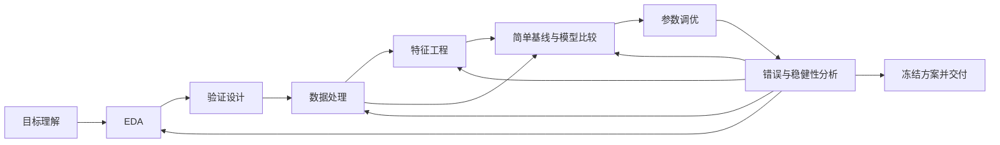

# Data Analyst Agent 工作流与实验工具修改规范

状态：A–D 的工程实现与回归验收已完成（2026-11-07）；E 的真实模型评估尚未启动，需要另行登记预算。首版内部搜索采用显式、有界的候选列表。

目标是持续打造能够理解数据、设计可靠实验、形成有效机器学习方案并稳定交付的 Data Analyst Agent。Meta 根据 Target 的实际运行轨迹发现能力缺口，改进工作流、提示词、技能及实验记录工具；Target 在工作流引导下自主完成分析与建模。

本提案替换旧规范中以 draft/debug/improve/select 为主要研究结构、把实验历史塞入提示词、Meta 不能修改实验工具的设计。保留研究事实、预算、评估与源码身份的可追溯能力。本文只定义修改方案，不启动新实验，不改写此前 25 次实验。

相关依据：[现有规范](/Users/tangyehui/gear/docs/data-analysis-harness-spec.zh-CN.md)、[25 次实验记录](/Users/tangyehui/gear/tmp/titanic-astra-max-20261106/experiment-summary.json)、[实际 Target 输入](/Users/tangyehui/gear/tmp/titanic-astra-max-20261106/target-prompts/round-5-slot-5.complete.txt)、[最终重训记录](/Users/tangyehui/gear/tmp/titanic-astra-max-20261106/project-v4/research/exports/run_db5faa429ab043ef8cfda3221a32de85/output/receipt.json)。

## 1 要解决的问题

| 当前设计或实际行为 | 修改要求 |
| --- | --- |
| Meta 主要围绕摘要、失败恢复和解释审计修改提示词 | Meta 以分析能力和最终交付质量为目标，从完整可观察轨迹诊断问题；记忆优化只是可选手段 |
| Target 按单个 improve 操作推进，缺少清晰的完整分析框架 | 提供从目标理解到最终交付的可组合工作流，并保存各阶段状态 |
| 默认限制一个机制、一个候选、单点参数变更 | 允许有预算的模型比较、参数搜索、特征组合与集成；需要归因时再使用单项消融 |
| 多份长提示词和大量历史摘要同时注入 | 主提示词保持简短，按需加载阶段指导；历史通过工具检索 |
| 实验事实、解释、选择和成本散落在长文本中 | 统一记录格式，事实自动采集，Agent 只补充简短的意图、解释和下一步 |
| 当前实验查询按固定 offset 返回记录，提示词却提到按 ID 查询 | 工具正式支持 ID、条件检索、分页和可比较性检查；提示词引用真实 schema |
| 最终提交执行带内部搜索的程序，重训时重新选择了 Title 编码 | 搜索与最终训练分离，交付冻结已选配置，不能只冻结源码 |

研究阶段 570 行五折比较选择了稀有 Title 合并，完整 891 行重训却重新比较并选择不合并。这是已确认的执行差异，不据此断定它造成官方分数下降。用户反馈的官方分数为 0.77511，尚未由系统独立读取。

## 2 角色与优化目标

### Meta

Meta 的优化对象是一套完整分析能力：工作流、阶段指导、可复用技能、实验工具、历史检索和交付方法。它应发现分析中的遗漏、错误假设、不恰当验证、低效搜索、未利用的证据及交付不一致，并实施能改善这些行为的修改。

Meta 可以加入通用的特征构造、模型选择、调参和交付模板；有领域条件的技能明确标注适用范围。任务专属训练源码和预测仍是 Target 的运行产物，领域技能不携带任务答案或测试标签。

主要评价依据是在相同任务起点和资源预算下，Target 实际交付方案的有效性、质量与稳定性。数据理解、验证合理性、搜索覆盖、成本和可复现性用于诊断。提示词长度、报告字数、阶段完成数量和自报审计结论不能替代结果质量。

“最好的 Data Analyst Agent”是跨任务持续优化目标。Titanic 是一个开发案例；对泛化能力的结论需要来自不同数据来源的任务。首版聚焦表格监督学习，同时让 EDA、处理、记录和工作流组件可复用于其他分析任务。

### Target

Target 是具体任务的分析者。它负责理解问题、分析数据、设计验证、处理数据、构造特征、比较模型、调参、分析错误，并形成可复现的训练与预测 pipeline。

Target 可以根据当前证据决定组合哪些步骤、回到哪个阶段，以及何时停止。已有分析仍适用时直接复用；新数据、变换或问题使结论失效时才重新执行相关步骤。

### 执行层

Gear 管理 harness 版本、研究 checkpoint、评估计划与比较结果。Hitch 继续负责真实运行、资源、轨迹和产物。固定执行层保存原始事实、计算正式指标、执行预算和数据权限；分析方法及实验记录工具的组织方式可以演化。

## 3 Target 的初始工作流

初始工作流包含下列九个阶段。阶段表示要完成的分析职责，不要求每次实验机械执行九遍。

| 阶段 | 主要工作 | 最小产物 | 后续去向 |
| --- | --- | --- | --- |
| 目标与任务理解 | 明确预测对象、分析单位、指标、约束、数据来源和交付形式 | task brief、成功标准、未解决问题 | EDA |
| EDA | 检查分布、缺失、重复、异常、标签、类别结构、群组/时间关系和潜在泄漏；按问题使用图表 | data profile、关键发现、待验证线索 | 验证设计、数据处理 |
| 验证设计 | 根据数据生成过程选择随机、分层、群组或时间验证；确定指标、基线和比较规则 | validation plan、适用范围 | 基线与后续全部比较 |
| 数据处理 | 修复已确认的数据质量问题，设计缺失、异常、编码及 train/predict 一致处理 | preprocessing spec、数据质量检查 | 基线、特征工程 |
| 特征工程 | 将领域知识、EDA 和错误线索转为特征，检查冗余与信息来源 | feature spec、比较或消融结果 | 模型选择、错误分析 |
| 模型选择 | 尽早建立简单可运行基线；根据数据和预算比较有差异的模型族与特征组合 | candidate pipelines、模型对比 | 参数调优 |
| 参数调优 | 对有潜力的方案定义搜索空间、方法、预算和停止条件 | search plan、trial 结果、已选参数 | 错误分析、交付 |
| 错误与稳健性分析 | 检查错误切片、折间差异、校准、漂移和失败输入；决定下一次投入 | error report、后续计划或停止理由 | 回到任一相关阶段，或交付 |
| 选择与交付 | 冻结特征、模型、超参数和预测处理；全量拟合、生成预测、检查格式、总结结果 | resolved pipeline、预测文件、简短报告 | 结束 |

图表只在帮助理解数据或比较结果时生成，不以图表数量衡量 EDA。清洗与特征工程分别记录：前者解决质量和表示一致性，后者提出新的可用信号。

模型选择阶段的简单基线应尽早运行，不等待所有特征工程完成。后续特征、模型和调参可以循环比较。概率校准、阈值选择和集成属于可选分析动作，使用训练内证据，并纳入预算和最终 pipeline；不是每次任务的强制步骤。



每个阶段保存 `status`、输入版本、产物引用、简短结论及复用/跳过原因。状态至少区分未开始、进行中、完成、复用、跳过、失败。工作流可以回退和分支，不能通过改一个状态把未执行步骤伪装成完成。

阶段产物的依赖被显式记录。例如数据范围或验证计划变化，会使相关的特征结论和模型成绩失去直接可比性；单纯修改展示模板不使模型结果失效。哪些事实仍可复用，由其输入身份决定。

## 4 Pipeline 的组合与最终冻结

Target 输出的机器学习方案由下列部分组成：

```text
PipelineSpec
  input_schema
  preprocessing
  feature_transforms
  estimator_or_ensemble
  hyperparameters
  prediction_transform
  training_seed
  code_and_dependency_refs
```

数据处理和特征变换应实现明确的 fit/transform 接口，训练与预测共用同一变换；学习到的统计量在对应训练范围拟合。训练内比较使用同一 validation plan，不能为不同模型挑选更有利的划分。

`SearchPlan` 与 `ResolvedPipeline` 分开：

- SearchPlan 描述模型候选、参数空间、搜索方法、trial/fit 上限及选择规则。
- ResolvedPipeline 描述已选的具体特征开关、估计器、参数、阈值和训练入口，引用产生该选择的实验及 variant。
- 最终 `refit` 只接受 ResolvedPipeline，在完整训练数据上重新拟合统计量和权重，不再比较模型、重新调参或更改特征开关。
- 代码可复用，配置必须显式。不能把“相同源码 digest”当成“相同选择结果”。

搜索由实验工具调度；最终训练使用单独的固定入口。执行前后核对实际参数清单与 resolved 配置，输出重训 receipt。若需重新选择配置，必须形成新的研究实验及选择记录。

## 5 简短且按需加载的提示词

所有提示词统一使用英文，Meta 后续新增或修改的提示词也遵循此约定。主提示词只定义目标、职责和工作方式。阶段提示词描述该阶段应解决的问题。参数类型、权限、预算计数、日志分页和输出上限由工具 schema 与运行时承担，不在每份提示词中重复。

初始 Meta 主提示词：

```text
Your goal is to continually improve a Data Analyst Agent that understands data, designs reliable experiments and delivers high-quality results.
Inspect authorized Target trajectories, code, artifacts and experiment records to identify analytical gaps, mistaken assumptions, inefficient searches or delivery problems.
Address the most valuable capability gap by improving the workflow, stage prompts, skills or experiment record tools. Prefer simplifying existing rules and write all prompts in English.
Provide evidence for the problem, concrete changes and a validation plan. Test improvements with Target runs from the same starting point and budget; retain the current harness when evidence is insufficient.
```

初始 Target 主提示词：

```text
You are a Data Analyst. Work toward the task objective through data understanding, validation design, data processing, feature engineering, model comparison, hyperparameter tuning, error analysis and delivery.
First inspect the current workflow state and relevant experiments. Reuse valid analysis and complete only the steps needed for this experiment.
Use the experiment tool to plan, execute and organize experiments, making progress based on evidence within the budget.
Deliver a reproducible pipeline, the required prediction files and a concise conclusion.
First call task_inspect. Seal this rollout with rollout_finish.
```

阶段初始提示词如下；工具调用参数和详细检查项放在对应技能/工具说明中，按需读取。

| 阶段 | 初始提示词 |
| --- | --- |
| 目标理解 | Clarify the question, prediction unit, metric and deliverable. Record constraints and unknowns that affect the method. |
| EDA | Identify data properties and quality issues that affect modeling. Support findings with statistics or plots and propose testable leads. |
| 验证设计 | Choose inner validation based on sampling, groups and time structure. Describe the deployment scenario and distinguish the fixed shared evaluation from inner validation. |
| 数据处理 | Address confirmed data quality issues and keep training and prediction transformations consistent. Fit learned transforms only on the relevant training partition. |
| 特征工程 | Turn findings and error patterns into testable features. Preserve a baseline; an early simple baseline can skip feature expansion. |
| 模型选择 | Build a working baseline early, then compare different model families within budget. Use the same inner validation for all candidates. |
| 参数调优 | Declare a bounded candidate space, fit budget and stopping rule. Record every trial and choose parameters using comparable training evidence. |
| 错误分析 | Locate stable error patterns and unreliable conclusions. Decide which stage to revisit, what evidence is needed, or when to stop. |
| 交付 | Freeze the exact pipeline and parameters. Delivery fits that configuration, produces and validates predictions; describe results and limitations. |

默认主提示词控制在一屏内，每阶段一至三句话。长度是可读性约束，不是优化奖励。模型实际只加载当前阶段及必要依赖；不再一次性注入所有 operator、技能与完整历史。

取消通用默认要求中的“只能一个 challenger”“只能单项参数变更”“每次必须写 Mechanism audit”“必须使用相同首折”“最后一次不能做任何组合”。它们可以作为特定问题下的分析策略，不再支配全部研究。资源并行度由实际分配决定，不在通用提示词中硬编码为单线程。

运行时生成的工具指导必须与实际可用工具一致。移除当前系统提示中对不可用 read/bash/web_search 等工具的泛化指令；统一展示当前工具名及 schema。

## 6 统一实验工具

对 Agent 暴露一个 `experiment` 工具，以 `action` 区分操作。数据检查和源码编辑继续由各自工具完成。实验工具负责执行、事实收集、检索与整理，避免让 Agent 维护多套平行账本。

保留 `task_inspect` 作为入口，但它只返回任务 brief、当前阶段、阶段状态、预算、当前选择和相关证据引用。需要时再读取当前阶段指导与完整记录，不再把全部指导文件和历史同时返回。`experiment.record` 可提交带输入/产物引用的阶段更新；运行时校验后更新工作流状态。

| action | 输入重点 | 输出与行为 |
| --- | --- | --- |
| `search` | 数据/验证范围、阶段、模型、状态、关键词、排序、cursor | 可分页的统一摘要；返回总数、覆盖范围和过滤条件 |
| `get` | experiment ID、所需 sections、artifact cursor | 完整记录、版本、源码和证据引用；显式区分摘要与原文 |
| `compare` | experiment/variant IDs、metric、validation scope | 同表比较；指出不可比较项、缺失证据和成本差异 |
| `record` | 分析发现、计划、阶段产物或解释 | 追加分析记录，不接受伪造执行成绩；可记录尚未训练的 EDA 结论 |
| `run` | pipeline/search plan、validation plan、预算 | 冻结计划、登记实验、运行并自动保存每个 trial、fold、失败和正式评估结果 |
| `select` | experiment ID、明确 variant ID、选择理由 | 核对可用证据并生成 ResolvedPipeline；记录保持原方案或采用新方案 |

`run` 支持有界的模型比较和调参计划。先声明候选范围/搜索空间、选择规则和最大工作量，再执行；动态搜索的每个实际 trial 继续追加记录。内部搜索与正式共享验证分开，不能让每个参数组合额外查询共享验证标签。

一次 `run` 先在训练内选择并冻结一个 variant，再执行一次正式共享验证。该次正式分数不能触发同一实验中的再次搜索或改选；新的候选需要下一次实验。正式选择必须引用被评估的具体 variant，不能把其分数赋给同一源码内其他配置。

`record` 和 `search` 不算一次模型实验；实际模型拟合必须经过受计量的执行路径。`record` 无权将自报分数登记为权威指标。预算、幂等执行和结果绑定由工具内核自动完成，不要求 Target 手工拼装 digest 或 receipt。

工具形式示例，以下是拟议 API，不是当前已经提供的接口：

```json
{
  "action": "search",
  "filters": {"stages": ["model_selection", "tuning"], "status": ["completed", "failed"]},
  "scope": "compatible_checkpoint",
  "view": "summary",
  "cursor": null
}
```

“查全部历史”是完整可检索，不是把全部历史放进一个 prompt。分页必须能遍历授权范围内所有成功、失败、平局、被拒绝和未晋升分支记录。其他验证计划的记录可作参考，工具不能把它们混入同一成绩排序。

成对评估运行中的 Target 只能读取共同 checkpoint 及本分支新增历史；阶段封存并按规则合并后，才可检索其他分支新增记录。Meta 可以读取其被授权诊断的分支轨迹，权限范围由执行层提供。

## 7 实验记录统一格式

每条记录分为 Agent 的意图/解释、执行层事实和派生视图。Target 通常只需填写目的、主要变化、结论和下一步；ID、输入身份、实际配置、成绩、耗时、文件引用和 trace 位置自动采集。

| 字段组 | 内容 | 写入方 |
| --- | --- | --- |
| identity | experiment/variant/run ID、harness/workflow/tool 版本、父实验、时间 | 执行层 |
| scope | 数据范围、验证计划、metric、checkpoint、可见历史范围 | 执行层 |
| intent | 本次目标、相关阶段、拟改变内容、选择该方向的依据 | Target |
| plan | pipeline/search plan、候选范围、预算、停止及选择规则 | Target 提交，工具校验并封存 |
| execution | 状态、实际 trial/fit 数、每折结果、成本、错误、取消与重试 | 执行层 |
| variants | 每个候选实际配置、预测及内部评估引用 | 执行层 |
| formal_evaluation | 被正式评估的具体 variant、正式分数、范围、receipt | 评分器与执行层 |
| decision | 内层选中项、外层采用/保留、最终 ResolvedPipeline、各自理由 | 执行层保存决定；解释标明 Target 来源 |
| notes | 简短结论、局限、下一步、分析发现及更正 | Agent，追加版本 |
| artifacts_and_trace | EDA 图表、代码、预测、日志及可定位的轨迹引用 | 工具与产物采集器 |

默认展示为：`ID｜目标/改动｜实际候选｜内层结果｜正式结果｜采用情况｜成本｜下一步`。详情展开后展示数据处理、特征、模型、参数、逐折结果和证据。

必须区分四种常被混淆的结果：候选执行失败；候选内层落败并回退；候选内层获胜但正式验证未晋升；候选被正式采用。相同正式分数不能自动解释为相同候选或没有新训练。

原始执行事实追加保存；解释可以追加更正版本。`null` 表示未知，不按零处理。摘要、图表和索引均能追溯到原始记录；缩短展示不删除原文。

旧 `analysis-experiment@1/@2/@3` 保留原记录，适配成新视图，不重写旧 digest。新记录使用明确的新版本；旧数据缺少 stage、variant 或实际配置时标记 unknown，不用推测填满。

## 8 Meta 可以修改实验工具的哪些部分

新增可编辑的实验工具实现目录，纳入 harness 版本。Meta 可以改进：

- 记录的扩展字段、分析笔记 schema 和标准化方式。
- 应用层存储组织、压缩、分区、索引、缓存及其迁移代码。
- 检索、过滤、排序、比较和摘要策略。
- 展示模板、表格、图表、详情展开和按阶段生成的上下文。
- 工具说明及向 Agent 呈现的参数界面，通过兼容适配器连接稳定内核。

工具由两个部分构成：

| 部分 | 可修改性 | 职责 |
| --- | --- | --- |
| 实验工具插件 | Meta 可编辑 | 记录组织、派生存储、扩展 schema、查询与展示 |
| 固定实验内核 | Meta 不修改 | 权限和预算、受计量执行、正式评分、原始事实与产物保存、身份校验 |

插件可维护自己的 JSONL/数据库、压缩副本和索引，但原始 receipt、预测及运行证据不被覆盖。插件不能改变正式成绩、隐去失败成本或把缓存命中伪装成新训练。读取原始事实通过受控接口，插件不直接操作 Hitch 私有存储。

存储/schema 变更必须带版本及迁移办法：旧记录可读；失败迁移不破坏源数据；索引可重建；完整导出保留全部记录与原始引用。恢复旧 harness 时，可读旧版本或从原始记录重建自己的视图。

这允许 Meta 真正优化实验工具的存储和展示，同时保持比较依据稳定。工具插件与 Target 生成代码同样受运行资源和可见数据范围约束。

## 9 Meta 如何使用 Target 轨迹

每轮 Meta 先读取运行概览，再按问题查询阶段事件、工具调用/结果、源码变化、EDA 产物、搜索轨迹、选择与最终交付。仅提供 history 摘要不足以支持诊断。

通过 Gear 到 Hitch 的现有公共轨迹接口读取，绑定 run、canonical digest、seq 范围与字段路径。每个分析阶段和实验记录都能跳转到相关轨迹。长日志与历史可分页；Meta 可以继续取原文，不能只看到固定截取的前几条记录。

诊断使用可观察动作、工具结果、代码和显式解释，不依赖模型私有思维链。缺少日志时记录证据缺口，不把缺失推断为某阶段一定没有执行。

每个有实质改动的 Meta 提案只需要一张简短的问题卡：

```text
能力缺口：分析在哪一步不充分，影响了什么。
证据：相关实验、轨迹位置和产物；区分观察与推测。
修改：需要改工作流、阶段提示、技能或工具中的什么。
预期：Target 应出现什么更合理的行为，如何检查。
验证：回放/工程检查，以及需要什么真实对照预算。
```

Meta 可同时修改一个能力所需的多个文件，不限制为一个参数或一句提示。它也可以删除累积的规则、合并阶段、调整顺序和改进工具，而不必每轮新增约束。

例如：看到 Target 反复局部调参而没有模型族比较，可以改模型选择和预算分配；看到 EDA 已识别群组但验证未使用，可以改 EDA 到验证设计的衔接；看到候选回退被历史摘要掩盖，可以改实验记录与展示。是否改善最终结果仍需运行验证。

## 10 预算与 harness 评估

明确区分阶段、Target rollout、逻辑实验、候选 trial 和模型 fit。首版迁移保留一个 Target rollout 对应一个逻辑实验；工作流状态跨 rollout 继续，一个实验可以执行多个相关阶段。以后若解除这一对应关系，需要新的预算协议，不能静默重解释已授权次数。

单个逻辑实验可以包含有界模型比较或参数搜索。工具在执行前显示候选/trial 上限、fold 数、预计 fit 上限和重训预留；执行后报告实际值。所有拟合与分析消耗计入资源预算，不能用“一个实验”隐藏无界搜索。

对已有 5 轮、每轮最多 5 个 Target 实验的设置，两种模式必须显式区分：

| 模式 | 5 轮的 Target 实验上限 | 允许的结论 |
| --- | ---: | --- |
| 顺序改进：每轮运行一个新 harness | 25 | 展示累计研究进展和行为变化；不能归因于 harness 本身 |
| 配对比较：每轮旧、新 harness 各 5 次 | 50 | 在同 checkpoint、模型、数据和资源上比较 harness 的开发效果 |

配对模式不能用旧 harness 在较早 checkpoint 的成绩替代当前对照。Meta 查看新分支结果后，不能再修改已经参与该次对照的候选而沿用原分数。多任务评估按任务报告原始指标；跨任务归一化和汇总规则在评估前固定。

记录格式检查、历史回放和工具回归测试可以验证工程与行为合同；它们不能代替真实 Target 对照。观察到阶段执行更完整，也不等于模型质量已经提高。本次旧预算已经用完，新 spec 的真实运行另行登记，本文不自动扩大实验额度。

## 11 实现位置与迁移

以当前工作区 `examples/data-analysis-harness/` 为实现入口。本次隔离执行 checkout 将相关实现放在 `examples/mle-bench/`；实施时按组件职责对齐，保留一套分析引擎，MLE-bench 适配目录负责数据/评分接入。

拟议 harness 布局：

```text
harness/
  workflow.yaml
  prompts/
    meta.md
    target.md
    stages/{task,eda,validation,processing,features,models,tuning,errors,delivery}.md
  skills/
  workflows/research/
    policy.py
    memory.py
  tools/experiment/
    interface.json
    records.py
    storage.py
    query.py
    render.py
    migrations/
```

| 实施位置 | 修改内容 |
| --- | --- |
| `target-carrier/fixed/target-loader.js` | 按实际工具注册生成指导，接入统一 experiment facade，阶段指导按需加载 |
| `target-carrier/fixed/driver.mjs` 与 worker | 阶段状态、受控实验内核、trial/variant 记录、resolved 配置执行 |
| `target-carrier/harness/` | 初始工作流、短提示词、实验工具插件、检索式 memory |
| `lib/contracts.mjs`、schemas 与 store | 新记录和 resolved pipeline 合同、旧记录适配、版本与迁移 |
| `lib/hitch-backend.mjs` 与 Meta evidence 接入 | 分页轨迹/产物读取、实验到轨迹的定位，不读取 Hitch 私有目录 |
| `refit.mjs` | 只执行冻结配置，禁止在交付路径重新搜索和选模型 |
| Meta candidate 检查与封存 | 扩大允许编辑范围到 workflow 和工具插件；绑定所有影响行为的文件版本 |

`draft/debug/improve/select` 作为旧记录标签保留，不再作为 Target 顶层工作流。旧实验接口通过兼容适配器保留；新 prompt 只引用新接口。`memory.py` 逐步改为相关记录检索和上下文组装，不再复制整段历史解释。

这次修改不要求重构整个 Gear 控制面，也不创建新的 Kaggle 专属评测控制 API。Hitch 只在现有公共轨迹/产物接口确实缺少必需能力时补接口；分析策略与记录工具插件留在 Gear harness。

## 12 实施阶段与验收

| 阶段 | 交付 | 验收重点 |
| --- | --- | --- |
| A 记录与冻结合同 | 统一记录、variant、ResolvedPipeline、旧记录适配 | 能准确解释此前 25 次实验及最终配置变化 |
| B 工作流与短提示词 | 九阶段初始流程、状态与产物依赖、按需上下文 | Target 能从基线完成建模并在后续 rollout 复用已有分析 |
| C 可进化实验工具 | search/get/compare/record/run/select、插件存储与展示 | 所有历史可检索，事实与解释分离，存储变更兼容 |
| D Meta 轨迹闭环 | 轨迹定位、问题卡、插件编辑与检查 | 能从实际行为提出并实施针对能力缺口的修改 |
| E 真实评估 | 预登记的同起点对照及跨任务检查 | 报告真实质量、稳定性、成本和行为变化，不把单案例涨分泛化 |

必需验收案例：

1. **工作流覆盖与复用**：冷启动形成任务理解、EDA、验证和基线；后续只修改特征时，能复用仍适用的画像与验证，不重复拟合无关阶段。
2. **验证与变换一致**：一个存在群组/时间结构的样例能触发对应验证策略；学习型变换只在各训练分区拟合，预测时使用相同 pipeline。
3. **真实模型探索**：预算足够且数据支持时，能进行模型族比较和有界调参；没有把单 challenger 或单参数限制继续写成通用规则。
4. **记录完整**：导入本次 25 次实验后，可检索 24 次有效运行和 1 次失败；内层失败、正式验证失败、平局、晋升均正确展示，不能把回退成绩误认成候选成绩。
5. **精确查询**：按 ID 直接取回记录；分页遍历无遗漏/重复；不同验证计划不直接排序，缺失值保留 unknown。
6. **工具演化**：Meta 修改记录扩展字段、存储索引或展示后，旧记录仍可查询，原始分数与失败成本不变；迁移失败可以回到旧版本。
7. **上下文有界**：25 条和更长历史均可分页访问；默认只注入相关摘要及当前阶段指导，无静默截断，能按引用取得完整原文。
8. **轨迹诊断**：从实际轨迹定位一个分析遗漏，提出对应工作流/工具改动，并在后续可观察行为中检验；不能只提交一段更长的 prompt。
9. **最终配置不漂移**：使用一个训练数据扩大后搜索结果会反转的回归样例，确认 refit 仍执行冻结的配置，search 调用数为零；明确记录全部重训 fit。
10. **预算与证据**：工具运行失败保留记录和消耗；重复请求不产生免费重跑；25 次顺序模式与 50 次配对模式在计划及报告中不混淆。

工程验收通过说明新流程可运行、可复现且记录可信。只有预登记的真实对照和后续独立任务评估，才用于判断 Data Analyst Agent 的分析与建模能力是否提高。
