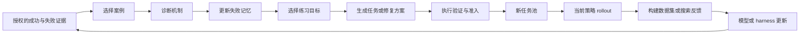

# gear.curriculum：Failure → Data 独立能力包设计

状态：本分支已实现基础与扩展算子、四类生成合同、监督提案、可信数据构建和 CPU 调用方闭环，并接入正式 `ReflectiveSearch`；见[当前 API](curriculum.zh-CN.md)与[逐项验收台账](curriculum-implementation-status.zh-CN.md)。完整论文配方与效果实验按台账验收，不是 0.2.4 已发布 API。

本版本范围（2026-11-20 更新）：**不做 GPU 训练。** 继续交付独立 curriculum 算子、无 GPU 的数据生成／验证配方、固定模型权重的 harness 改进和真实 LLM 对照。已有 CPU 更新、训练合同及 DiagEvo 编排保留其实际验证边界；GPU 权重更新、训练节点部署、跨节点训练制品准备、论文规模训练证据保留与 GPU 效果实验列为后续工作，不作为本版验收条件。下文的训练路线仍是完整设计，不能因本次范围调整将尚未实现的能力改标为完成。

核验日期：2026-11-19。版本基线：本地 Git 标签 `v0.2.4`，commit `e4c3e8b1cd459c12ca0705ff46493e1e6096790c`。实现分支 `codex/curriculum-foundations` 从本地 `dev` commit `37aeed4714fb8efa4e88255c3ed87323f1d29e01` 创建，版本为 0.2.4；原工作区已有修改保持原状。

## 1. 开源核验与采用方式

“有论文”“有 GitHub 页面”“有可运行源码”分别记录。未找到代码只表示本次未核实到官方实现，不断言不存在。以下没有运行上游训练或复现效果。

| 方法 | 核验状态 | License / 采用方式 | 一手来源 |
| --- | --- | --- | --- |
| DataEnvGym | 有实际源码、示例和测试 | MIT；优先参考 teacher/engine、技能组织与数据生成接口 | [项目](https://dataenvgym.github.io/)、[代码](https://github.com/codezakh/DataEnvGym) |
| TRACE | 有环境生成提示词、pipeline、训练与路由源码 | MIT；环境生成依赖 coding agent 执行提示词，不是独立的纯 Python 生成函数 | [代码](https://github.com/ScalingIntelligence/TRACE)、[论文](https://arxiv.org/html/2604.05336v2) |
| Agent-R | 有 MCTS、路径采集源码；仓库已归档 | Apache-2.0；训练依赖外部工具链，优先参考轨迹构造机制 | [代码](https://github.com/ByteDance-Seed/Agent-R)、[论文](https://arxiv.org/abs/2501.11425) |
| GEPA | 有可运行优化器 | MIT；作为 prompt 搜索与反思模块的实现参考 | [代码](https://github.com/gepa-ai/gepa) |
| ACE | 有实际源码；部分 playbook 操作仍为 TODO | Apache-2.0；参考经验提取和增量 playbook 更新，按具体文件核对实现范围 | [代码](https://github.com/ace-agent/ace) |
| CoEvolve | 官方链接对应仓库当前主要是 README、图片和 LICENSE | Apache-2.0 文件存在，但没有据此确认完整训练实现；按论文实现参考机制 | [仓库](https://github.com/StoneHanaMori/CoEvolve)、[论文](https://arxiv.org/html/2604.15840v1) |
| Self-Direction | 官方提供精简代码片段与伪代码，明确不是直接运行的程序 | 未确认完整实现及其代码许可；作为设计参考 | [实现说明](https://self-direction.github.io/implementation.html) |
| Forge | 未核实到官方可运行实现 | 按论文重实现，并记录适配差异 | [论文](https://arxiv.org/html/2609.15209v1) |
| SENTINEL | 未核实到官方可运行实现 | 按论文重实现，并记录适配差异 | [论文](https://arxiv.org/html/2606.12908v1) |
| DiagEvo | 未核实到已发布的官方实现 | 按论文重实现，并保留多数投票伪标签的证据限制 | [论文](https://arxiv.org/html/2609.00768v2) |

采用源码时固定上游 commit、保留对应 license/notice，另记模型权重、数据和环境各自的许可；不从仓库代码许可推断这些资产的许可。

优先抽取的源码位置：

- [DataEnvGym open_ended.py](https://github.com/codezakh/DataEnvGym/blob/master/src/dataenvgym/gym/data_generation_agents/math/baselines/open_ended.py)：从 student 错题生成新训练样本，适合最小基线。
- [TRACE aggregate_capabilities.py](https://github.com/ScalingIntelligence/TRACE/blob/main/pipeline/aggregate_capabilities.py)：成功/失败能力标签的覆盖与差异统计；[environment_generation.md](https://github.com/ScalingIntelligence/TRACE/blob/main/prompts/general/environment_generation.md) 与 [calibrate_environment.py](https://github.com/ScalingIntelligence/TRACE/blob/main/pipeline/calibrate_environment.py) 分别对应生成和校准。
- [Agent-R path_collection.py](https://github.com/ByteDance-Seed/Agent-R/blob/main/path_collection.py)：修复轨迹和 loss mask 构造；原脚本的模型调用、环境与全局 RNG 必须拆开。
- [GEPA adapter.py](https://github.com/gepa-ai/gepa/blob/main/src/gepa/core/adapter.py)：`make_reflective_dataset` 的反思输入合同。
- [ACE playbook_utils.py](https://github.com/ace-agent/ace/blob/main/playbook_utils.py)：条目解析与计数更新；其中 UPDATE/MERGE/DELETE 的 TODO 不算已实现能力。

## 2. 必须保持的 0.2.4 设计

权威基线：[作者指南](https://github.com/rsi-gear/gear/blob/v0.2.4/docs/algorithm-operators.zh-CN.md)、[能力布局](https://github.com/rsi-gear/gear/blob/v0.2.4/docs/operator-capability-layout-spec.zh-CN.md)。

1. 0.2.4 已有公共能力入口为 `gear.core / evaluation / memory / training / search`；本设计新增与它们并列的 `gear.curriculum`，集中承载 failure→data 能力。完整算法继续放在 `gear.algorithms`。`gear.ops` 已移除，不重新引入。
2. 搜索算法采用 `Algorithm.step(view, state) -> Decision`。纯算子直接返回；副作用构造 `Call`，交由 runtime 执行。参数/子模块/资源进入冻结身份，状态显式保存。
3. 训练保留 `TaskSource → RolloutExecutor → DatasetBuilder → ModelUpdater` 四阶段，不强制改成搜索的 Call/Decision，不在纯搜索 worker 中直接运行训练。
4. `MetaInput` 当前要求真实 `CandidateRef + task_ids`。训练阶段不为复用 Meta 而伪造候选、任务或调用结果。
5. 搜索 run 的任务范围已冻结，`fresh` 只产生新执行样本，不产生新任务授权。`CommitLibrary` 也不会将任务文件自动注册成可执行任务。
6. `Score/unscored` 尚未开放；当前 rollout 的 blind 模式是显式 `scored_private`。依赖 counterfactual reset、树搜索、工具探索、LoRA 或路由的配方必须独立声明后端能力。
7. 原始执行事实、模型诊断、算法接受、任务准入、模型发布、champion 发布分别记录。LLM 的“valid=true”不能替代真实执行验证。

源码基线：[Meta](https://github.com/rsi-gear/gear/blob/v0.2.4/python/gear/core/meta.py)、[SearchView](https://github.com/rsi-gear/gear/blob/v0.2.4/python/gear/search/api.py)、[训练合同](https://github.com/rsi-gear/gear/blob/v0.2.4/python/gear/training/contracts.py)、[训练循环](https://github.com/rsi-gear/gear/blob/v0.2.4/python/gear/training/loop.py)。

## 3. 抽象目标

新增独立领域包 `gear.curriculum`，只提供 failure→data 的算子和输入输出定义：从执行反馈识别能力缺口、选择学习目标、构造练习和监督样本、解释验证结果。模型训练和 harness 优化的调用方直接组合这些算子，负责必要的格式转换、模型调用、执行和持久化。这里的独立指 Python 顶层能力包，随 Gear 发布；本次不拆分成单独的 PyPI distribution。

复用单位是可独立替换的决策或数据变换，不是一篇论文一个黑盒 `run()`。区分三种输出：

- **Practice tasks/environments**：新增问题、工具任务或环境，用于后续采样与优化。
- **Learning datasets**：已验证成功解、修复轨迹、偏好对、RL rollout groups、过程性问答。
- **Learning assets**：failure memory、playbook、adapter library；资产本身不等于任务或训练样本。



上图是调用方组织的完整流程，不是 curriculum 内置的运行流水线。生成、验证、训练由调用方沿用现有运行机制持久化和计量。一次失败可以同时触发 prompt 改进与新任务生成，但两条分支不能彼此假冒完成证据。

### 3.1 包职责与依赖方向

| 包 | 负责的能力 |
| --- | --- |
| `gear.curriculum` | 案例抽取、失败归因、失败记忆更新、练习选择、生成、验证和监督构造的算子及输入输出定义 |
| `gear.search` | harness/候选的父代、提案、排名、采纳与搜索流程；既有 sampling 只从已准入集合安排搜索评测 |
| `gear.evaluation` | 执行与评分证据、样本计划、比较与归约 |
| `gear.memory` | 通用历史与资产快照/发布；failure mode 的学习规则由 curriculum 定义 |
| `gear.training` | 训练格式编码、可信 token/mask/reward 构建、优化器与模型更新 |
| `gear.algorithms` | 已导出正式 `ReflectiveSearch`；完整 Forge、TRACE、SENTINEL 等方法按各自执行能力单独验收 |

按算子和数据定义组织；以下为目标布局，后续能力按实际实现需要创建，可继续合并：

```text
gear/curriculum/
  __init__.py          轻量公共导出
  contracts.py         算子输入输出的数据定义
  cases.py             案例提取、筛选、成功/失败对齐
  diagnosis.py         诊断模型输入构造与输出解析
  capabilities.py      能力字典、重复标签及覆盖／差异统计
  memory.py            FailureMode、错误原因和掌握状态更新
  selection.py         学习目标、预算分配和练习池选择
  generation.py        练习规划、任务/环境/修复/问答生成
  validation.py        验证计划与验证证据解释
  signals.py           可比执行历史中的遗忘、边界与稀有行为信号
  skills.py            子技能提案、技能树及其生成配额更新
  supervision.py       修复片段、偏好对、过程问答的语义提案
```

依赖要求：

- `curriculum` 只依赖轻量 `core` 合同及标准库；不导入 `search`、`training`、`evaluation`、`memory` 或完整算法。
- 完整算法或训练 stage 直接导入需要的算子，在调用处转换输入输出。首版不设独立转换层；多处出现相同转换后再考虑提取普通辅助函数。
- 单独导入或测试 `SelectLearningTargets` 不加载 Project、搜索 worker、训练后端或 GPU 库。
- 需要模型的算子提供输入构造与响应解析；需要环境验证的算子提供验证计划与证据解释。调用方使用现有 Meta/agent/Hitch 执行接口完成外部工作。
- 调用顺序、阶段、pending 调用和恢复位置保存在调用方已有的搜索 state 或训练运行记录中。curriculum 不定义通用推进协议、全局运行上下文或第二套调度状态机。

失败记忆和练习池是普通算子输入输出：调用方传入旧值，算子返回新值。算子不保存上次调用的隐式状态，也不持有 store、执行器、`SearchView` 或 `TrainingContext`。

来源标识沿用调用方已有的任务、证据和产物引用，算子只透传和关联它们，不新增统一引用体系。读取、摘要校验、授权和跨 run 导入由调用方负责。

## 4. 最小公共算子集合

下表为拟议能力，不新增按论文名分支的 TS 调度器。第一批只实现多个配方实际复用的部分。

| 算子 | 归属 | 输入 → 输出 | 执行性质 |
| --- | --- | --- | --- |
| `ExtractOutcomeCases` | `curriculum.cases` | 已归一化的执行/评分证据、筛选规则 → `OutcomeCase[]` | 纯；保持失败、不完整、基础设施错误的区别 |
| `ExtractLearningSignals` | `curriculum.signals` | 可比的时序 rollout 观测 → forgetting/boundary/rare 布尔信号 | 纯；保留三种条件与证据，不用软评分替代论文条件 |
| `ContrastiveDiagnoser` | `curriculum.diagnosis` | 成功/失败案例 → 诊断模型输入；模型响应 → 诊断 delta | `prepare / parse`；模型调用由调用方执行 |
| `ContrastCapabilities` | `curriculum.capabilities` | 同策略完整成功/失败 → 能力字典与独立标签输入；响应及多轮标签 → 能力评估 | 纯；完整矩阵、来源绑定、coverage/gap 与一致性筛选，不执行模型 |
| `SelectLearningTargets` | `curriculum.selection` | 模式/技能摘要、历史进展、预算、显式随机源 → 目标 ID 与预算分配 | 纯；frequency/frontier/forgetting 等为可替换策略 |
| `ProposeSubskills` | `curriculum.skills` | 技能树与训练案例 → 模型输入；响应 → 新子技能动作 | `prepare / parse`；限制 family 和失败引用 |
| `PlanSkillPractice` | `curriculum.skills` | 技能树、绑定版本的 explore/exploit 动作与预算 → 新树与学习目标 | 纯；拒绝负配额、超预算及越界更新 |
| `MergeFailureMemory` | `curriculum.memory` | 旧模式集合、诊断 delta、掌握度观测 → 新模式集合 | 纯；不自行调用模型或落盘 |
| `PlanPractice` | `curriculum.generation` | 目标、来源引用、生成参数 → `PracticePlan` | 纯；选择 task/trajectory/example/environment 及变异意图 |
| `GeneratePractice` | `curriculum.generation` | 计划、材料、生成配置 → 模型输入；模型响应 → 未准入 `PracticeDraft[]` | `prepare / parse`；调用方运行模型或生成环境的 agent |
| `ValidatePractice` | `curriculum.validation` | 草案、规则 → `ValidationPlan`；计划与执行证据 → `ValidationReport` | `plan / assess`；调用方执行环境验证，纯检查可直接计算 |
| `SelectPractice` | `curriculum.selection` | 已验证条目、旧池描述、重复/难度/探索规则 → `TaskPoolPlan` | 纯；输出选择计划，不赋予执行权限 |
| `BuildSupervision` | `curriculum.supervision` | 修复方案、独立验证、配对规则 → `SupervisionProposal` | 纯；给出语义片段、偏好关系、标签来源与证据，不制造 token/logprob |

`BuildLearningDataset` 继续属于 `gear.training`：它消费 curriculum 的监督提案及可信原始证据，按 SFT/preference/RL/example 合同编码并封存可训练数据。训练格式和梯度样本资格不进入 curriculum 核心。

这里的 `BuildLearningDataset` 表示训练侧职责，不另设统一包装类。调用方直接使用 `SFTDatasetBuilder`、`GRPODatasetBuilder` 以及 `gear.training.data.supervision` 下的修复、偏好、过程问答 builder。成功／前缀及修复 builder 的 `build_offline` 重新验证原始捕获与 proof，保留精确 token 和后缀 mask，封存为现有 SFT updater 的离线合同；过程问答使用真实 tokenizer 并保留 synthetic 侧录。偏好输出仍为中间数据，DPO 更新器与各配方 GPU 实测尚未完成。

`prepare / parse` 和 `plan / assess` 是对应算子的普通方法，不引入统一执行请求协议。模型输入包含具体 prompt、响应 schema 和允许材料；`parse` 只校验模型输出结构，不能将模型判断升级为执行证明。组件参数和提示词由调用方纳入冻结配置。语义去重、可学习性估计需要模型或 rollout 时也由调用方明确执行，不能藏在纯 `SelectPractice` 内。

调用方直接复用现有 `ReadArtifact / QueryHistory / Meta / Evaluate / Rollout / CommitLibrary / PublishLibrary`，不复制其传输、权限、恢复实现。专用执行组件留在具体调用方，例如 Forge 四向变异调度、DiagEvo 的 double-confidence 编排、TRACE 的 Python 环境启动和分组校准。能力字典与标签统计作为纯 `ContrastCapabilities` 算子提供；阈值由配方显式配置，不引入通用执行层。

## 5. 数据合同与归属

数据定义保留版本、来源和完整性。持久化时的内容摘要、产物存储和运行 state 由调用方管理。以下是算子输入输出的语义字段，不是可直接提交给 0.2.4 的 wire JSON。

| 类型 | 所属能力 | 必须表达的语义 |
| --- | --- | --- |
| `OutcomeCase` | `curriculum` | task/source family、样本/attempt、策略与环境身份、轨迹/反馈 refs、outcome、是否完整；成功、任务失败、基础设施失败、未知分开 |
| `FailureMode` | `curriculum` | 稳定 mode ID、机制描述、支持与反证 refs、覆盖范围、频次、状态、诊断器身份；描述是模型解释，支持证据是事实 |
| `Capability / CapabilityLabeling / CapabilityAssessment` | `curriculum` | 规范能力字典、绑定案例与算子的完整标注矩阵、逐轮覆盖／差异和一致性；标签是模型判断，不是因果证明 |
| `SkillTree / Subskill` | `curriculum` | 根技能及子技能、family 来源、支持案例和每轮请求生成量；不是可执行任务注册 |
| `SkillTreeAction / SkillPracticePlan` | `curriculum` | 旧树摘要绑定的扩展或配额增量、预算检查后的新树与学习目标；调用方持久化 |
| `PracticePlan` | `curriculum` | 目标 mode/skill、来源、预算、产物类型、mutation intent、生成器和验证策略身份 |
| `PracticeDraft` | `curriculum` | 指令、环境/附件/初始化、候选参考解、验证器材料、lineage；尚未取得 student rollout / training 准入 |
| `ValidationPlan` | `curriculum` | 待检查草案、规则、所需验证项与预期证据；不包含执行权限或调度状态 |
| `ValidationReport` | `curriculum` | schema/环境/可解性/目标忠实度/重复检查的逐项结果、证据 refs、验证版本、缺失与拒绝原因 |
| `TaskPoolPlan` | `curriculum` | 选择的已验证条目 ID、权重、任务槽、原池版本、适用策略版本；无文件 I/O |
| `SupervisionProposal` | `curriculum` | 监督形式、来源案例、语义片段/偏好关系、标签性质、验证证据；不是已准入梯度样本 |
| `LearningDatasetManifest` | `training` | 数据格式、来源池/轨迹、行为策略、标签性质、tokenizer/masks/reward 证据、builder 身份 |

curriculum 领域类型集中定义在其轻量合同模块。调用方从已有评测结果构造案例，保存失败记忆，解释任务选择，并将监督提案交给训练 builder。`core`、`evaluation`、`memory` 不为承载本功能反向导入 curriculum，也不加入 FailureMode 或课程评分策略。选择结果仍需调用方确认任务已准入，不能扩大 `view.tasks`。

失败记忆的状态迁移为 `active → mastered → active`，另可标记 `unresolved`。是否掌握由显式测量规则决定；未再出现不等于掌握。伪标签一致性测量标注为 self-consistency，不能标作外部 verifier 证明。

Task pool 的来源 family 不能通过更换 task ID 跨越 train/dev/test 边界。验证集聚合分数可以按授权用于停止/选型；私有任务内容、答案、轨迹不能进入生成器。最终测试集不用于课程选择。

## 6. 调用方接入方式

### 6.1 训练调用方

调用方在自己的 `TaskSource.generate(ctx)` 实现中直接组合算子：从授权训练历史构造案例，组织诊断和生成调用，执行验证，最后将选择结果转换成原 rollout executor 要求的任务格式。第一轮没有历史时使用种子任务，不能虚构 failure。

TaskSource 继续返回既有任务格式，不增加公共结果封套或包装 executor。失败记忆、练习池描述和生成报告由该调用方另存于其运行记录或 stage 工作目录，并绑定原 operation/input 身份；恢复或复用阶段结果时同步核对这些记录，缺失或不一致则明确报错。不能依赖上次 Python 实例属性，也不假定 TrainingLoop 会自动恢复调用方新增的记录。

现有 controller 的 `AgentTaskSource.tasks(rollout_id)` 与公共 `TaskSource.generate(ctx)` 是不同接口。使用哪条路径，由具体训练配方决定并在调用处转换参数；curriculum 不提供它们的统一包装。[现有 stage](https://github.com/rsi-gear/gear/blob/v0.2.4/python/gear/training/adapters/stages.py)

保留外层四阶段：

```text
调用方的 TaskSource（组合 curriculum 算子）
  → existing RolloutExecutor
  → SFT / preference / GRPO-specific DatasetBuilder
  → existing or capability-declared ModelUpdater
```

当前 `TrainingLoop` 只封存已完成 stage。TaskSource 内多次收费调用由该 stage 利用现有 runner/运行记录保存子调用身份和结果；恢复先核对未知执行，再复用已完成结果。不能因为外层有 journal 就声称内部 generate/verify 自动 exactly-once。curriculum 不管理这些调用记录。

训练 stage 使用现有 agent runner 和受控执行路径。调用方把算子产生的 prompt/schema/材料转换成该路径需要的输入，不直接执行搜索 `Meta` 返回的 Call，也不伪造搜索候选。

**调用方负责冻结配置。** 0.2.4 的 `stage_identity` 不自动读取 Module 嵌套参数；训练调用方需将实际算子参数、prompt/schema 和资源摘要放入现有 `TrainingConfig.parameters` 等持久身份材料，源码/包依赖按既有机制声明，并绑定实际使用的资源字节。相同源码但配置变化也必须拒绝恢复旧 run。运行中 memory/pool 是状态，不能混入构造配置。[身份实现](https://github.com/rsi-gear/gear/blob/v0.2.4/python/gear/training/runtime/implementation.py)

训练 CAS 引用与搜索 `core.ArtifactRef` 不假定 wire 兼容。跨运行复用材料时，调用方通过已有导入路径验证 owner、摘要、可见性和用途；普通 dict 字段名称相同不构成授权。

纯文本训练配方须匹配实际 executor 的输入合同。例如 DiagEvo 使用固定的 `model-call` harness，先协商 Hitch 的文本训练能力，并由任务创建方把冻结消息转换成 candidate input；不能用发送工具定义的 `training-tool` 冒充纯文本采样。真实 runner、代理和原生网关的合同验证与 GPU 更新／效果验收分别记录，详见 [DiagEvo 接入边界](training/diagevo.zh-CN.md#原生文本-harness-合同)。转换仍留在调用方，不增加 curriculum adapters。

### 6.2 Harness 搜索调用方

搜索算法在现有 `step(view, state)` 中调用算子，把模型输入转换为真实 `MetaInput` 和 Call，并用已有 state 保存 pending 引用；获得响应后再调用解析和选择算子。读取材料、保存记忆和执行评测均直接使用既有能力。

生成的新任务先输出为待准入资产。最小可运行路径在外层调用流程中封存、验证新任务，并在**下一个新 run** 的 admission 固定扩展训练任务集；显式导入选中的候选和允许资产，保留原 run 身份。

跨 run 使用同一外部固定验证/测试方案衡量收益，不把扩展训练池导致的分数变化当成直接可比结果；现有 run 的独立 gate 不被任务生成器修改。这个路径是 Forge-inspired 分轮适配，不声称完整复现 Forge 的单 run 动态池。

同一搜索 run 内扩展任务池是后续框架能力：需要显式 task-pool admission 合同、池快照引用、预算、版本与恢复。新增能力须更新 wire schema、requirements 和 runtime 支持，不能把任务生成塞进 `candidate`、普通 `library`、`fresh SamplePlan`，或只改 `SearchView.tasks`。

0.2.4 `Meta` 不执行 benchmark/工具环境探索。SENTINEL 的参考执行和 TRACE 的生成环境校准必须由调用方安排在明确支持的任务构建/验证执行通道，不能绕过 Meta 的只读边界。

## 7. 验证与训练数据的关键区别

`ValidatePractice` 至少分别返回：结构有效、环境可启动、目标与检查一致、参考执行可行、确实针对指定能力、去重结果。没有参考解的任务可以保留为探索候选，但不能冒充“已证明可解”。语义验证与执行验证的证据等级分别标注。

草案的执行验证先取得有限的 `validation-only` 授权，绑定封存草案摘要、允许的资源/工具/网络、验证器与预算。它不授予 student rollout 或梯度训练资格；验证结果通过后，再由调用方完成任务封存和准入。基础结构检查失败的草案不进入执行验证。

生成器编写的 verifier 也需验证：用已知正确轨迹、错误轨迹和简单作弊策略做校准；否则生成器与 verifier 可能共同接受错误任务。验证需绑定实际封存环境，不能只验证生成前的草稿。

数据构建按目标分开：

- **SFT 成功/前缀**：复用可信 `SFTDatasetBuilder`，需要独立 success/prefix proof。最终失败分数不能定位第一个错误步骤。
- **Agent-R 修复**：上游会拼接失败前缀、反思标记和正确分支；失败前缀 `loss=False`，修复后缀 `loss=True`。Gear 的加强验收要求明确 reset/checkpoint 回退，或从真实失败终态继续修复，再取得执行证据；这是适配要求，不宣称上游已经实现 verified replay。拼接字符串不证明轨迹可执行；修改后的轨迹重新生成捕获，不继承旧 logprob。
- **Preference**：trajectory pair 绑定相同任务和起始条件，允许后续历史分叉；step pair 则绑定相同决策前缀/状态。明确比较依据与标签来源；DPO 更新器是独立能力，当前 SFT/GRPO 支持不等于 DPO 已支持。
- **GRPO**：使用当前 behavior policy 的完整 rollout group 和可信 reward/token/logprob；不能按成功筛掉组内失败，也不能把 teacher 的参考轨迹作为当前策略 on-policy 样本。
- **Self-Direction 过程问答**：合成问答标作 synthetic procedural examples，通过专用离线数据合同编码；不能伪造 native trajectory receipt 或 success proof。LoRA 训练、加载、路由需分别有实现和能力声明。

生成监督额外声明 `feedback_only / verified_reference / gold_answer_allowed`，由宿主授权决定可见材料，配置不能自行放宽权限。Self-Direction 官网示例包含 `failure.gold`，论文附录 F.2 则声明不提供 gold-answer tokens；实现时需选择并记录具体监督协议，不能笼统宣称与论文完全一致。[官网片段](https://self-direction.github.io/implementation.html)、[论文附录](https://arxiv.org/html/2610.31846v1)

参照：[可信 builders](https://github.com/rsi-gear/gear/blob/v0.2.4/python/gear/training/data/builders.py)、[训练 stage 约束](https://github.com/rsi-gear/gear/blob/v0.2.4/docs/training/stages.zh-CN.md)。

## 8. 论文到算子配方的映射

| 完整方法 | 共用组合 | 专用策略 / 复现缺口 |
| --- | --- | --- |
| Forge | OutcomeCases → diagnose → FailureMemory → PlanPractice → Generate/Validate → SelectPractice → harness search | 训练失败建库、验证停滞触发、四类变异；单 run 动态任务池需扩展 |
| DataEnvGym | student feedback → ProposeSubskills → PlanSkillPractice → Generate/Validate → training loop | skill-tree explore/exploit 算子与 CPU 调用方已实现，LLM/GPU 效果另验收；这是 teacher 环境框架，不当成一个固定策略 |
| SENTINEL | failure memory → target directives → reference execution → task construction → validation → mixed pool → GRPO | [retail 调用方](../examples/curriculum-harness/SENTINEL.zh-CN.md)已接 solver 执行与评分、跨轮失败记忆、真实参考重放、native 校准、混合池与新的正式搜索 run；CLI／worker、候选约束、三组对照及具名训练任务 mastery 探针通过模型替身集成；探针绑定当前策略与全部支持任务，未知不当失败、重复失败重新激活且不增加诊断频次；真实模型效果仍待验收；GPU GRPO 列后续 |
| CoEvolve | policy-aligned history → forgetting/boundary/rare selection → environment exploration → task-solution generation → harness search | [retail 调用方](../examples/curriculum-harness/COEVOLVE.zh-CN.md)实现完整来源重放、三信号消融、多次独立探索、轨迹聚合、native 校准与正式搜索接入；signal 条件保留成功来源，不伪造失败；替身集成与真实模型效果分别验收，论文环境与 GRPO 列后续 |
| DiagEvo | solver samples → error-cause diagnosis → active/mastered memory → mixed practice generation → confidence filtering → training | 多数票伪标签、双置信度过滤、状态迁移；不宣称 oracle 正确性 |
| TRACE | success/failure contrast → capability selection → executable environment generation/calibration → per-capability RL → adapter composition | [无 GPU 调用方](../examples/curriculum-harness/TRACE.zh-CN.md)实现规范字典、多轮标签、能力筛选、独立 Python 环境隔离与 rollout 校准；新 seed 练习接入混合池和正式搜索，验证／测试维持原始环境。真实模型效果待验收；专项 LoRA、RL 和 MoE 路由列后续，不能以文本 playbook 替代 |
| Agent-R | search tree → error-boundary proposal → repair plan → revision dataset → iterative SFT | [无 GPU retail 调用方](../examples/curriculum-harness/AGENTR.zh-CN.md)已实现实际 UCT 搜索、逐步 critic、共同前缀回退、新后缀执行与原任务评分，产出语义修复提案；harness 组合及真实效果待验收。状态一致性是接纳条件，普通推理回执不冒充训练捕获，迭代 SFT 列后续 |
| Self-Direction | base failure → 查找已有 lesson → 未命中才生成样本/训练/注册 adapter → retry → 必要时 clean-base fallback | 下一任务从 base 开始；记录 adapter 身份和路由策略，冻结基座不保证激活 adapter 后无回归 |
| GEPA / ACE | existing search / reflection / memory operators | 提供诊断或改进分支；默认不自动扩展任务分布 |

新完整算法只在具有真实入口、默认组件、可替换参数、完整执行接入和验证后进入 `gear.algorithms`；可复用的 failure→data 算子集中在 `gear.curriculum`，不进入 `gear.search` 或强制套用其六模块。草案不提前占用“已支持算法”导出。既有 GEPA/RandomSearch 保持 v1，不直接混入 v2 Call；外层调用方可使用 curriculum 算子准备它们所需的数据。

## 9. 作者接口草案

下面是本分支当前签名的组合示意，省略调用方输入和执行函数，不是 0.2.4 已发布 API。`call_model`、`run_checks` 代表调用方现有的执行路径，不是 curriculum API；搜索中应拆成已有 step/Call，训练中按既有 stage 执行和恢复。输入转换直接写在调用处，算子不管理执行状态。

```python
# 当前算子签名；执行、持久化和参数冻结在调用方。
from gear.curriculum import (
    ExtractOutcomeCases, ContrastiveDiagnoser, SelectLearningTargets,
    MergeFailureMemory, PlanPractice,
    GeneratePractice, ValidatePractice, SelectPractice,
)

cases = ExtractOutcomeCases()(case_input)
diagnoser = ContrastiveDiagnoser()
diagnosis = diagnoser.parse(call_model(diagnoser.prepare(cases)), cases=cases)
next_memory = MergeFailureMemory()(memory, diagnosis)
targets = SelectLearningTargets()(next_memory, budget=budget, rng=rng)
generator = GeneratePractice()
validator = ValidatePractice("caller-validator-v1")
plans = PlanPractice(generator.identity, validator.identity)(targets)
drafts = tuple(draft for plan in plans for draft in generator.parse(
    call_model(generator.prepare(plan, cases=cases)), plan=plan,
))
checks = validator.plan(drafts)
report = validator.assess(checks, run_checks(checks))
pool_plan = SelectPractice()(drafts, report, budget=budget, base_pool_version="pool-v1")

# 调用方保存 next_memory，验证并准入选中的任务，
# 再把任务转换成既有 executor 要求的格式。
```

同一组算子也可以用于一次性离线数据准备，无须创建搜索 run 或训练循环。调用方需要哪部分就组合哪部分，不要求经过固定阶段。纯筛选不可读取实时历史或使用全局随机数；恢复时复用已保存的输入和选择结果。

## 10. 状态、发布与成本

跨轮流程的调用方按实际需要保存输入历史快照、处理游标、失败记忆、计划与结果引用、当前策略版本及调用进度。搜索继续使用已有 state，训练继续使用运行记录；curriculum 不规定额外状态树。大轨迹不塞入 2 MiB Decision state。

pool、dataset、模型/adapter、harness、共享学习库分别版本化。一次新模型更新不会悄悄改写旧任务的难度估计或执行身份；旧估计需要明确的 staleness 策略。跨 run 导入继续走既有授权路径。

预算分别覆盖诊断模型、生成模型、参考探索、验证、学生 rollout、模型更新。controller 检查收费副作用和租约；配方只分配已允许预算。source 验证失败、预算不足或未生成合格任务时返回明确状态，使用原池回退必须是冻结配置的一部分，不无限重试。

## 11. 实施顺序与验收

本版按不做 GPU 训练的范围验收。真实模型调用使用固定权重，改进对象是 harness；CPU 数值测试只证明相应数据合同和本地更新行为。SENTINEL／CoEvolve 已提供 retail 参考执行与探索调用方；TRACE 已提供独立环境生成、分组校准和经混合池进入正式搜索的调用方。Agent-R 已提供实际搜索、回退和修复材料入口，harness 组合及真实效果继续验收；Self-Direction 的无 GPU 组合仍待实现。GPU 训练及效果归入后续范围。GPU controller 配置或训练资源不是本版的前置条件。

**第一阶段：算子与输入输出。** 在 `gear.curriculum` 实现案例、失败记忆、练习计划、验证报告及对应算子。先提供简单的错题条件生成基线与随机生成基线，展示调用方自己的 TaskSource 如何组合算子并返回原任务格式。配置冻结、子调用恢复、生成任务封存和验证授权在该调用方实现中完成。

**第二阶段：完整配方与 harness 外层循环。** 接入 Forge-inspired 四类变异、SENTINEL 参考执行构造，以及 CoEvolve 采样信号；每个 recipe 单独验收。生成任务进入新的已准入 run，固定外部评价任务。

**第三阶段：按需求扩展运行能力。** 同 run 动态 task-pool、MCTS 状态恢复、DPO/LoRA/MoE 后端按各自合同实现。不将这些能力混入第一阶段交付承诺。

本分支已用单元与调用方集成检查覆盖案例去重、失败分类、引用与 family 约束、显式预算/随机源、验证绑定、语义近邻与难度测量、混合配额、轻量导入、Module 重建、CPU 更新及三个本地阶段的中断恢复。四类 `kind` 和 `BuildSupervision` 已导出；可信 builder 对修复的新捕获、偏好的实际输入与状态、合成问答的真实 tokenizer mask 分别检查。CPU 示例比较 fixed/random/failure 三种同任务预算策略。另有[真实 LLM harness 示例](../examples/curriculum-harness/README.zh-CN.md)，固定模型权重，只更新 developer prompt；正式版本以 `Project.refine` 对照 fixed/random/failure/memory，使用新 run 准入、约束修订和独立留出评价。具体运行是否完成、效果和限制以验收台账与对应报告为准，不代表完整论文复现或 GPU 训练效果。

以下为完整设计的分阶段验收清单。本版继续核验无 GPU 路径的收费调用恢复、真实执行、隔离、对照与成本；涉及 GPU 权重训练和相应专用后端的条目保留为后续验收。实验完成要求报告真实结果，不要求 failure 必须胜过对照；负结果不能通过改写协议或筛选运行变成收益证据：

1. 纯算子无 I/O；算子输入输出可校验、可序列化；搜索与训练调用方分别验证实际参数和提示词变化进入身份；TaskSource 返回原 executor 接受的任务格式。
2. stage 内诊断后、生成后、验证后崩溃均可恢复；未知外部结果先 reconcile，不重复生成收费数据。
3. 相同 evidence/sample 不重复计数；基础设施失败、不完整和任务失败不混同；部分轨迹不声称全量归因。
4. train/dev/test 和 family 隔离；新任务文件写入不自动扩权；盲模式不以隐藏评分派生 failure 标签。
5. 生成环境启动、参考执行、验收断言与负例校准均有真实证据；语义近重复结果与 exact hash 分别记录。
6. 修改轨迹后不复用旧 token/logprob；GRPO 组完整；SFT proof、preference 对齐与 synthetic example 类型各自校验。
7. 比较至少包含：固定数据、同预算随机生成、失败条件生成、完整记忆/调度。计量包括 generation/validation/training 成本。
8. 分别报告旧失败修复率、未见任务收益、历史能力回归、多轮曲线与单位成本收益；不能以原题修复率代替持续改进。
9. curriculum 核心及包根不得导入 search/training/evaluation/memory；纯算子可在没有 Node/Hitch/GPU 后端的进程中加载。固定输入、参数和显式随机源时输出一致；调用方集成检查覆盖模型输入转换、结果解析及任务格式转换。

效果边界参考：[仅失败学习的修复—泛化差距](https://arxiv.org/abs/2610.22984)。上述框架验收不替代论文复现或 GPU 效果实验。
