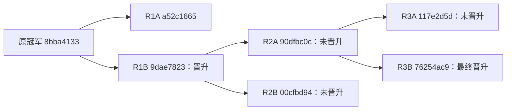

# Titanic 后续三轮迭代：2026-11-05

用户回报首份 submission 线上得分 0.77751 后，本阶段完成了额外三轮、六个真实 Meta 候选的全部五折评估。R1B 与 R3B 先后晋升；最终冠军为 `76254ac9d667768c06d398e368676f190917b83e`，CV **83.870456%**，promotion holdout **143/178（80.337079%）**。已用全部 891 条训练数据生成并独立验证 418 行新 CSV，较首份文件改变 24 条预测；新版本线上得分仍未知。

本篇是[首轮验证记录](kaggle-titanic-validation-2026-11-05.zh-CN.md)的续篇；保留第一份报告和 CSV，不改写历史结果。

## 线上反馈与本地指标

用户回报首份 CSV 得分 **0.77751**，反馈记录时间为 2026-11-05T09:08:56.776972Z。来源为用户陈述，`verified_via_kaggle_api=false`；关联文件 SHA-256 为 `88b3e60545b6d241b7e431e3a06a5d49bf97b75bb895523a2b15e84b74096d55`。本阶段没有自动提交 Kaggle，新版本的线上分数未知。

| 版本 | Mean-fold accuracy | Promotion holdout | 线上分数 |
| --- | ---: | ---: | --- |
| 原 CSV / 8bba4133 | 82.463919% | 141/178（79.213483%） | 用户回报 0.77751，未 API 核实 |
| 中间冠军 R1B / 9dae7823 | 83.586768% | 142/178（79.775281%） | 未取得 |
| 最终冠军 R3B / 76254ac9 | 83.870456% | 143/178（80.337079%） | 未取得 |

最终冠军较原 CSV 的 CV 高 **1.406537 个百分点**，holdout 多正确 **2 个样本**（+1.123596 个百分点）。较中间冠军的 CV 高 0.283688 个百分点，holdout 多正确 1 个样本。线上反馈没有变成搜索目标；这些本地变化不证明统计显著性，也不保证线上改善。holdout 已参与多次选择，不是未接触的最终测试集。

## 六个候选与晋升结果

保持 713 条 development、178 条 holdout、五折划分、训练 seed=42，以及 total_score 目标和 valid_output≥1 约束。六个新候选共 **30 个有效 CV 单元**，每个候选完整覆盖同样五折；新 evolution 另外实际重测冠军 baseline 五折。均值是五折等权平均，不是 pooled OOF accuracy。

| 候选 | 改动 | Mean-fold accuracy | Holdout | 结果 |
| --- | --- | ---: | --- | --- |
| R1A | 固定 Title 称谓特征 | 82.885483% | 未评估 | 未晋升 |
| R1B | Cabin/Deck 与家庭人均票价特征 | 83.586768% | 142/178（79.775281%） | 晋升 |
| R2A | 增加 Title、AgeMissing | 83.444924% | 未评估 | 未晋升 |
| R2B | Histogram gradient boosting | 82.322075% | 未评估 | 未晋升 |
| R3A | 票号全部 ASCII 字母类别 | 82.883499% | 未评估 | 未晋升 |
| R3B | RF + classic GradientBoosting soft voting | 83.870456% | 143/178（80.337079%） | 晋升 |

R1 为 accepted；R2 两个新候选都不如当时冠军，round 为 rejected、无 nominee，因此没有运行它们的 holdout。“未评估”不代表零分。R3 的 slot 1 通过独立冠军对照和 holdout 门槛，accepted、championChanged=true；相对当时冠军的 objectiveGain 为 0.005617978。

R3A 将票号中的全部 ASCII 字母拼接成类别，使用固定 Numeric/Unknown 类别，并非只取第一段。最终 R3B 使用 RandomForest（500 棵树、depth=6、leaf=2）与 **classic GradientBoostingClassifier**（150 stages、learning_rate=0.04、depth=2、leaf=5、subsample=1.0），固定 seed，soft-voting 权重 [2,1]。其特征继承 R2A 的 Title/AgeMissing 与 Cabin/Deck/FarePerPerson，未引入 R3A 的票号特征。六份源码审查和 manifest 验证均未发现阻塞项，包括未发现标签泄漏、预测集拟合或外部数据访问。

## 真实继承与预算边界

六个精确 Git commit 的 parent 均已核对。本次实际覆盖多代源码继承；提案父级与当前冠军是独立身份。R3 从未晋升的 R2A 采样生成提案，当时冠军仍是 R1B，R3 仍须与冠军比较后晋升。

旧 evolution 保留原累计截止时间 2026-11-05T09:38:05.554Z。R1 后剩余时间不足以完成两轮，因此通过公开 control.start 从已晋升 R1B 的精确 commit 创建新 evolution，一次登记余下两轮并重新评估五折 baseline，没有重置旧预算或已消费尝试，也没有声称跨 evolution 复用旧 staged baseline。新 baseline eval 为 `eval_231b653b13e44cfaba924498973e8b56`，均值仍为 0.8358676784208698。

| 阶段 | evolution ID | round ID |
| --- | --- | --- |
| R1 | `a572e3f8-fdbd-43a9-a2c9-ff64fde930a4` | `1e2f4018-e4a7-42d3-8e74-179bb1920fb8` |
| R2 | `ccfb4ba8-d34e-4c6d-bd40-7b7db713a7c3` | `f3e3726b-8064-4f7b-b5c5-d80fd7f6a9c0` |
| R3 | `ccfb4ba8-d34e-4c6d-bd40-7b7db713a7c3` | `21e6c0a0-e202-483f-a512-8722785033bd` |

R2/R3 共用 batch `4d7f7bfa-8bb4-4d9a-ae95-8292fefa449f`，R3 是该 batch 自动延续。本阶段总共三个额外 round，没有将“最多三轮”扩成更多轮。目标、晋升阈值、模型身份、依赖和隔离要求未放宽。

## 精确身份与公开证据

| 候选 | commit | Git parent | manifest digest |
| --- | --- | --- | --- |
| R1A | `a52c1665a6abe23d18bf5e66de1dd58ebd7d36e7` | `8bba41331faa2e4ed5bcd7eb715300f4f18204fa` | `sha256:86c61cf3bc38b222b65d9d0c236db8704d8c59400eca3d6dae607584afac3273` |
| R1B | `9dae7823ab9134d0f908131e1e40dc80f0eb2875` | `8bba41331faa2e4ed5bcd7eb715300f4f18204fa` | `sha256:f1e57f1abd625b1740ef0e387904b6675ee8d49f415ff1dd44f1e8b12a9ad235` |
| R2A | `90dfbc0c480bc4afdbcd846fad47d678e086519f` | `9dae7823ab9134d0f908131e1e40dc80f0eb2875` | `sha256:fbb49c3cd3a9c8e554f1911bd2d42bb6e7c1754848d3cfb5ce62befda9a900fc` |
| R2B | `00cfbd944235778d9fe7ae65b99c34a5e558ba73` | `9dae7823ab9134d0f908131e1e40dc80f0eb2875` | `sha256:48f458dd5a1205161f3b928fcac4cfbac1f40919b6398cace82c163bb969ef76` |
| R3A | `117e2d5d9f684e07207809779093695e59b84579` | `90dfbc0c480bc4afdbcd846fad47d678e086519f` | `sha256:9d48a69c8dba0a7a3d351b7d67da22e6f8f9467f02a1576805ae893009842dcc` |
| R3B | `76254ac9d667768c06d398e368676f190917b83e` | `90dfbc0c480bc4afdbcd846fad47d678e086519f` | `sha256:b4ad02419fd23cd90cf556055c0099cd6f32c74d963dba8896db8c1149a00ed1` |

| 执行 | eval ID |
| --- | --- |
| R1A CV | `eval_cc205ab5c410435bacfca0ff8c91b6b3` |
| R1B CV / holdout | `eval_14cb589fe4a3413b99f7d41288d98ca5` / `eval_66ee184e569b4c4d986aa93342b17f49` |
| R2A CV | `eval_a501a49747c54ac98f35a793dd50ed35` |
| R2B CV | `eval_1eb4983972ca4607bde55b253e5ff9ff` |
| R3A CV | `eval_c9e8f6475e1b468a8fd679200c761d41` |
| R3B CV / holdout | `eval_6c1acaa7760646b3b9218e4f4b10825a` / `eval_ae7365a829c24d3992c4030212352cbc` |

本地证据根为 `tmp/kaggle-e2e-20261105/iterations/20261105-followup/`，包含 `plan.json`、`leaderboard-feedback.json`、各 admission、`report-1/`、`report-2/`、`report-3/` 和[最终公开快照](../tmp/kaggle-e2e-20261105/iterations/20261105-followup/final-report/report.json)。最终快照的 selected commit、CSV 摘要及 finalization complete 与独立验证一致，`test_accuracy=null`。逐折 raw accuracy、run IDs、产物 manifest 与晋升身份以公开 API 报告及各 `champion-selection.json` 为准。R2 终态特保存在 `report-2/status/f3e3726b-8064-4f7b-b5c5-d80fd7f6a9c0.json`：该 report 顶层 current 已自动切到 R3，不能误读为 R2 的终态。原 `public-report/` 未覆盖。

运行环境沿用首轮记录：真实 Meta `openai-codex/gpt-6-astra`、Target `openai-codex/gpt-5.6-luna`，固定 linux/arm64 镜像、DSH run_pipeline、Python 数值依赖与沙箱。宿主 Node 23.11.0 不在 Gear 声明的 engine 范围内；复现应使用受支持的 Node 22.19+（22.x）或 24+，Target 镜像仍是 Node 22.23.0。

## 新 CSV 与最终验收

R3B 的精确 commit/manifest 已独立 finalization，状态为 complete。校验证明冻结任务使用全部 891 个训练 ID，receipt 输入摘要与任务计划一致；导出的 418 行恰好两列 `PassengerId,Survived`，ID 唯一且集合与顺序均匹配 test，预测均为二元值。0/1 分别为 261/157 条，较首份 CSV 有 **24 条预测改变**。预测摘要、manifest 与 completed/exit_code=0/seed=42 的 receipt 相互绑定。

| 最终产物 | 身份 |
| --- | --- |
| eval ID | `eval_32ce2a7ba8d845919d09e3d80cfdc7fd` |
| run ID | `run_731f0b710c6e4965868df5bd99696f75` |
| 输出 manifest | `sha256:13b39f681706568a0d0d16833afaa202c25d45207518325a07713bb5d323ef18` |
| 新 CSV SHA-256 | `sha256:b27a547d72e858999162eae236dbb3b2a4dd395567f4512eb99fad1ae0764ff7` |
| receipt SHA-256 | `sha256:97fe8ba3f563286ebb8c55698d1188bc7cf2d767b0579b21b8ea281e179eae52` |

新文件为 `tmp/kaggle-e2e-20261105/iterations/20261105-followup/finalization/submission.csv`；同目录保留 `finalization.json`、`independent-verification.json` 和通过公共产物 API 导出的 `artifacts/`。原 CSV 与首轮报告保留，用户回报的 0.77751 仅关联原 CSV。没有新线上结果，也没有 test accuracy。

CLI 复查沿用[首轮记录](kaggle-titanic-validation-2026-11-05.zh-CN.md#复现与证据导出)的环境与控制面恢复说明，将 finalization 参数换成本篇最终 commit、manifest 和上述新输出目录；相同输入会读取已登记执行。查询原始证据可用公开 `eval inspect`、`runs inspect`、`verifier inspect` 和 `runs artifacts list`，使用本篇 eval/run IDs。后续快照保存在本阶段目录，避免覆盖首轮 `public-report/`。

本阶段已结束，专用 Gear core 与 Docker registry 均已停止，状态、镜像和全部产物保留；`plan.json` 已登记 complete 与 cleanup。现有 JSON/CSV 可直接离线复查。需要重新查询控制面时，按首轮记录恢复同一 core；需要重新执行容器任务时，再启动该记录中的专用 registry，不需要新建或重置 evolution。
