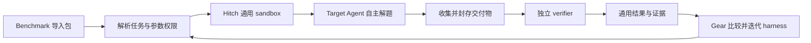

# MLE-bench 通用任务执行与可配置参数约束修改规范

状态：设计提案，尚未实施。日期：2026-11-09。

本文基于当前 Gear / Hitch 工作区及 Titanic 实验暴露的问题编写。新增字段、文件布局和能力名称均为拟议接口，不代表当前 CLI 已支持。本文只新增规范，不修改运行代码、实验配置、冻结记录或正在进行的实验。

兼容决策：本次采用破坏性替换，全部移除旧 MLE-bench research 协议兼容代码。新版本只支持新的通用任务合同，不保留旧协议读取、恢复、重放、迁移适配、备用入口或旧执行器依赖。

## 1. 目标与架构决策

MLE-bench 与 Terminal-Bench、AutomationBench 使用同一条通用执行链：导入任务包，准备公开输入与环境，启动 sandbox 内的 Agent，收集交付物，由独立 verifier 验证并返回结果。Gear 使用这些结果优化 harness。

交叉验证、模型选择、实验组织和最终训练属于 Agent 的解题方法。需要限制这些方法时，通过任务声明的参数值、修改权限和可验证约束表达；不为“严格实验”另建一套任务生命周期。

必须满足以下决策：

1. 一个 Target 实验默认是一轮完整任务执行，包含所需的分析、训练、预测和交付。不能把一次正常任务隐式拆成多个 Agent rollout，再要求操作者额外执行 refit 才完成交付。
2. MLE-bench importer 负责数据、任务说明、环境和 grader 的适配；不编写 Agent 的研究状态机。
3. Agent 可以使用所选 harness 的普通终端、文件和代码工具。实验工具、分析工作流、CV 库可以随 harness 提供，但不作为所有任务的必经协议。
4. CV、fit 额度、参数冻结等均可配置，并可分别声明允许修改或禁止修改。参数值与权限声明分离。
5. 不可修改的规则来自任务作者及用户准入配置，不能由 Agent 改写。允许修改的参数按声明的主体、范围和时机变更。
6. 强约束必须有可信执行或验证能力支撑；不能用 Agent 自报内容代替强制执行，也不能将不支持的约束静默降级。
7. Gear/Hitch 的通用控制层不解释 sklearn 参数、fold、pipeline 或 Titanic 行数。任务特定能力位于 benchmark 包或明确声明的工具插件中。
8. 旧研究执行链及其专用合同、CLI、依赖和测试随本次修改直接删除，不设置双轨运行或兼容过渡期。新协议的正常取消与恢复能力继续由通用执行层提供。

本文修订 [Gear/Hitch 边界规范](mle-bench-gear-hitch-boundary-spec.zh-CN.md) 中“固定运行器承担任务内研究序列、CV 和 refit”的默认要求，并修订 [Data Analyst 工作流规范](data-analyst-agent-workflow-v2-spec.zh-CN.md) 中强制阶段状态机与 pipeline factory 的要求。其私有数据隔离、来源追溯、资源预算和历史记录不可改写的原则继续保留。

## 2. 当前问题与修改方向

| 当前实现 | 问题 | 修改方向 |
| --- | --- | --- |
| `research/lib/operation-provider.mjs`、`sequence.mjs` 将一次评估展开为多次顺序研究 rollout | 任务执行与研究策略耦合，额外维护 checkpoint、选择和预算状态 | 默认提交普通完整任务；多次实验使用通用 repetitions/评估预算 |
| `research/target-carrier/fixed/target-loader.js` 限制为专用 inspect/run/select/finish 工具 | Agent 必须正确使用额外协议才能交付；普通 shell/文件能力被替换 | 使用通用 Agent adapter；实验工具由 harness 组合，不作为默认工具白名单 |
| 固定 `build_pipeline(config)`、variants schema、Python 对象归一化 | 合法 sklearn 对象也可能在拟合前被拒绝，工具契约侵入模型实现 | 默认交付文件/程序；只在明确请求且支持的约束下启用特定训练接口 |
| research verifier 首先确认 receipt 格式，研究层另行计算有效结果 | 进程成功、receipt 有效、任务成功和模型质量容易混淆 | 以独立 verifier 的交付验证与实际指标作为任务结果 |
| CV 结束后另外调用 refit | “实验结束”可能没有预测文件 | 所需 refit 在同一次任务交付前完成；可恢复子步骤仍归属同一任务 |
| Titanic 通过比赛名选择 891/418 特殊分支，缺少私有答案 | 与正式 MLE-bench 评分任务混在一起 | 用显式数据与评分合同区分正式评测和无标签预测交付 |

本修改不能仅把现有控制器改名或移动目录。验收必须证明默认执行路径不再依赖这些专用协议。

## 3. 统一调用链与职责



| 组件 | 负责 | 不负责 |
| --- | --- | --- |
| Benchmark 包 | 指令、公开输入、私有评分资源、环境、产物合同、参数定义、任务约束插件 | 决定 Agent 的模型搜索步骤和提示词策略 |
| Harness / Meta | 工具组合、提示词、skill、可编辑参数默认值、分析方法与记忆组织 | 改写任务私有答案、grader 或不可修改规则 |
| Target | 根据任务和有效配置写代码、实验、训练、生成并提交产物 | 自行放宽参数权限或伪造可信约束证据 |
| Hitch | 准入、sandbox、通用资源限制、工具能力绑定、产物封存、独立 verifier、取消与恢复 | 理解某个模型的 Python 内部对象或制定建模策略 |
| Gear | harness 生成、评估 repetitions、比较、晋升、整体预算和证据访问 | 管理任务内每个 fold、模型变体或手工补跑 refit |

普通运行结束后自动进入 verifier。任务失败、超时或缺少产物也必须产生明确结果，不以 Agent 是否调用专用 `rollout_finish` 判断交付。

## 4. 任务包合同

逻辑上，导入包包含以下内容；实际输出应复用现有 Harbor/Hitch task 与 resource 合同，不再维护另一套目录协议。

```text
task/
  instruction.md             # 任务目标、数据说明、交付路径
  task.toml                  # 通用环境、资源、超时、产物设置
  environment/               # 镜像及环境准备
  public/                    # Agent 可读取的输入
  parameters.yaml            # 参数默认值、schema、权限声明
  tests/                     # verifier 入口及公开的评分合同
  resource.lock.json         # 使用现有资源绑定机制
```

私有答案单独绑定到 verifier，不能混入 Agent 镜像、公开目录、候选 harness 或 Meta 可见材料。上图的 `tests/` 表示 verifier 资源，不表示将其私有内容挂载给 Agent。

交付合同至少声明：必要文件、路径、格式/schema、大小限制、是否要求可复现程序或模型文件。普通 MLE-bench 默认以 `submission.csv` 为评分输入；是否必须训练模型、保存权重或满足最低 fit 次数，必须由任务另外声明，不能用 `fits == 0` 一概判定所有合法解法无效。

Importer 必须保存上游版本、公开数据摘要、私有评分资源摘要、grader 身份和环境身份；数据名称、行数、标签列等来自导入元数据，通用控制层不得出现 Titanic 特判。

## 5. 参数、权限与约束

### 5.1 参数分类

本规范将“超参数”作为广义实验配置处理，保留其不同职责：

| 参数类别 | 示例 | 修改后的语义 |
| --- | --- | --- |
| 方法参数 | 内部 CV 方法/折数、特征、模型及模型超参数 | 可作为 harness/Target 的搜索变量；不直接改变外部评分标准 |
| 执行约束 | fit 调用额度、计数要求、可信 CV 要求、交付前是否冻结选择 | 决定允许的执行方式及所需可信能力 |
| 通用资源 | CPU、内存、墙钟时间、整体 Target 调用额度 | 继续使用现有资源和预算合同，不能由任务内参数突破 |
| 评估协议 | grader、评分数据划分、指标、最终评分所用 CV | 改变比较条件，必须建立新的评估版本 |

`method.cv` 明确表示 Agent 的训练内验证；`evaluation` 表示产生正式比较分数的协议。二者不得继续共用一个含糊的 `validation` 字段。

### 5.2 配置示例

以下展示常规任务的配置方式。具体参数 schema 与能力映射由 benchmark 包声明，通用层只按 schema、权限和依赖能力校验。

```yaml
version: 1

parameters:
  method:
    cv:
      method: stratified_kfold
      folds: 5
      seed: 42
  training:
    max_fits: null                 # 无额外 fit 次数上限；仍受通用资源限制
    fit_accounting: observed       # observed 或 enforced
    cv_execution: agent           # agent 或 trusted
  delivery:
    freeze_selection: false

parameter_policy:
  /method/cv/method:
    mutable: true
    actors: [meta, target]
    choices: [kfold, stratified_kfold]
    apply_at: training_start
  /method/cv/folds:
    mutable: true
    actors: [meta, target]
    minimum: 3
    maximum: 10
    apply_at: training_start
  /method/cv/seed:
    mutable: false
  /training/max_fits:
    mutable: true
    actors: [meta]
    nullable: true
    minimum: 1
    maximum: 50
    apply_at: task_start
  /training/fit_accounting:
    mutable: false
  /training/cv_execution:
    mutable: false
  /delivery/freeze_selection:
    mutable: false
```

用户可以在准入前将 `fit_accounting` 改成 `enforced`、`cv_execution` 改成 `trusted`、`freeze_selection` 改成 `true`，也可以明确允许 Meta 在限定枚举内修改这些值。改变的是配置和绑定的能力，不是切换到另一套任务控制器。

示例中的可空 `max_fits` 只有在值非空时才施加数值范围。非空硬上限要求可信 fit 计数能力；`observed + max_fits: 20` 不能被解释为已强制执行 20 次上限，未满足能力依赖时必须拒绝准入。

### 5.3 权限规则

1. 参数定义及初始权限来自任务包。用户可在任务包允许的范围内选择或收紧策略；需要放宽包的禁止项时必须创建明确的任务版本，不能伪装成原 benchmark。
2. `parameter_policy` 在运行准入时冻结、保存于 Agent 不可修改的权威位置；sandbox 内提供只读副本。修改该副本不能改变有效权限。
3. `mutable: false` 表示 Meta 与 Target 均不可改。`mutable: true` 必须列出 `actors`、变更时机及适用的类型/值域。未声明路径默认不可改。
4. v1 使用精确 JSON Pointer 路径，不支持通配符或任意表达式。未知路径、重复声明、相互覆盖的父子权限声明直接拒绝。模型参数可由任务 schema 声明为一个完整的 JSON 对象，并明确该对象是否整体可编辑。
5. 对最终解析值逐字段检查；替换父对象、删除后重建字段、覆盖配置文件、命令行参数或环境变量都不能绕过锁定的子字段。
6. `task_start` 的值必须在 Agent 启动前确定。`training_start` 的值可以由获准的 Target 在训练前选择；一旦进入对应执行动作，该动作的取值不可变。后续训练可在预算内申请新取值，不能修改过去的执行事实。
7. `mutable` 表示允许修改配置，不等于已证明运行代码遵守配置。执行层面的遵守情况必须另行给出验证状态。

配置解析顺序为：任务默认值 → 已准入的用户覆盖 → 获准的 Meta 候选覆盖 → 获准的 Target 动作取值。每一级先校验权限，再应用值；后一级不能覆盖前一级冻结的规则。

### 5.4 变更记录与 Agent 接口

Meta 的配置变更与 harness 修改一起检查和封存。Target 的运行时选择通过通用、可审计的配置提交通道登记；可以提供文件提交或现有工具扩展，不要求 Agent 使用完整的研究状态机。

每次接受或拒绝的变更记录主体、参数路径、旧值、新值、规则摘要、作用阶段及原因。运行开始时提供完整有效配置、可改路径和必要工具说明；缺少合同信息应在启动前失败，不能让 Agent 猜测工具 schema。

读懂了 prompt、改过配置文件或者输出了一段 JSON，都不能单独构成“约束已执行”的证据。

## 6. 约束如何兑现

### 6.1 默认行为

当任务没有声明强制训练约束时，Agent 使用普通工具自主实现训练、CV、搜索与交付。可提供 sklearn 示例、实验记录库和推荐工作流，但不要求固定 factory、variants schema、阶段打卡、select 或 finish 调用。

此时通用层强制执行 CPU、内存、时间等实际支持的限制；fit 次数与内部 CV 信息可以作为诊断信息，但必须注明是观测值或 Agent 自报，不能用于声称满足未经验证的硬约束。

### 6.2 强约束能力

当配置要求强制执行时，任务包必须声明可验证的能力绑定，例如：

| 要求 | 所需能力与证据 |
| --- | --- |
| `max_fits` 非空 / `fit_accounting: enforced` | 可信计数器、明确计数单位、并发额度预留、执行记录及覆盖范围 |
| `cv_execution: trusted` | 可信划分生成/加载及执行，绑定数据、实际行分配、配置和执行代码身份 |
| `freeze_selection: true` | 在最终训练前封存已选源码和具体参数，受控交付执行验证绑定，禁止隐式重新搜索 |

能力名称、版本、支持的训练接口及依赖限制在 admission 时验证并冻结。缺少能力、存在不可控制的旁路、依赖版本不支持或覆盖范围不符合要求时，返回明确的 `unsupported_constraint`，不启动收费的 Agent 实验。

参数约束可能要求限制部分训练入口；这种限制必须由配置及其能力要求显式导出并展示。不能在所有 MLE-bench 任务中默认替换整个 Agent 工具集。

### 6.3 fit 次数的定义

`fit` 不是所有机器学习代码都共享的可观测事件。v1 的强计数能力必须明确其范围，例如“可信训练服务接收的一次顶层训练尝试”：进入训练即计一次，失败也计一次，CV 每折一次，最终 refit 一次；估计器内部的嵌套调用另列诊断指标，不重复计入顶层额度。

该计数不能冒称覆盖任意 Python 程序中的学习行为。若任务要求“所有训练行为均受限”，必须声明并验证足以封闭旁路的受限执行接口与支持范围；保留任意代码执行却只包装 `sklearn.fit` 时，不得声称满足此要求。不支持时拒绝配置，而不是通过启发式扫描猜测训练次数。

计数额度必须在并发启动前原子预留；失败、取消和恢复不能归零。缺少可信计数回执应报告证据不可用，不得将未知值填为 0。

### 6.4 固定 CV 与参数冻结

可信 CV 的具体行分配属于动作输入。配置未变且动作恢复时沿用同一份分配；允许修改内部 CV 时，为新的训练动作生成新的配置与分配身份，不改变已经发生的结果。

`freeze_selection: true` 只约束选择之后的交付过程，不能阻止 Agent 在选择之前于预算内比较模型。最终训练所需参数应使用任务工具明确支持的可序列化合同或冻结产物表示；禁止要求通用控制器归一化任意 Python 对象。

无法冻结的动态代码、闭包或模型对象，在该强约束启用时应由对应插件给出具体兼容性错误；不启用该约束时，不得因此阻止普通脚本执行。预测文件仍由独立 verifier 读取，verifier 不导入 Agent 的 pickle、模型模块或训练代码。

## 7. 身份、可比性与预算

必须区分以下概念，并映射到已有任务、执行、候选和证据身份机制；不再建立另一套研究 journal。

| 身份 | 包含内容 | 用途 |
| --- | --- | --- |
| 任务/评估身份 | 数据划分、grader、指标、输出合同、评估环境及权限策略 | 判断结果是否处于同一个比较条件 |
| 候选/方法身份 | harness、Meta 选择的可编辑参数 | 表示被优化的具体方法 |
| 执行身份 | 上述身份、完整有效参数、runtime、repetition/seed、资源额度及实际动作 | 追溯与恢复，禁止换输入重用结果 |

在相同外部 verifier 下，修改内部 CV 折数或模型超参数可以继续比较最终提交分数；内部 CV 分数只能在其自身协议下解释。修改正式评分使用的 CV、私有评分划分、grader 或指标则必须建立新评估版本，并在新版本下重新评估 baseline 和候选。

修改权限不提供免费实验额度。新协议所需评估、失败后的新采样、环境变更后的重新执行，都必须计入已授权预算；不能通过生成新项目 ID、checkpoint 或参数版本重置累计额度。

如果允许候选改变资源或 fit 上限，所有候选仍须服从共同的授权额度范围，并记录各自实际配置和用量。质量分可在同一 grader 下比较，但不能宣称是等计算量比较；需要等预算实验时，应锁定相应字段。

“两轮 harness 迭代，每个 harness 两次实验，含基线六次”默认映射为三个 harness 各两次完整任务执行。Agent 在一个 sandbox 内比较多个模型属于内部训练动作，不额外生成 Target 会话。两次 repetition 的任务输入、seed 配对及聚合规则由通用评估计划明确，不能再隐式解释成两个共享研究 checkpoint 的半成品 rollout。

## 8. 完成、评分与错误语义

同一次完整任务应包含交付所需的最终训练和预测。实现可以将其组织成受控子步骤，但不要求用户在“已完成”后手工补一次 refit；恢复这些步骤也不能追加模型采样或更换已选参数。

结果必须明确区分：进程是否结束、必要交付物是否存在、格式是否合法、强约束是否验证通过、正式质量分是否可用。映射到现有通用 observation/metric 合同，不另造一套与 Hitch 结果竞争的 receipt。

| 情况 | 必须表达的结果 |
| --- | --- |
| Agent 正常退出但缺少必要提交文件 | 任务交付失败 |
| CSV 合法且 verifier 有可信答案 | 返回真实评分及验证证据 |
| CSV 合法但任务只有无标签预测数据 | 可确认交付有效；质量分为不可用，不能把格式通过的 1 当准确率 |
| 明确违反锁定参数或强约束 | 合同违反，并标明参数/动作及证据 |
| 训练程序报错 | 保留具体退出状态和有界错误输出，不仅返回“候选失败” |
| 运行器、verifier 或证据采集故障 | 基础设施/证据不可用，不能伪装成已测得的模型质量 0 |

内部 CV 指标、Agent 自报指标与外部 verifier 指标分别标注来源。Gear 只能用配置指定、来源可信的正式指标晋升候选。允许失败记零的评分合同也必须同时保留失败类别，不能因此丢失故障原因。

Meta 通过已有授权的轨迹/产物接口读取 seed 的工具调用、输出、代码及有界错误证据。具体错误不能只留在 Meta 无权读取的私有内部文件里。私有答案、隐藏评分细节和模型私有推理不进入诊断材料。

## 9. Titanic 与正式 MLE-bench 的处理

正式 MLE-bench 任务必须导入已声明的公开/私有数据、原始任务描述和 grader，使用独立 verifier 评分；不能通过比赛名改用内部 CV 分数。

如果用户仅提供 Titanic 的官方训练集和无标签测试集，应声明为“预测交付任务”：可以生成提交文件、报告训练内 CV，但不能宣称取得官方测试准确率。若需要可评分的开发任务，应显式准备隔离的评分划分并声明为自定义评估版本，保留与官方数据及评分定义的区别。

上述区别来自数据和评分合同；移除 `competition === 'titanic'` 决定执行模式、固定行数及评估语义的分支。所需样本数可以作为该任务的输入 schema 校验，不能进入通用控制层。

## 10. 代码修改范围

| 位置 | 计划修改 |
| --- | --- |
| Hitch `benchmark-packages/kaggle/mlebench/` | 收敛为上游数据、说明、环境及 grader 的导入/适配；输出标准任务与参数合同 |
| Hitch `benchmark-packages/kaggle/analysis.mjs` | 复用或改造成标准任务 producer；移除默认要求研究请求、checkpoint 和专用工具调用的指令 |
| Hitch `benchmark-packages/kaggle/research/` | 删除旧研究 CLI、provider、sequence、checkpoint、选择、独立 refit/export 及其存储/恢复协议；新任务直接使用通用 task/eval |
| Hitch `research/target-carrier/` | 删除固定 carrier、研究状态机、全局工具限制、专用包清单及锁文件；确有价值的纯方法工具按新接口重新组合到 harness，不携带旧协议 |
| Hitch `benchmark-packages/kaggle/analysis-contracts/` 及旧接口导出 | 删除旧 research schema、版本分支、receipt/checkpoint 转换与专用导出；新参数合同使用单一 schema，不保留旧名称别名或兼容 facade |
| Hitch `integrations/analysis-runtime/` | 仅保留被显式约束绑定的可信能力；不作为普通 Python 训练的必经层，不继续扩展通用对象序列化体系 |
| Hitch task verifier | 以提交产物和正式评分合同验收，消费必要的可信约束证据；避免 receipt 合法等同于任务成功 |
| Gear `examples/mle-bench/harness/` | 提供可组合的普通分析 harness，允许自主执行和交付；删除不再成立的强制协议提示 |
| Gear/Hitch 通用层 | 仅在现有能力不足处扩展通用参数权限、配置冻结和证据传递，不加入 ML 业务字段分支 |
| 旧测试、fixture、构建与发布配置 | 删除只验证旧协议的测试/fixture、专用构建脚本、依赖及发布项；有价值的行为断言改写为新接口测试，不保留旧协议回归套件 |
| 文档和旧规范 | 删除旧入口使用说明和兼容承诺，明确此次为破坏性替换；更新新任务创建与执行方式 |

实现开始前先核查现有 schema、资源、产物和恢复 API；能复用的直接复用。参数解析、权限校验、身份计算各保持一个权威实现，不在 importer、工具和 verifier 中复制出不同规则。

## 11. 实施顺序与切换边界

1. **标准任务纵向闭环**：先用一个确定性提交程序验证标准任务包 → sandbox → 产物 → 独立 verifier，全程不依赖研究序列、pipeline factory 或手动 refit。
2. **参数合同**：加入默认值、精确路径权限、有效配置记录与准入校验；验证允许/禁止修改及普通训练路径。
3. **必要强约束**：按声明绑定现有可信组件；不支持的覆盖范围明确拒绝。每增加一种能力，都提供正向执行和绕过/缺证据用例。
4. **删除旧执行链**：移除第 10 节所列旧协议、控制器、carrier、schema、依赖、导出和专用测试。构建产物与发布包只能包含新的任务路径；禁止用 feature flag、动态导入或固定旧版本依赖保留备用研究执行链。
5. **真实 Agent 与通用回归**：按单独登记的模型与预算运行完整任务，验证工具可用、交付自动完成、失败诊断可达，再运行 harness 比较及其他 benchmark 回归。

实际部署切换前，先让旧执行结束或通过当时可用的公开接口确认取消；不能在运行中替换其执行器。此要求只规定切换时机，不构成保留旧实现的理由。

切换后，旧配置、项目和 checkpoint 不再被新运行器接受；通用 schema/版本校验应明确拒绝不支持的输入，不加载旧解析器或执行自动转换。需要继续工作时，重新导入任务、创建新项目并登记执行预算。

历史日志和产物可以作为静态审计材料保留，但不提供旧协议读取、恢复或重放服务，也不将旧 receipt、checkpoint、划分或 runtime 绑定改写为新协议结果。保留历史文件不要求保留旧代码。修复验证产生的新结果不能替换原失败实验记录。

## 12. 验收标准

| 编号 | 验收用例 | 通过条件 |
| --- | --- | --- |
| A01 | 标准 MLE-bench 导入 | 生成普通 task/resources/verifier，私有标签不进入 Agent/Meta 材料 |
| A02 | 无专用训练约束 | 普通 Agent 通过终端和文件工具训练、写提交文件；不需要 inspect/select/finish 状态协议 |
| A03 | 可修改参数 | Meta/Target 在被授权的范围和时机修改内部 CV，记录真实有效值 |
| A04 | 禁止修改参数 | 直接改值、删除字段、覆盖父对象、修改权限副本及替代配置来源均不能绕过规则 |
| A05 | 能力依赖 | 非空硬 fit 上限、可信 CV、冻结选择缺少所需能力时，在模型启动前报错 |
| A06 | 可信计数 | 并发、失败、取消、恢复的额度与计数符合声明单位；未知计数不记为 0 |
| A07 | 普通 sklearn/其他训练程序 | 不启用冻结约束时，不因框架不能序列化合法 Python 对象而阻断训练 |
| A08 | 固定 CV 与可改 CV | 固定动作恢复沿用原行分配；获准的新内部 CV 有独立动作身份，旧记录不变 |
| A09 | 冻结选择可配置 | 关闭时允许普通交付；开启时验证所选源码/参数与最终训练一致，违反规则有明确证据 |
| A10 | 完成交付 | Agent 退出后自动收集和验证产物；缺文件失败；所需 refit 已在该任务完成边界内执行 |
| A11 | 真实质量与格式分离 | 正式分数来自独立 verifier；无标签任务报告质量不可用，不能用格式成功冒充准确率 |
| A12 | 可比性 | 内部方法变化可在共同 grader 下比较；正式评估协议变化不能复用旧 baseline 分数 |
| A13 | 预算 | 基线及两候选各两次完整执行共六次；失败、新版本和恢复不产生未计入的 Agent 采样 |
| A14 | 错误可诊断 | 可从授权材料获得真实的有界训练错误；明确区分 Agent、配置、约束和基础设施错误 |
| A15 | 旧链路清除与通用性 | 源码、构建产物和发布包均无旧 research 执行器、兼容适配、schema 分支、入口别名或旧版本运行依赖；旧输入在执行前被拒绝；Terminal-Bench、AutomationBench 回归通过；通用核心无新 ML 专用分支 |

验收报告分别列出静态/确定性测试、真实 Linux sandbox 验证和真实模型执行。不能用前两者替代第三者，也不能把产物格式通过描述为模型质量通过。

完成标准是：使用者能准备一个声明清楚的任务包，配置允许和禁止修改的参数，随后通过通用执行链得到可信评分或明确的交付结果；不再需要理解一套额外的 MLE-bench 研究控制协议。
